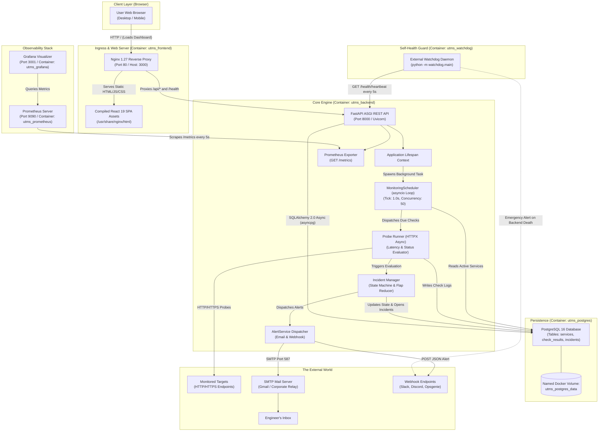
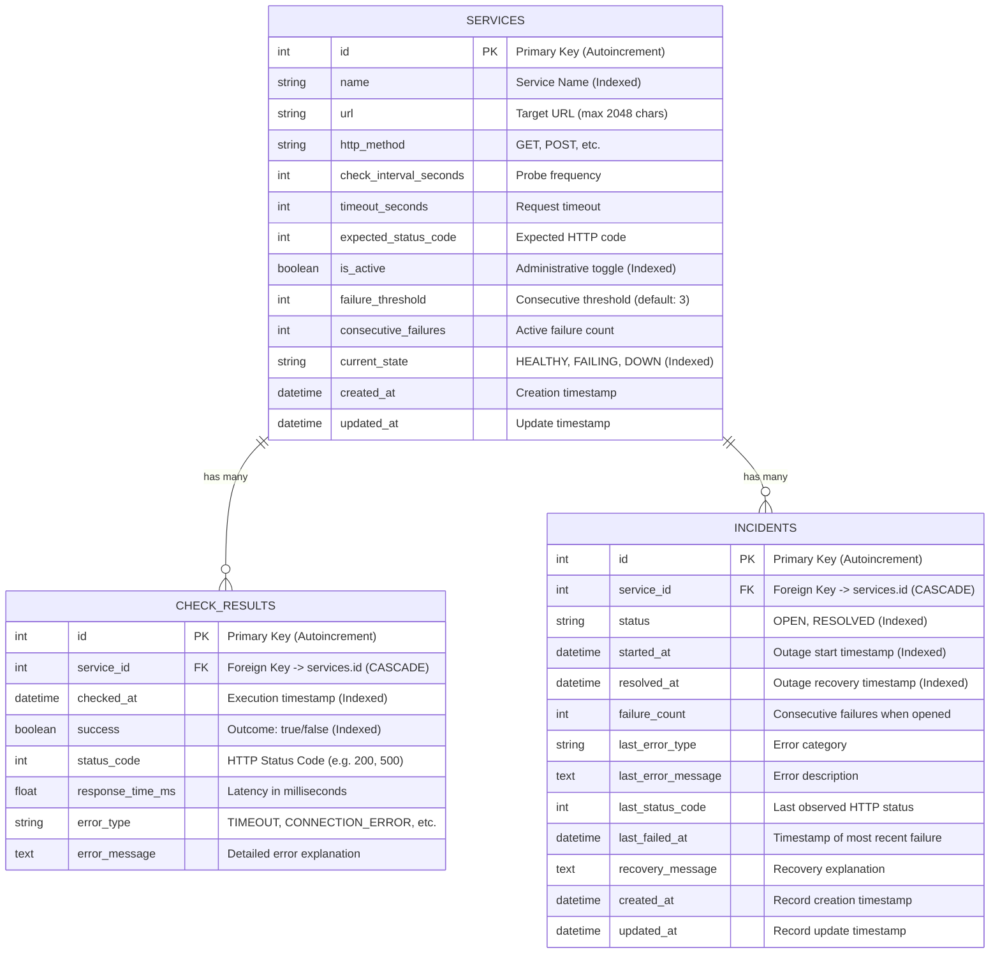
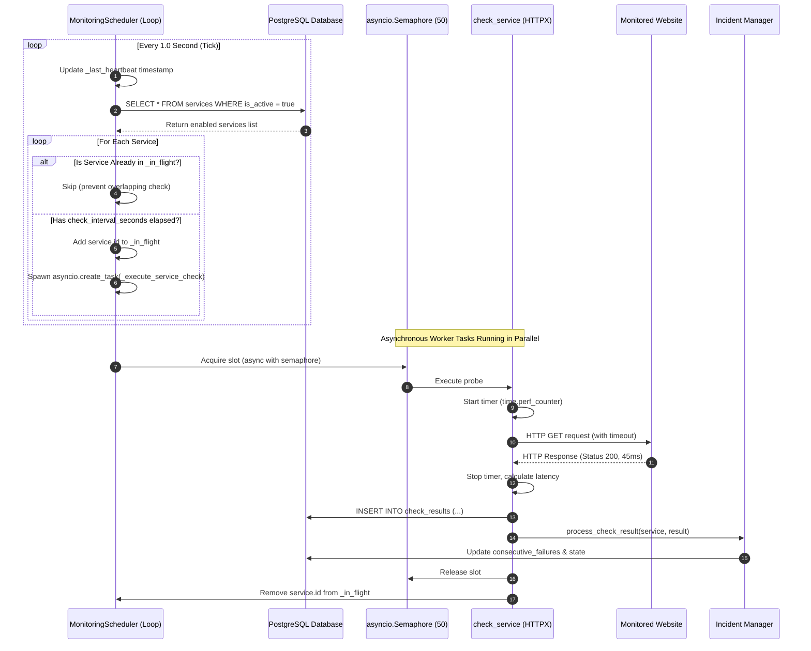
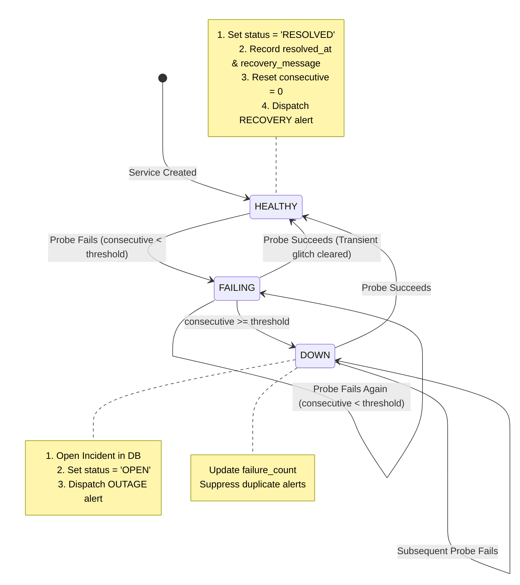
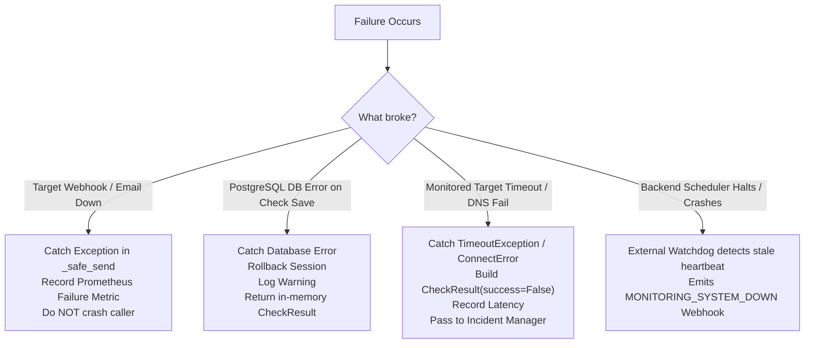
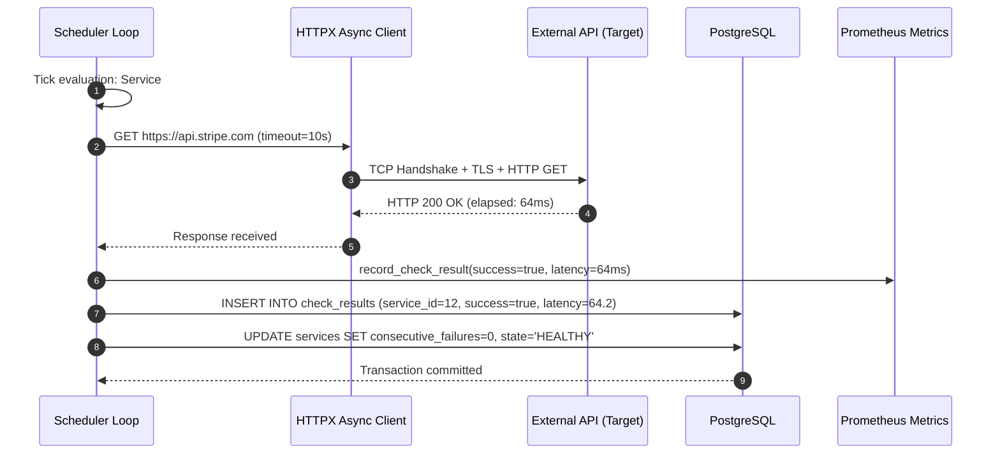
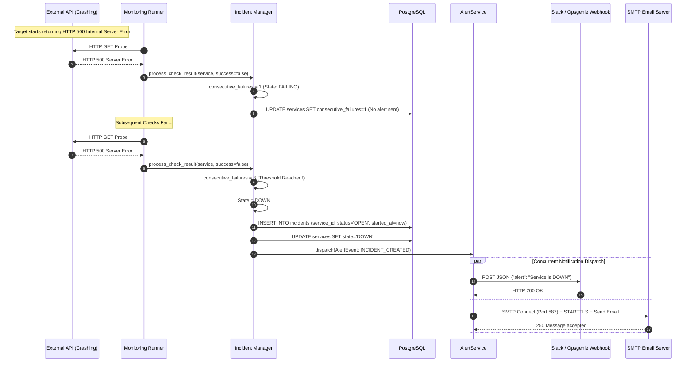
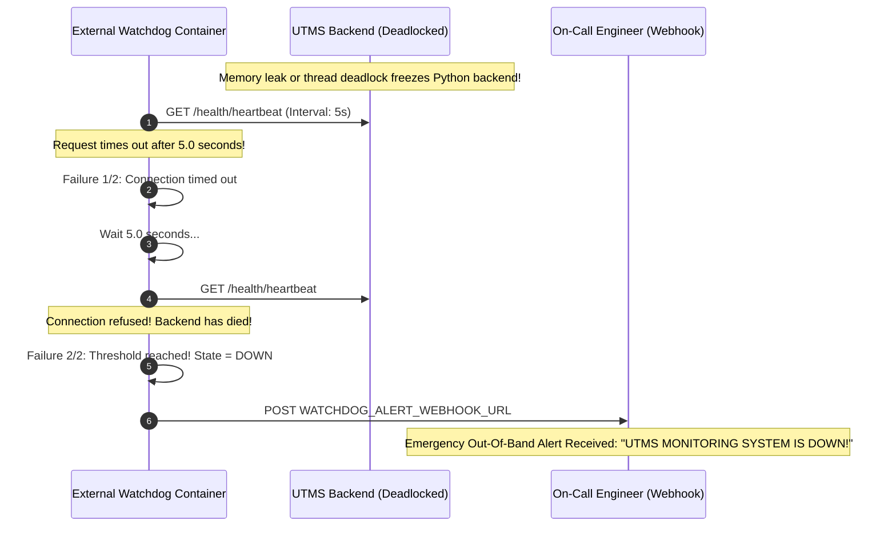
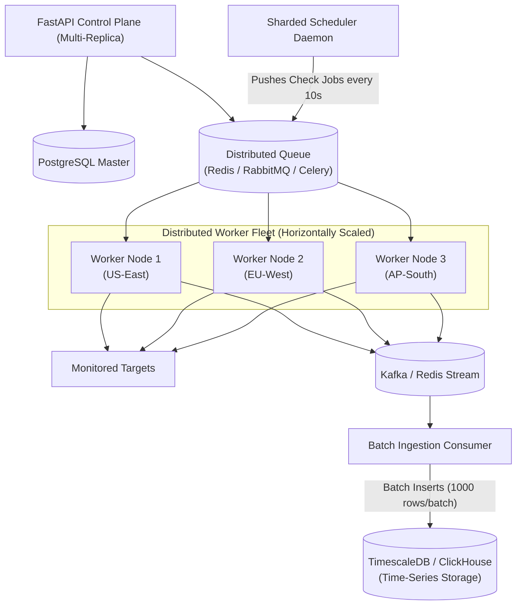

# Uptime Monitoring System (UTMS) — Complete Technical Handbook & Learning Guide

> **Target Audience:** From a 15-year-old curious beginner to an aspiring software engineer preparing for rigorous technical interviews.
> **Codebase Source of Truth:** `https://github.com/Arcohnix/Up-Time-Monitoring-System`
> **Version:** 1.0.0 Production Architecture Reference

---

## Table of Contents

1. [Project in One Sentence](#1-project-in-one-sentence)
2. [Explain the Problem](#2-explain-the-problem)
3. [Explain the Entire System Like I'm 15](#3-explain-the-entire-system-like-im-15)
4. [What Exactly Does UTMS Do?](#4-what-exactly-does-utms-do)
5. [Complete Architecture](#5-complete-architecture)
6. [Complete Technology Stack](#6-complete-technology-stack)
7. [Python Fundamentals Used](#7-python-fundamentals-used)
8. [Async Programming — The Engine of UTMS](#8-async-programming--the-engine-of-utms)
9. [FastAPI Deep Dive](#9-fastapi-deep-dive)
10. [PostgreSQL Deep Dive](#10-postgresql-deep-dive)
11. [SQLAlchemy Deep Dive](#11-sqlalchemy-deep-dive)
12. [Alembic & Database Migrations](#12-alembic--database-migrations)
13. [Monitoring Engine — The Core of the Project](#13-monitoring-engine--the-core-of-the-project)
14. [HTTP Monitoring & Probe Anatomy](#14-http-monitoring--probe-anatomy)
15. [False Alerts & Consecutive Failure Detection](#15-false-alerts--consecutive-failure-detection)
16. [Incident Management State Machine](#16-incident-management-state-machine)
17. [Notification System](#17-notification-system)
18. [Watchdog — "Who Watches the Watcher?"](#18-watchdog--who-watches-the-watcher)
19. [Frontend Architecture (React 19)](#19-frontend-architecture-react-19)
20. [Vite Build System](#20-vite-build-system)
21. [Tailwind CSS Design System](#21-tailwind-css-design-system)
22. [Nginx Reverse Proxy & Static Serving](#22-nginx-reverse-proxy--static-serving)
23. [Docker Containerization Deep Dive](#23-docker-containerization-deep-dive)
24. [Docker Compose Multi-Container Orchestration](#24-docker-compose-multi-container-orchestration)
25. [Prometheus Metrics Instrumentation](#25-prometheus-metrics-instrumentation)
26. [Grafana Dashboards & Visualization](#26-grafana-dashboards--visualization)
27. [Observability: Logs, Metrics, and Traces](#27-observability-logs-metrics-and-traces)
28. [GitHub Actions CI/CD Pipeline](#28-github-actions-cicd-pipeline)
29. [Testing Strategy (Pytest & In-Memory Async DB)](#29-testing-strategy-pytest--in-memory-async-db)
30. [Systematic Error Handling & Failure Matrix](#30-systematic-error-handling--failure-matrix)
31. [Complete Data Flow & Sequence Diagrams](#31-complete-data-flow--sequence-diagrams)
32. [Complete Request Lifecycle Trace](#32-complete-request-lifecycle-trace)
33. [Security Architecture: Implemented vs Production Needs](#33-security-architecture-implemented-vs-production-needs)
34. [Scalability: From 10 to 10,000 Monitors](#34-scalability-from-10-to-10000-monitors)
35. [Reliability & SRE Principles (SLA, SLO, SLI)](#35-reliability--sre-principles-sla-slo-sli)
36. [Performance Profiling & Bottlenecks](#36-performance-profiling--bottlenecks)
37. [Production Readiness Scorecard](#37-production-readiness-scorecard)
38. [What I Would Improve (Future Roadmap)](#38-what-i-would-improve-future-roadmap)
39. [Technology Choices & Architectural Trade-offs](#39-technology-choices--architectural-trade-offs)
40. ["Explain This Code" Section (25 Key Code Snippets)](#40-explain-this-code-section-25-key-code-snippets)
41. [Comprehensive Technical Interview Preparation](#41-comprehensive-technical-interview-preparation)
42. ["Tell Me About Your Project" Scripts](#42-tell-me-about-your-project-scripts)
43. [Brutally Honest System Weaknesses](#43-brutally-honest-system-weaknesses)
44. [A-to-Z Technical Glossary](#44-a-to-z-technical-glossary)
45. [Final Mental Model: "If You Remember Only One Thing"](#45-final-mental-model-if-you-remember-only-one-thing)

---

## 1. Project in One Sentence

### The One Sentence Explanation
> **UTMS is an automated, asynchronous observability platform that continuously verifies whether websites and APIs are online, measures their response speeds, alerts engineers the moment outages occur, and uses an independent external watchdog to monitor its own health.**

---

### The One Paragraph Explanation
The **Uptime Monitoring System (UTMS)** is a distributed monitoring service designed to eliminate silent digital outages. Built with an asynchronous Python FastAPI backend, a high-concurrency `asyncio` scheduler, and a modern React 19 frontend served through an Nginx reverse proxy, UTMS regularly sends HTTP probes to external servers. It records network latency, validates status codes against database definitions in PostgreSQL, and applies consecutive failure thresholds to distinguish between momentary internet hiccups and actual system downtime. When downtime is confirmed, it opens a tracked incident and dispatches alerts via SMTP email or webhooks, resolving the incident and notifying engineers once the target recovers. Crucially, a decoupled external watchdog process continuously audits the monitoring server itself, guaranteeing that the monitoring system never fails silently.

---

### The 30-Second Elevator Pitch
"Every online company loses revenue and customer trust when their servers crash. The biggest danger isn't just downtime—it's **not knowing** your systems are down until angry customers complain on social media. 

I built UTMS, a full-stack, automated uptime monitoring platform. It probes hundreds of web endpoints concurrently every few seconds, records response times down to the millisecond, suppresses false alarms using consecutive failure thresholds, and notifies engineering teams instantly via webhooks or email when true outages hit. To ensure absolute reliability, it features an isolated external watchdog container that answers the classic question: *'Who monitors the monitoring system?'*"

---

### The 2-Minute Explanation
"Modern software architectures rely on dozens of interconnected microservices, payment gateways, and third-party APIs. If your payment service crashes at 2:00 AM on a Sunday, you can lose thousands of dollars every minute while your engineers are asleep.

UTMS solves this by providing automated, round-the-clock infrastructure surveillance. Here is how it functions:

1. **Service Registration:** An engineer enters a URL into our React-based dashboard, specifying check intervals (e.g., every 30 seconds), expected HTTP status codes (e.g., 200 OK), and failure thresholds.
2. **Asynchronous Probing:** Rather than checking websites one-by-one synchronously—which would freeze the system—an in-process `asyncio` scheduler evaluates all active monitors concurrently using non-blocking HTTP requests.
3. **Threshold-Based State Machine:** A single dropped packet shouldn't wake an engineer at night. UTMS tracks consecutive failures. If a service fails once, its state is marked `FAILING`. Only when it reaches the defined threshold (e.g., 3 consecutive failures) is it marked `DOWN`.
4. **Automated Alerting & Incident Lifecycle:** The moment a service drops, UTMS creates an incident record in PostgreSQL and fires off alerts via SMTP email and webhooks. When the target recovers, the incident automatically closes, and a recovery notification is dispatched.
5. **Observability:** Metrics are instrumented with Prometheus and visualized on Grafana dashboards.
6. **Decoupled Watchdog:** If the UTMS container itself crashes or runs out of memory, it cannot alert anyone. Therefore, a standalone watchdog daemon continuously queries the monitoring engine's heartbeat clock. If the heartbeat stops ticking, the watchdog fires an emergency out-of-band alert."

---

### The Technical Explanation (Senior Engineer / Architect Summary)
"UTMS is a containerized, event-driven synthetic monitoring platform composed of six distinct architectural services orchestrated via Docker Compose.

The core service is a **FastAPI** application running on **Python 3.13** under an ASGI server (**Uvicorn**). During application startup, an `asynccontextmanager` lifespan kicks off an asynchronous polling scheduler. This scheduler executes periodic ticks, queries **PostgreSQL 16** (via **SQLAlchemy 2.0 Async** and **asyncpg**) for active targets, and dispatches parallel HTTP probes bounded by an `asyncio.Semaphore` to enforce concurrency caps and prevent socket exhaustion.

Probes are executed with **HTTPX**, capturing wall-clock latency via `time.perf_counter()`, HTTP status codes, DNS errors, SSL handshakes, and timeouts. Results are streamed to a database log table and passed to an incident state machine that evaluates consecutive failures. When a threshold is crossed, an `AlertService` concurrently dispatches structured payloads to configured providers (**SMTP/TLS** and **HTTP Webhooks**) using `asyncio.gather` with fault isolation.

The frontend is a **React 19 Single Page Application (SPA)** compiled with **Vite** and styled with **Tailwind CSS**, running inside an **Nginx 1.27** reverse proxy that routes browser traffic, caches static assets, and proxies `/api/*` and `/health` upstream to the backend.

Observability is maintained through custom **Prometheus** middleware and collectors exposed at `/metrics`, scraped by a Prometheus container and visualized in pre-provisioned **Grafana** dashboards. 

Fault tolerance is closed-loop: an external **Watchdog** daemon probes the `/health/heartbeat` endpoint every 5 seconds. This endpoint evaluates whether the API is responsive, whether the scheduler loop is intact, and whether the background worker's heartbeat timestamp is fresh. If the worker deadlocks or dies, the watchdog detects the stale heartbeat and dispatches an emergency webhook."

---

## 2. Explain the Problem

### Why Uptime Matters
In the digital economy, **software availability is equivalent to the front door of a physical business being unlocked.** If the door is locked, business ceases completely.

Consider three real-world scenarios:

1. **The Food Delivery Platform at 2:00 AM:**
   Imagine a food delivery app with millions of active users. At 2:15 AM on a Saturday night, a minor cloud routing update breaks their payment processing API (`https://api.fooddelivery.com/v1/checkout`). The main mobile app still opens, food menus still render, but every time a hungry customer taps 'Place Order', the transaction fails silently.
   - **Without automated monitoring:** The engineering team discovers the issue at 9:00 AM when customer support arrives to find 4,000 angry emails and social media complaints. Total cost: seven hours of lost revenue, thousands in refunds, and severe brand damage.
   - **With UTMS:** At 2:15:30 AM (after 3 consecutive failed probes 10 seconds apart), UTMS detects that the payment endpoint is returning HTTP 500. It opens an incident and sends an emergency webhook to the on-call engineer's phone. By 2:22 AM, the on-call engineer has rolled back the bad routing update. Total downtime: 7 minutes.

2. **The Healthcare Patient Portal:**
   A hospital network runs an authentication API that doctors use to access critical medical records. If the server runs out of database connections and begins timing out, physicians in emergency rooms cannot pull up patient allergies or medication histories. Waiting for a doctor to file an IT ticket could endanger lives.

3. **The E-Commerce Black Friday Sale:**
   During peak sales events, traffic surges can cause server CPU starvation. Endpoints don't crash outright; instead, response times degrade from 120 milliseconds to 15 seconds. Customers assume the checkout button is broken and abandon their carts. UTMS measures latency and flags degraded performance before full outages occur.

---

### Why Manual Checking Fails
Why can't engineers or QA testers simply check websites manually?
- **Humans Need Sleep:** Systems fail disproportionately during off-peak hours (automated nightly backups, scheduled database maintenance, zero-day security updates).
- **Human Speed is Inadequate:** A human checking 50 endpoints once an hour means a service could be broken for 59 minutes before anyone notices. UTMS checks them every 10–30 seconds.
- **Scale:** A modern company may manage 200 microservices, internal dashboards, database APIs, and webhook listeners. It is physically impossible for a human to manually test 200 endpoints continuously.
- **Subjectivity:** A human might click a link, wait 8 seconds, see it load, and think "it works." UTMS measures that 8 seconds is an unacceptable 8000ms latency spike that violates service level agreements.

---

### Why Can't We Just "Ping" a Server?
Beginners often ask: *"Why build a complex HTTP monitoring system? Can't we just use the `ping` command?"*

The `ping` command uses **ICMP (Internet Control Message Protocol)**. It asks a computer's operating system network stack: *"Is this machine powered on and connected to the internet?"*

Here is why `ping` is completely insufficient for web applications:
- **The Web Server Can Crash While the Machine is On:** A Linux server can be happily responding to `ping` packets while its Nginx or FastAPI process has completely crashed, deadlocked, or run out of memory. `ping` reports 100% healthy; real users receive "Connection Refused".
- **The Database Can Disconnect:** A FastAPI server can be running, but its connection pool to PostgreSQL has died. Real users get HTTP 500 errors. `ping` still reports 100% healthy.
- **Routing & SSL Failures:** An SSL/TLS certificate can expire, blocking all browser traffic with security warnings. `ping` knows nothing about SSL/TLS certificates or HTTPS handshakes.
- **Application Logic Errors:** An endpoint might return HTTP 403 Forbidden or HTTP 503 Service Unavailable. `ping` cannot read HTTP headers, status codes, or response bodies.

UTMS performs **application-layer (Layer 7) synthetic probing**. It acts like a real web client: establishing an SSL/TLS connection, sending real HTTP headers, waiting for the HTTP status code, verifying that the response code matches expectations (e.g., HTTP 200), and timing the response.

---

## 3. Explain the Entire System Like I'm 15

Imagine you are learning how software works for the very first time. Let us strip away the confusing jargon and build an intuitive mental model using everyday analogies.

### Core Computing Concepts Made Simple

#### 1. Computer vs. Server
- **A Personal Computer:** The laptop or desktop you use to play games, watch videos, or do homework. When you close the lid, it goes to sleep.
- **A Server:** Just a computer! But it has no screen, no keyboard, sits in a refrigerated room (a data center) in another city, is plugged into ultra-fast fiber-optic internet, and **never gets turned off**. Its entire job is to serve files and answers to people across the world.

#### 2. Client vs. Server
- **The Client:** You! More specifically, the web browser (Chrome, Safari, Firefox) on your phone or laptop. You are the customer requesting something.
- **The Server:** The computer waiting to fulfill your request.

#### 3. IP Address vs. Domain Name
- **IP Address (e.g., `192.168.1.1` or `142.250.190.46`):** The exact street address and coordinate of a computer on the global internet. Computers speak in numbers.
- **Domain Name (e.g., `google.com` or `github.com`):** The nickname humans use because nobody wants to memorize random strings of numbers. The **DNS (Domain Name System)** is simply the internet's contact book that translates `google.com` into `142.250.190.46`.

#### 4. HTTP and HTTPS
- **HTTP (Hypertext Transfer Protocol):** The universal language that clients and servers use to talk to each other. It is the grammar of the web.
- **HTTPS (Hypertext Transfer Protocol Secure):** The exact same grammar, but locked inside an unbreakable encrypted envelope so hackers sitting on coffee shop Wi-Fi cannot read your passwords or data.

#### 5. Request vs. Response
- **Request:** You asking a question: *"Hey server, please give me the home page of your website."*
- **Response:** The server replying: *"Here is the HTML code for the home page, and by the way, everything went great (Status Code 200)."*

#### 6. HTTP Status Codes
Think of status codes like universal traffic lights or hand signals from the server:
- **`200 OK` (Green Light):** *"Everything worked perfectly! Here is your data."*
- **`301 / 302 Redirect` (Detour):** *"I moved! Look for this file over at this new address."*
- **`400 Bad Request` (Yellow Light):** *"You sent me nonsense that I don't understand."*
- **`404 Not Found` (Dead End):** *"You asked for a page that does not exist."*
- **`500 Internal Server Error` (Red Light / Explosion):** *"I broke! My code had an unhandled bug or crashed while trying to process your request."*
- **`503 Service Unavailable` (Closed for Repairs):** *"I am completely overwhelmed with traffic or undergoing maintenance."*

#### 7. What is an API?
**API** stands for *Application Programming Interface*.
- When a human visits a website, they want pretty buttons, colors, and pictures.
- When a computer talks to another computer, it doesn't want buttons or pictures. It wants clean, raw data (usually formatted as **JSON**—text formatted like Python dictionaries with keys and values).
- An API is simply a door in the server that accepts data and returns clean data for other programs to read.

---

### The Restaurant Analogy: How UTMS Works

To understand how all parts of UTMS fit together, imagine a busy, high-end restaurant:

```
┌────────────────────────────────────────────────────────────────────────┐
│                        THE RESTAURANT ANALOGY                          │
├─────────────────────┬──────────────────┬───────────────────────────────┤
│ Restaurant Element  │ Software Element │ What It Does in UTMS          │
├─────────────────────┼──────────────────┼───────────────────────────────┤
│ The Dining Room     │ Frontend (React) │ Clean, pretty interface where │
│                     │                  │ users view stats and tap      │
│                     │                  │ buttons.                      │
├─────────────────────┼──────────────────┼───────────────────────────────┤
│ The Front Door Host │ Nginx Web Server │ Directs guests: sends diners  │
│                     │                  │ to tables and food orders     │
│                     │                  │ to the kitchen.               │
├─────────────────────┼──────────────────┼───────────────────────────────┤
│ The Waiter          │ FastAPI (Backend)│ Takes orders from the host,   │
│                     │                  │ talks to the chefs, returns   │
│                     │                  │ results.                      │
├─────────────────────┼──────────────────┼───────────────────────────────┤
│ The Storage Pantry  │ PostgreSQL (DB)  │ Heavy locked room where all   │
│                     │                  │ recipes, history, and records │
│                     │                  │ are safely stored.            │
├─────────────────────┼──────────────────┼───────────────────────────────┤
│ The Relentless Chef │ Worker/Scheduler │ Works in the background every │
│                     │                  │ 10 seconds, checking food     │
│                     │                  │ temperatures tirelessly.      │
├─────────────────────┼──────────────────┼───────────────────────────────┤
│ The Security Guard  │ Watchdog         │ Stands outside looking into   │
│                     │                  │ the kitchen window. If the    │
│                     │                  │ chef collapses, calls 911!    │
└─────────────────────┴──────────────────┴───────────────────────────────┘
```

1. **The Dining Room (React Frontend):**
   This is what you see in your browser. It shows dark-mode cards, clean graphs showing response times, status badges (`HEALTHY`, `DOWN`), and buttons to add new websites. It doesn't do any heavy math or store data; it simply renders what it is told.
2. **The Front Door Host (Nginx):**
   When your browser connects, Nginx greets you. If you ask for visual assets (HTML, CSS, JS), Nginx hands them over instantly. If you ask for data (`/api/services`), Nginx says: *"Hold on, let me forward you to the waiter in the kitchen."*
3. **The Waiter (FastAPI Backend):**
   The waiter receives data requests, checks that your data is valid (using Pydantic), fetches data from the pantry, and brings it back to Nginx.
4. **The Storage Pantry (PostgreSQL Database):**
   The database remembers everything: which websites you want to monitor, every single health check performed over the past month, when outages started, and when they recovered. Even if the server loses power, the pantry has all records saved safely on disk.
5. **The Line Chef (Background Monitoring Worker):**
   While the waiter is serving customers, a chef in the back doesn't talk to customers at all. Every second, the chef looks at a clock (the **Scheduler**), pulls a list of websites, and sends internet requests to test them.
6. **The Security Guard (The External Watchdog):**
   What happens if the chef slips, knocks their head on a counter, and goes unconscious? The kitchen is silent, but the customers don't know why their food stopped coming.
   The **Watchdog** is an independent guard standing outside. Every 5 seconds, the guard taps on the kitchen window: *"Chef, are you still awake?"* If the chef doesn't respond twice in a row, the guard pulls the fire alarm and texts the restaurant owner.

---

## 4. What Exactly Does UTMS Do?

Let us trace the complete lifecycle of a monitored website from the moment a user registers it to an outage, alert, and subsequent recovery:

```
[ User Adds Service via UI ]
             │
             ▼
[ 1. POST /api/services ] ──────► Validated by Pydantic & Stored in PostgreSQL
                                               │
                                               ▼
                                 [ 2. Background Scheduler Tick ]
                                 (Evaluates every 1.0 second)
                                               │
                                               ▼
                              [ 3. Is Service Due for a Check? ]
                                   ├─ No  ──► Wait for next tick
                                   └─ Yes ──► Enqueue in Async Pool
                                               │
                                               ▼
                                  [ 4. Non-Blocking HTTP Probe ]
                                  (HTTPX sends GET request with timeout)
                                               │
                                               ▼
                                  [ 5. Analyze Response Code ]
                                   ├─ Status == Expected (e.g. 200 OK)
                                   │    │
                                   │    ▼
                                   │  Record Latency & Mark Success
                                   │  Reset Consecutive Failures to 0
                                   │
                                   └─ Status != Expected OR Timeout / Network Error
                                        │
                                        ▼
                                  [ 6. Register Failure ]
                                  Increment consecutive_failures counter
                                        │
                                        ▼
                           [ 7. Failure Threshold Reached? ]
                           (e.g., consecutive_failures >= 3)
                                ├─ No  ──► State = FAILING (Transient glitch; no alert)
                                └─ Yes ──► State = DOWN (True outage confirmed!)
                                             │
                                             ▼
                                  [ 8. Open Incident Record ]
                                  Create record in PostgreSQL 'incidents' table
                                             │
                                             ▼
                                  [ 9. Dispatch Emergency Alerts ]
                                  Concurrently send Email (SMTP) & Webhook POST
                                             │
                                             ▼
                               [ Target Recovers on Subsequent Probe ]
                                             │
                                             ▼
                                 [ 10. Mark Incident RESOLVED ]
                                 Calculate total downtime duration
                                 Reset consecutive_failures to 0
                                 State = HEALTHY
                                             │
                                             ▼
                                [ 11. Dispatch Recovery Alerts ]
                                Notify team that the service is restored!
```

---

## 5. Complete Architecture

### High-Level Distributed Architecture Diagram



---

### Deep Component Breakdown

For each component in the system, we answer five critical architectural questions:

#### 1. React Frontend SPA
- **What is it?** A client-side Single Page Application built with React 19, Vite, and Tailwind CSS.
- **Why do we need it?** Humans cannot easily read thousands of lines of raw SQL records or JSON dumps. The frontend provides a visual control center with dark/light themes, real-time charts, command palettes, and modals.
- **What does it do?** Queries `/api/dashboard`, `/api/services`, and `/api/incidents` via standard browser `fetch()`. It renders charts using custom SVG components, tracks state with React Context, and lets users manage monitored targets.
- **What does it communicate with?** Directly and only with the Nginx container on the same origin (port 80 inside container, port 3000 on host).
- **What happens if it fails?** Users cannot view the visual dashboard or add new services via the browser. However, **background monitoring, incident detection, and email/webhook alerts continue running completely unaffected** because the backend runs as an independent process.

#### 2. Nginx Web Server & Reverse Proxy
- **What is it?** A lightweight, high-performance web server running Nginx 1.27 on Alpine Linux.
- **Why do we need it?** Browser single-page applications need two things: (1) an ultra-fast static file server with gzip compression and caching, and (2) an API proxy that eliminates CORS (Cross-Origin Resource Sharing) headaches by exposing the frontend and backend under the exact same port and domain.
- **What does it do?** Serves static files from `/usr/share/nginx/html`. When an incoming request starts with `/api/` or `/health`, Nginx proxies it across Docker's internal bridge network to `http://backend:8000/`. It also implements SPA fallback (`try_files $uri $uri/ /index.html;`) so reloading a subpath doesn't return a 404.
- **What does it communicate with?** Incoming web browsers and the `utms_backend` container.
- **What happens if it fails?** External web browsers cannot load the dashboard UI or reach the API from the outside. Internal background checks continue running.

#### 3. FastAPI Backend
- **What is it?** A modern, asynchronous Python web framework running on Python 3.13 and Uvicorn.
- **Why do we need it?** It is the operational brain. It exposes RESTful CRUD APIs, manages database transactions, defines data validation schemas via Pydantic, and hosts the background monitoring scheduler.
- **What does it do?** Validates payloads, coordinates database queries via SQLAlchemy Async, starts/stops background tasks during lifespan events, and exports Prometheus metrics.
- **What does it communicate with?** PostgreSQL (for persistent storage), monitored external websites (via probes), SMTP/Webhook providers (for alerts), and Prometheus (for telemetry).
- **What happens if it fails?** Monitoring stops, API requests fail, and no alerts can be sent from the backend. The external watchdog detects this failure within 10 seconds and fires an emergency notification.

#### 4. PostgreSQL Database
- **What is it?** An enterprise-grade, relational SQL database running PostgreSQL 16 on Alpine Linux.
- **Why do we need it?** Monitoring requires strict relational integrity. If a service is deleted, all its historical check results and incident logs must cascade delete cleanly. Relational transactions guarantee that an incident cannot be half-created.
- **What does it do?** Persists service definitions (`services`), individual probe records (`check_results`), and outage tracking records (`incidents`).
- **What does it communicate with?** Only the backend container via TCP port 5432 over the isolated Docker bridge network.
- **What happens if it fails?** The backend enters a degraded state (`/health` returns `overall_status: "degraded"`), and checks cannot be saved to history. The backend entrypoint script waits for PostgreSQL to become reachable before booting.

#### 5. Background Monitoring Scheduler & Worker
- **What is it?** An asynchronous, in-process coroutine task (`MonitoringScheduler`) running inside the FastAPI Python process.
- **Why do we need it?** Without a scheduler, checks would only happen when a human clicked a button. The scheduler automates continuous evaluations every second without blocking API request threads.
- **What does it do?** Executes an evaluation tick every 1.0s. It queries PostgreSQL for enabled services, checks whether their configured `check_interval_seconds` has elapsed, prevents overlapping checks on slow endpoints, and spawns parallel probe coroutines bounded by an `asyncio.Semaphore`.
- **What does it communicate with?** The PostgreSQL session factory and external target websites via HTTPX.
- **What happens if it fails?** If an unhandled exception crashes the scheduler loop, the API remains alive, but checks stop executing. The `/health/heartbeat` endpoint will detect that `scheduler_running` is false or `worker_alive` is false, causing the external watchdog to fire an alert.

#### 6. External Watchdog
- **What is it?** A completely decoupled Python daemon running in a separate container (`utms_watchdog`).
- **Why do we need it?** It solves the fundamental problem: *"Who monitors the monitoring system?"* If the backend freezes or runs out of memory, it cannot report its own death.
- **What does it do?** Every 5.0 seconds, sends an HTTP GET request to `http://backend:8000/health/heartbeat`. It validates that the API responded, that the scheduler is active, and that the worker's heartbeat clock has ticked within the last 30 seconds. If two consecutive probes fail, it posts an emergency alert to an external webhook.
- **What does it communicate with?** Probes `utms_backend` via HTTP, and posts to `WATCHDOG_ALERT_WEBHOOK_URL`.
- **What happens if it fails?** Normal monitoring and user dashboards continue operating perfectly. The only risk is losing the backup fail-safe if the backend subsequently crashes.

#### 7. Prometheus & Grafana
- **What are they?** Prometheus is a time-series metric scraper; Grafana is a data visualizer.
- **Why do we need them?** While PostgreSQL stores tabular business records (services, incidents), time-series databases like Prometheus are optimized for high-frequency numeric telemetry (latencies, tick counts, error rates).
- **What do they do?** Prometheus scrapes `/metrics` on the backend every 5 seconds. Grafana queries Prometheus and renders pre-provisioned dashboards showing p95 latencies, total checks, and active incident gauges.
- **What happens if they fail?** Only secondary metric visualizations are affected; core uptime checks, incident handling, and alert dispatches continue running normally.

---

## 6. Complete Technology Stack

The following comprehensive inventory documents every technology, library, and tool utilized within the repository:

| Technology / Library | Version / Base | Category | Purpose in UTMS | What Problem It Solves |
| :--- | :--- | :--- | :--- | :--- |
| **Python** | `3.13-slim` | Core Language | Primary backend and watchdog programming language. | Provides modern async capabilities, robust typing, and high development velocity. |
| **FastAPI** | `^0.110.0` | Web Framework | Powers the RESTful API endpoints and lifespan management. | High performance, native `async`/`await` support, automatic OpenAPI/Swagger generation. |
| **Uvicorn** | `^0.28.0` | ASGI Web Server | Serves the FastAPI application over HTTP. | Asynchronous Server Gateway Interface that executes Python async coroutines concurrently. |
| **PostgreSQL** | `16-alpine` | Relational Database | Primary persistent relational datastore. | ACID transactions, foreign key cascades, efficient indexing on timestamps and service IDs. |
| **SQLAlchemy** | `^2.0.28` | Database ORM | Object Relational Mapper for database queries. | Eliminates manual raw SQL strings, provides type-safe model mappings and async query execution. |
| **asyncpg** | `^0.29.0` | DB Driver | Asynchronous PostgreSQL driver for Python. | High-performance, non-blocking binary communication with PostgreSQL over TCP. |
| **greenlet** | `^3.0.0` | Python Utility | Underpins SQLAlchemy's async engine bridging. | Enables SQLAlchemy to execute async I/O within its object-relational mapping patterns. |
| **Alembic** | `^1.13.0` | DB Migrations | Database schema version control and migration engine. | Safely applies schema changes (creating tables, renaming columns) without data loss. |
| **HTTPX** | `^0.27.0` | HTTP Client | Asynchronous HTTP client for monitoring probes and watchdog. | Non-blocking HTTP/HTTPS requests with connection pooling, timeouts, and redirect handling. |
| **Pydantic** | `^2.6.0` | Validation | Data parsing, type enforcement, and schema validation. | Rejects malformed requests (e.g. invalid URLs or negative intervals) before they touch the database. |
| **pydantic-settings** | `^2.2.0` | Configuration | Type-safe environment variable parsing (`Settings`). | Automatically reads and validates `.env` variables into typed Python properties. |
| **python-dotenv** | `^1.0.0` | Configuration | Loads `.env` file variables into `os.environ`. | Allows developers to configure database credentials and alert keys locally without hardcoding secrets. |
| **prometheus-client** | `^0.20.0` | Telemetry | Python metrics client for Prometheus scraping. | Exposes native Counters, Gauges, and Histograms in Prometheus exposition text format at `/metrics`. |
| **React** | `^19.2.8` | UI Framework | Component-based Single Page Application. | Declarative user interface with reactive state updates, virtual DOM, and component modularity. |
| **Vite** | `^8.3.0` | Build Tool | Development server and production frontend bundler. | Ultra-fast Hot Module Replacement (HMR) and optimized Rollup-based production chunking. |
| **Tailwind CSS** | `^4.3.3` | Styling | Utility-first CSS framework with Vite plugin. | Rapid UI styling with zero runtime CSS overhead and native dark/light theme support. |
| **Lucide React** | `^1.57.0` | Icons | Production SVG icon library for React. | Clean, consistent icons for status badges, navigation, server indicators, and buttons. |
| **oxlint** | `^1.81.0` | Linter (Frontend) | Rust-based high-speed JavaScript/JSX linter. | Enforces clean frontend coding conventions and catches React bugs prior to production builds. |
| **Nginx** | `1.27-alpine` | Web Server / Proxy | Production web server, asset cache, and reverse proxy. | Serves static assets, manages SPA routing fallbacks, and proxies API calls to port 8000. |
| **Docker** | Engine 24+ | Containerization | Packages code, runtime, and dependencies into isolated units. | Eliminates "it works on my machine" bugs; ensures identical execution across dev and production. |
| **Docker Compose** | Spec v2+ | Orchestration | Multi-container coordination and networking. | Boots PostgreSQL, Backend, Frontend, Prometheus, Grafana, and Watchdog with one command. |
| **Prometheus** | `v2.54.0` | Metrics Server | Time-series database that pulls metrics from `/metrics`. | Aggregates application performance, latency histograms, and check counts over time. |
| **Grafana** | `11.1.0` | Visualization | Dashboard visualizer connected to Prometheus datasource. | Provides engineering dashboards for visual latency heatmaps, error spikes, and uptime stats. |
| **GitHub Actions** | Ubuntu-Latest | CI/CD | Automated continuous integration pipeline (`ci.yml`). | Automatically lints, tests, and builds Docker containers on every pull request and push to `main`. |
| **Pytest** | `^8.0.0` | Testing | Python testing framework for unit and integration suites. | Flexible test runner with assertions, fixture injection, and detailed failure diffs. |
| **pytest-asyncio** | `^0.23.0` | Testing Plugin | Enables Pytest to run asynchronous test coroutines. | Allows testing of `async def` API routes, database transactions, and background scheduler loops. |
| **aiosqlite** | `^0.20.0` | Test DB Driver | Async driver for in-memory SQLite (`sqlite+aiosqlite:///:memory:`). | Enables 100% isolated, ultra-fast test execution without requiring a live PostgreSQL instance. |
| **Ruff** | `^0.8.0` | Linter (Backend) | Extremely fast Python linter and code formatter. | Enforces PEP 8 standards, catches unused imports, and flags syntax errors in CI. |


---

## 7. Python Fundamentals Used

This project relies on modern, professional Python 3.13 design patterns. Below are the core Python fundamentals utilized throughout UTMS. For each concept, we explain it simply, show a generic snippet, show how UTMS uses it, and explain why it was necessary.

---

### 1. Classes and Object-Oriented Programming (OOP)
- **Simple Explanation:** A class is a blueprint for creating objects. An object bundles together data (attributes) and behavior (functions/methods).
- **Generic Example:**
  ```python
  class Car:
      def __init__(self, brand: str):
          self.brand = brand
      def drive(self):
          return f"{self.brand} is driving."
  ```
- **How UTMS Uses It:** In `app/checker/scheduler.py`, the `MonitoringScheduler` class encapsulates the background state:
  ```python
  class MonitoringScheduler:
      def __init__(self, session_factory, tick_interval=1.0, max_concurrency=50):
          self.session_factory = session_factory
          self.tick_interval = tick_interval
          self._running = False
          self._in_flight = set()
  ```
- **Why It Matters:** Encapsulation ensures internal state (like which services are currently executing checks in `_in_flight`) is protected and managed through controlled methods (`start()`, `stop()`, `tick()`).

---

### 2. Decorators (`@decorator`)
- **Simple Explanation:** A decorator is a function that wraps another function to modify or extend its behavior without changing its source code.
- **Generic Example:**
  ```python
  def announce(func):
      def wrapper():
          print("Starting function...")
          func()
          print("Finished function.")
      return wrapper
  ```
- **How UTMS Uses It:** FastAPI uses route decorators like `@router.get("/services")` and `@router.post("")` to register endpoints with the ASGI router:
  ```python
  @router.post("", response_model=ServiceResponse, status_code=status.HTTP_201_CREATED)
  async def create_new_service(service_in: ServiceCreate, db: AsyncSession = Depends(get_db)):
      return await create_service(db=db, service_in=service_in)
  ```
- **Why It Matters:** It cleanly separates HTTP routing and validation logic from core business logic.

---

### 3. Type Hints and Static Typing
- **Simple Explanation:** Type hints tell developers (and tools like IDEs and linters) what data types a variable, function argument, or return value should be.
- **Generic Example:**
  ```python
  def add_numbers(x: int, y: int) -> int:
      return x + y
  ```
- **How UTMS Uses It:** Used universally across all modules, for example in `app/checker/runner.py`:
  ```python
  async def check_service(
      service: Service,
      client: Optional[httpx.AsyncClient] = None,
      db: Optional[AsyncSession] = None,
      persist: bool = True,
  ) -> CheckResult:
  ```
- **Why It Matters:** Eliminates bugs before code runs, enables self-documenting code, and allows Pydantic to validate data types automatically at runtime.

---

### 4. Dataclasses (`@dataclass`)
- **Simple Explanation:** A special decorator that automatically writes boilerplate methods (like `__init__()`, `__repr__()`, and `__eq__()`) for classes that primarily store data.
- **Generic Example:**
  ```python
  from dataclasses import dataclass
  @dataclass
  class User:
      id: int
      username: str
  ```
- **How UTMS Uses It:** In `watchdog/watchdog.py` to represent probe results and alert events without heavy Pydantic overhead:
  ```python
  @dataclass
  class WatchdogCheckResult:
      success: bool
      status_code: Optional[int]
      response_time_ms: float
      api_alive: bool
      scheduler_running: bool
      worker_alive: bool
      error_message: Optional[str] = None
  ```
- **Why It Matters:** Dataclasses are lightweight, fast, and part of the standard Python library, ideal for the decoupled watchdog daemon.

---

### 5. Enumerations (`Enum`)
- **Simple Explanation:** A set of symbolic names bound to unique, constant values. It prevents "magic strings" and typo bugs.
- **Generic Example:**
  ```python
  from enum import Enum
  class Direction(str, Enum):
      NORTH = "north"
      SOUTH = "south"
  ```
- **How UTMS Uses It:** In `app/incidents/schemas.py` and `app/alerts/base.py`:
  ```python
  class ServiceState(str, Enum):
      HEALTHY = "HEALTHY"
      FAILING = "FAILING"
      DOWN = "DOWN"

  class AlertEventType(str, Enum):
      INCIDENT_CREATED = "incident_created"
      INCIDENT_RESOLVED = "incident_resolved"
  ```
- **Why It Matters:** Enforces strict state integrity. A developer cannot accidentally set a service state to `"down"` (lowercase) or `"BROKEN"`; only defined enum members are permitted.

---

### 6. Asynchronous Programming (`async` / `await` & Coroutines)
- **Simple Explanation:** Writing code that can pause while waiting for slow things (like network responses or database queries) so the computer can do other work in the meantime.
- **Generic Example:**
  ```python
  import asyncio
  async def fetch_data():
      await asyncio.sleep(1)
      return "Data ready"
  ```
- **How UTMS Uses It:** Throughout the backend engine, from route handlers to HTTP probes:
  ```python
  response = await client.request(method=method, url=service.url, timeout=timeout)
  ```
- **Why It Matters:** Described in full detail in [Section 8](#8-async-programming--the-engine-of-utms).

---

### 7. Context Managers (`async with` / `with`)
- **Simple Explanation:** A structure that guarantees cleanup actions (like closing a file or releasing a database connection) happen automatically, even if errors occur.
- **Generic Example:**
  ```python
  with open("file.txt", "r") as f:
      data = f.read()
  # File is automatically closed here!
  ```
- **How UTMS Uses It:** In `app/main.py` for application lifespan management, and for database sessions:
  ```python
  @asynccontextmanager
  async def lifespan(app: FastAPI):
      scheduler = get_scheduler()
      await scheduler.start()
      yield  # Application runs here
      await scheduler.stop()
      await engine.dispose()
  ```
- **Why It Matters:** Prevents memory leaks, connection starvation, and zombie background tasks when the server restarts or shuts down.

---

### 8. Exception Handling (`try` / `except` / `finally`)
- **Simple Explanation:** Code that catches errors when things go wrong and handles them gracefully instead of crashing the whole program.
- **Generic Example:**
  ```python
  try:
      val = 10 / 0
  except ZeroDivisionError:
      val = 0
  ```
- **How UTMS Uses It:** In `app/checker/runner.py`, every probe isolates network timeouts and connection errors:
  ```python
  try:
      response = await client.request(...)
  except httpx.TimeoutException as exc:
      result = CheckResult(success=False, error_type="TIMEOUT", ...)
  except httpx.ConnectError as exc:
      result = CheckResult(success=False, error_type="CONNECTION_ERROR", ...)
  ```
- **Why It Matters:** If a monitored website is down, the monitoring server must NOT crash! It must catch the exception, record it as a failure, and keep running.

---

### 9. Environment Variables and Pydantic Settings
- **Simple Explanation:** Reading settings (like passwords or ports) from the operating system rather than hardcoding them in the source code.
- **Generic Example:**
  ```python
  import os
  db_pass = os.getenv("DB_PASSWORD", "default_pass")
  ```
- **How UTMS Uses It:** In `app/core/config.py` using `pydantic-settings`:
  ```python
  class Settings(BaseSettings):
      POSTGRES_SERVER: str = "localhost"
      POSTGRES_PORT: int = 5432
      ENABLE_SCHEDULER: bool = True
      ALERT_EMAIL_ENABLED: bool = False
  settings = Settings()
  ```
- **Why It Matters:** Follows 12-Factor App methodology; allows changing configuration between Docker, CI, and local development without modifying a single line of code.

---

### 10. Dependency Injection
- **Simple Explanation:** Passing an object or resource (like a database session) into a function from the outside, rather than the function creating it internally.
- **Generic Example:**
  ```python
  def print_user(user_id, db):
      user = db.find(user_id)
  ```
- **How UTMS Uses It:** FastAPI's `Depends(get_db)` injects an active database session into every endpoint:
  ```python
  @router.get("/services")
  async def list_services(db: AsyncSession = Depends(get_db)):
      return await get_services(db=db)
  ```
- **Why It Matters:** Enables easy unit testing. In `tests/conftest.py`, the real PostgreSQL database is replaced with an in-memory SQLite database using `app.dependency_overrides[get_db]`.

---

### 11. List Comprehensions
- **Simple Explanation:** A concise, Pythonic syntax for creating a new list by transforming or filtering elements from an existing list.
- **Generic Example:**
  ```python
  squares = [x * x for x in range(5)]  # [0, 1, 4, 9, 16]
  ```
- **How UTMS Uses It:** In `app/checker/scheduler.py` to filter services:
  ```python
  enabled_services = [s for s in all_services if s.is_active]
  ```
- **Why It Matters:** Highly readable, fast, and idiomatic Python.

---

### 12. Pydantic Models for Data Validation
- **Simple Explanation:** Classes that declare data schemas. When data is received, Pydantic parses, validates, and coerces types automatically.
- **Generic Example:**
  ```python
  from pydantic import BaseModel, HttpUrl
  class CreateSite(BaseModel):
      url: HttpUrl
      interval: int
  ```
- **How UTMS Uses It:** In `app/schemas/service.py`:
  ```python
  class ServiceCreate(BaseModel):
      name: str = Field(..., min_length=1, max_length=255)
      url: str = Field(..., max_length=2048)
      check_interval_seconds: int = Field(60, ge=5, le=86400)
      timeout_seconds: int = Field(10, ge=1, le=120)
      expected_status_code: int = Field(200, ge=100, le=599)
  ```
- **Why It Matters:** If a user submits `check_interval_seconds: -5` or an empty name, Pydantic immediately returns an HTTP 422 Unprocessable Entity error with a clear message, protecting the database from corrupt data.

---

## 8. Async Programming — The Engine of UTMS

Understanding asynchronous programming is **mandatory** for understanding why UTMS is fast and how it can monitor thousands of websites simultaneously on a single CPU core.

---

### Synchronous vs. Asynchronous Programming

#### The Synchronous Restaurant (Blocking)
Imagine a waiter at a restaurant.
1. The waiter takes an order from Table 1.
2. The waiter walks into the kitchen and hands the order to the chef.
3. **The waiter stands motionless at the counter for 20 minutes waiting for the steak to cook.**
4. During these 20 minutes, customers at Table 2 and Table 3 are waving their hands, waiting to order, but the waiter ignores them because he is "blocked" waiting for Table 1's food.
5. The food finishes; the waiter delivers it to Table 1, and only then takes Table 2's order.

This is **synchronous (blocking) programming**. Every operation must finish completely before the next one can begin.

#### The Asynchronous Restaurant (Non-Blocking)
Now imagine a smart waiter:
1. The waiter takes Table 1's order and gives it to the kitchen.
2. While the steak is cooking, the waiter does **not** stand there waiting. The waiter immediately walks over to Table 2 and takes their order.
3. Then Table 3.
4. When the chef dings the bell indicating Table 1's steak is ready, the waiter pauses what he is doing, picks up the plate, delivers it to Table 1, and resumes helping others.

This is **asynchronous (non-blocking) programming**. When an operation involves waiting on an external system (network, disk, database), the computer leaves a note and immediately works on other tasks.

---

### The Mathematics of Synthetic Monitoring

Let us examine why synchronous monitoring fails at scale:

Imagine you are monitoring **100 websites**. Each website takes an average of **2.0 seconds** to respond across the internet.

#### Scenario A: Synchronous Execution (e.g., standard Python `requests`)
$$\text{Total Time} = 100 \text{ websites} \times 2.0 \text{ seconds} = 200 \text{ seconds (3.3 minutes!)}$$

- Website #100 must wait 3.3 minutes just to be checked.
- If you configure a check interval of 30 seconds, a synchronous worker **cannot physically keep up**. It falls further and further behind.
- Meanwhile, the CPU was doing 0% work during those 200 seconds; it was 99.9% idle, waiting for network packets to return over the wire.

#### Scenario B: Asynchronous Execution (UTMS with `asyncio` and `httpx`)
$$\text{Total Time} \approx \max(\text{latencies}) \approx 2.0 \text{ seconds!}$$

- All 100 HTTP requests are fired into the network almost simultaneously within milliseconds.
- The single Python process sits on an **Event Loop**. As packet responses arrive from the network cards, the event loop wakes up, processes the response, and records the metric.
- All 100 websites are checked in ~2 seconds.

---

### Concurrency vs. Parallelism
It is vital to distinguish between these two terms:
- **Parallelism (Multi-core / Multi-process):** Doing two things at the exact same physical instant on separate CPU cores (e.g. chopping onions with your left hand while an assistant chops carrots with their right hand).
- **Concurrency (Single-core Multitasking):** Juggling multiple tasks by switching between them when one is waiting (e.g. a single chef putting bread in a toaster, and while the toaster is running, chopping onions).

**Monitoring is I/O-bound, not CPU-bound.**
- Calculating 3D graphics or training machine learning models is *CPU-bound* (needs raw math horsepower / parallelism).
- Sending an HTTP request across the Atlantic ocean and waiting for a server in London to reply is *I/O-bound* (needs non-blocking concurrency).

UTMS uses Python's `asyncio` event loop to achieve massive concurrency on a lightweight, single-threaded container.

---

### How the Event Loop Works Behind the Scenes

```
┌────────────────────────────────────────────────────────┐
│                   THE ASYNC EVENT LOOP                 │
├────────────────────────────────────────────────────────┤
│                                                        │
│  [ Task Queue ]                                        │
│  ├── Probe Website A  ──► Fired socket request...      │
│  ├── Probe Website B  ──► Fired socket request...      │
│  └── Probe Website C  ──► Fired socket request...      │
│                                                        │
│  [ Operating System epoll/kqueue Listener ]            │
│  "Wake me when data arrives on sockets A, B, or C"     │
│                                                        │
│  (CPU is free! It processes an API request for the UI) │
│                                                        │
│  *DING!* Socket B received HTTP 200 OK!                │
│  └── Event loop resumes Task B, saves latency, commits.│
│                                                        │
│  *DING!* Socket A timed out after 10s!                 │
│  └── Event loop resumes Task A, marks Timeout failure. │
└────────────────────────────────────────────────────────┘
```

1. **`async def`:** Declares a function as a **coroutine**. Calling it does not run it immediately; it returns a coroutine object that can be scheduled on the event loop.
2. **`await`:** Hands control back to the event loop. It says: *"Pause this specific coroutine until this operation completes, and run other coroutines in the meantime."*

---

### Concurrency Bounding with Semaphores
What happens if you have 10,000 services and try to fire 10,000 network requests at the exact same microsecond?
1. The operating system runs out of network socket file descriptors (`Too many open files` error).
2. Local routers and DNS servers crash or drop packets under the sudden spike.
3. The server runs out of memory.

UTMS solves this using an **`asyncio.Semaphore`**:

```python
# In app/checker/scheduler.py
self.semaphore = asyncio.Semaphore(max_concurrency)  # Default: 50

async def _execute_service_check(self, srv: Service) -> None:
    async with self.semaphore:
        # Only 50 check tasks can run inside this block at the same time!
        # The 51st task waits patiently in line until one finishes.
        result = await check_service(service=srv, client=self.client, db=db)
```

A **Semaphore** acts like a bouncer at a club that only allows 50 people inside at a time. As soon as one person leaves, the next person enters. This guarantees high throughput without overwhelming system resources.

---

## 9. FastAPI Deep Dive

### What is FastAPI?
FastAPI is a modern, high-performance web framework for building APIs with Python 3.8+ based on standard Python type hints. It is built on top of **Starlette** (for ASGI web routing) and **Pydantic** (for data validation).

---

### Core Architectural Features Used in UTMS

1. **Native ASGI Lifespan (`@asynccontextmanager`):**
   In `app/main.py`, UTMS uses FastAPI's modern lifespan context manager to start background routines before accepting HTTP traffic and cleanly shut them down on exit:
   ```python
   @asynccontextmanager
   async def lifespan(app: FastAPI) -> AsyncGenerator[None, None]:
       logger.info("Starting UTMS...")
       scheduler = get_scheduler()
       if settings.ENABLE_SCHEDULER:
           await scheduler.start()  # Boots background monitoring loop
       try:
           yield  # The server is now running and serving requests
       finally:
           await scheduler.stop()   # Drains active probe tasks cleanly
           await engine.dispose()   # Closes database connection pools
   ```

2. **Custom ASGI Request Instrumentation Middleware:**
   UTMS wraps every request in a custom `PrometheusMiddleware` (inheriting from `BaseHTTPMiddleware`). It measures request latency using `time.perf_counter()` and records the HTTP method, matched endpoint path, and HTTP status code into Prometheus metrics:
   ```python
   class PrometheusMiddleware(BaseHTTPMiddleware):
       async def dispatch(self, request: Request, call_next):
           if request.url.path == "/metrics":
               return await call_next(request)
           start_time = time.perf_counter()
           response = await call_next(request)
           duration = time.perf_counter() - start_time
           record_api_request(
               method=request.method,
               endpoint=matched_route,
               status_code=response.status_code,
               duration_seconds=duration,
           )
           return response
   ```

3. **CORS Middleware (`CORSMiddleware`):**
   Configured to permit cross-origin requests from web browsers during local development:
   ```python
   application.add_middleware(
       CORSMiddleware,
       allow_origins=["*"],
       allow_credentials=True,
       allow_methods=["*"],
       allow_headers=["*"],
   )
   ```

---

### Comprehensive Route Inventory

Below is the complete, verified inventory of every API route implemented in UTMS:

| HTTP Method | Route URL | Purpose | Request Body | Response Model | Database Interaction |
| :--- | :--- | :--- | :--- | :--- | :--- |
| `GET` | `/health` | Top-level liveness & PostgreSQL connectivity check. | None | `HealthResponse` | Executes live `SELECT 1` query to test DB reachability. |
| `GET` | `/health/heartbeat` | Worker heartbeat & self-health probe (used by watchdog). | `stale_threshold` (Query float) | `dict` (JSON) | In-memory read of scheduler status and worker heartbeat timestamp. |
| `GET` | `/metrics` | Prometheus metrics scrape endpoint. | None | `text/plain` | Reads in-memory Prometheus registry counters, gauges, and histograms. |
| `POST` | `/api/services` | Register a new monitored website/endpoint. | `ServiceCreate` | `ServiceResponse` (HTTP 201) | `INSERT INTO services ...` |
| `GET` | `/api/services` | List all monitored services with pagination and filter. | `skip`, `limit`, `is_active` | `List[ServiceResponse]` | `SELECT * FROM services WHERE is_active = ...` |
| `GET` | `/api/services/{id}` | Retrieve details of a specific service. | None | `ServiceResponse` | `SELECT * FROM services WHERE id = :id` |
| `PATCH` | `/api/services/{id}` | Partially update configuration of an existing service. | `ServiceUpdate` | `ServiceResponse` | `UPDATE services SET ... WHERE id = :id` |
| `DELETE` | `/api/services/{id}` | Permanently delete a service and cascade delete its logs. | None | HTTP 204 No Content | `DELETE FROM services WHERE id = :id` (Cascades to checks/incidents) |
| `POST` | `/api/services/{id}/check`| Manually trigger an immediate on-demand health check. | `persist` (Query bool) | `CheckResult` | Executes HTTP probe; optionally `INSERT INTO check_results`. |
| `POST` | `/api/services/check-all` | Manually trigger immediate checks across all services. | `persist`, `concurrency` | `List[CheckResult]` | Executes parallel probes; persists all results to database. |
| `GET` | `/api/services/{id}/checks` | Fetch historical check logs with date/status filters. | `start_time`, `end_time`, `success`, `skip`, `limit` | `List[CheckResult]` | `SELECT * FROM check_results WHERE service_id = :id ...` |
| `GET` | `/api/services/{id}/summary`| Calculate uptime percentage and average latency. | `start_time`, `end_time`, `hours` | `ServiceSummary` | Aggregates `count()`, `sum()`, and `avg()` over `check_results`. |
| `GET` | `/api/services/{id}/incidents`| Fetch incident history for a specific service. | `status`, `skip`, `limit` | `List[IncidentResponse]` | `SELECT * FROM incidents WHERE service_id = :id` |
| `GET` | `/api/incidents` | List system-wide incidents across all services. | `service_id`, `status`, `skip`, `limit` | `List[IncidentResponse]` | `SELECT * FROM incidents ORDER BY started_at DESC` |
| `GET` | `/api/incidents/{id}` | Retrieve a specific incident record by ID. | None | `IncidentResponse` | `SELECT * FROM incidents WHERE id = :id` |
| `GET` | `/api/dashboard` | Aggregated dashboard overview metrics and service health. | None | `DashboardOverview` | Multi-table aggregation: services, recent checks, active incidents. |
| `GET` | `/api/v1/health` | Legacy/namespaced health probe. | `check_db` | `HealthResponse` | Verifies DB reachability. |
| `GET` | `/api/v1/health/db` | Explicit database connection check. | None | `dict` | Returns `{"database": "connected", "reachable": true}`. |
| `GET` | `/api/v1/health/heartbeat` | Namespaced worker heartbeat endpoint. | `stale_threshold` | `dict` | Heartbeat telemetry. |

---

## 10. PostgreSQL Deep Dive

### Why Relational Database (PostgreSQL)?
Unlike a simple key-value store (Redis) or document store (MongoDB), an uptime monitoring system has **strongly relational data**:
- A **Service** has many **Check Results**.
- A **Service** has many **Incidents**.
- If a Service is deleted, its check results and incidents must be deleted together (**Cascading Deletes**).
- When an incident is opened, the service's `consecutive_failures` counter and `current_state` must be updated within the same transaction (**Atomicity**).

---

### Entity-Relationship (ER) Diagram



---

### Detailed Table Explanations

#### 1. `services` Table
Stores configured targets to be monitored.
- `id` (Integer, Primary Key): Unique numeric identifier for the service.
- `name` (VARCHAR(255), Indexed): Human-readable service label (e.g., "Stripe Payment Gateway").
- `url` (VARCHAR(2048)): Complete HTTP/HTTPS URL to probe.
- `http_method` (VARCHAR(10), Default: `"GET"`): HTTP method used for probing.
- `check_interval_seconds` (Integer, Default: `60`): How often the scheduler probes this endpoint.
- `timeout_seconds` (Integer, Default: `10`): Maximum time allowed before marking a probe as timed out.
- `expected_status_code` (Integer, Default: `200`): Expected HTTP status code for a successful check.
- `is_active` (Boolean, Indexed, Default: `True`): Allows pausing monitoring without deleting the service.
- `failure_threshold` (Integer, Default: `3`): Number of consecutive failures before escalating to an incident.
- `consecutive_failures` (Integer, Default: `0`): Running counter of consecutive failed checks.
- `current_state` (VARCHAR(20), Indexed, Default: `"HEALTHY"`): Current state (`HEALTHY`, `FAILING`, `DOWN`).
- `created_at` / `updated_at` (TIMESTAMPTZ): Timestamps with timezone support.

#### 2. `check_results` Table
High-volume append-only historical log of every probe executed.
- `id` (Integer, Primary Key): Unique check record identifier.
- `service_id` (Integer, Foreign Key): References `services.id` with `ON DELETE CASCADE`. If a service is deleted, all check results are automatically purged from the database.
- `checked_at` (TIMESTAMPTZ, Indexed): Precise timestamp when the probe occurred.
- `success` (Boolean, Indexed): `True` if HTTP status code matched `expected_status_code`; `False` otherwise.
- `status_code` (Integer, Nullable): HTTP code returned (e.g. 200, 404, 500). Null if connection timed out or DNS failed.
- `response_time_ms` (Float, Nullable): Total round-trip latency in milliseconds.
- `error_type` (VARCHAR(50), Nullable): Standardized error category (`TIMEOUT`, `CONNECTION_ERROR`, `HTTP_STATUS`, `UNEXPECTED_ERROR`).
- `error_message` (Text, Nullable): Detailed technical error string or exception description.

#### 3. `incidents` Table
Lifecycle records of confirmed service outages.
- `id` (Integer, Primary Key): Incident number (e.g., Incident #14).
- `service_id` (Integer, Foreign Key): References `services.id` with `ON DELETE CASCADE`.
- `status` (VARCHAR(20), Indexed, Default: `"OPEN"`): Active state: `"OPEN"` or `"RESOLVED"`.
- `started_at` (TIMESTAMPTZ, Indexed): Timestamp when the failure threshold was reached and the incident was opened.
- `resolved_at` (TIMESTAMPTZ, Indexed, Nullable): Timestamp when the target produced its first successful check.
- `failure_count` (Integer): Number of consecutive failures accumulated.
- `last_error_type` / `last_error_message` (Text): Technical cause of the outage.
- `recovery_message` (Text, Nullable): Auto-generated recovery summary (e.g., `"Service recovered successfully with HTTP 200 in 142.5ms."`).

---

### Database Indexes: Why They Matter
An index in a database is like an index at the back of a textbook. Without an index, finding all check results for Service #4 requires scanning millions of rows from top to bottom (**Full Table Scan**). With an index on `service_id`, PostgreSQL jumps directly to the rows in milliseconds.

UTMS indexes:
- `services.name`: Fast search by name in the dashboard.
- `services.is_active`: Fast query in the scheduler to fetch only enabled services.
- `check_results.service_id`: Fast retrieval of check history for an individual service.
- `check_results.checked_at`: Fast time-window filtering (`start_time` to `end_time`).
- `check_results.success`: Fast calculation of uptime percentages.
- `incidents.status`: Instant retrieval of currently `OPEN` incidents for the dashboard alert banner.

---

## 11. SQLAlchemy Deep Dive

### What is SQLAlchemy?
SQLAlchemy is the Python SQL toolkit and Object Relational Mapper (ORM). UTMS uses **SQLAlchemy 2.0**, which introduces clean typed mapping (`Mapped[T]`) and native `asyncio` execution through `asyncpg`.

---

### ORM vs. Raw SQL
Instead of writing raw, error-prone SQL strings:
```python
# Danger: Susceptible to SQL injection, lacks type checking
cursor.execute(f"SELECT * FROM services WHERE id = {user_input}")
```
SQLAlchemy maps Python classes directly to database tables:
```python
# Type-safe, auto-escaped, clean object return
stmt = select(Service).where(Service.id == service_id)
result = await db.execute(stmt)
service = result.scalar_one_or_none()
```

---

### Async Sessions & Engine Architecture

In `app/db/session.py`:
```python
# 1. Create the asynchronous database engine with connection pooling
engine = create_async_engine(
    settings.async_database_url,
    pool_size=settings.DB_POOL_SIZE,        # default: 5 connections
    max_overflow=settings.DB_MAX_OVERFLOW,  # default: 10 extra connections
    pool_timeout=settings.DB_POOL_TIMEOUT,  # default: 30 seconds
    echo=settings.DEBUG,
)

# 2. Session factory to generate new AsyncSession objects for requests
AsyncSessionLocal = async_sessionmaker(
    bind=engine,
    class_=AsyncSession,
    expire_on_commit=False,
)
```

- **Connection Pool:** Opening a TCP connection to PostgreSQL takes 20–50ms. A connection pool keeps a pool of open connections alive and reuses them, dramatically accelerating response times.
- **`expire_on_commit=False`:** In async SQLAlchemy, accessing attributes on a model after `db.commit()` would normally trigger a lazy-load query, which fails in async context. Setting this to `False` prevents post-commit attribute expiration.

---

### How an Aggregation Query Works: End-to-End Trace

In `app/api/v1/endpoints/dashboard.py`, UTMS calculates statistics across all services using an optimized aggregation query. Let us trace how SQLAlchemy transforms Python code into SQL:

#### 1. What the Application Wants
"For every service, give me the total number of checks, how many succeeded, how many failed, and the average response time of successful checks."

#### 2. The SQLAlchemy Code
```python
stats_stmt = (
    select(
        CheckResultModel.service_id,
        func.count(CheckResultModel.id).label("total_checks"),
        func.sum(case((CheckResultModel.success.is_(True), 1), else_=0)).label("successful_checks"),
        func.sum(case((CheckResultModel.success.is_(False), 1), else_=0)).label("failed_checks"),
        func.avg(
            case(
                (CheckResultModel.success.is_(True), CheckResultModel.response_time_ms),
                else_=None,
            )
        ).label("avg_response_time"),
    )
    .group_by(CheckResultModel.service_id)
)
stats_rows = (await db.execute(stats_stmt)).all()
```

#### 3. Approximate SQL Generated by SQLAlchemy
```sql
SELECT 
    check_results.service_id, 
    count(check_results.id) AS total_checks, 
    sum(CASE WHEN (check_results.success = true) THEN 1 ELSE 0 END) AS successful_checks, 
    sum(CASE WHEN (check_results.success = false) THEN 1 ELSE 0 END) AS failed_checks, 
    avg(CASE WHEN (check_results.success = true) THEN check_results.response_time_ms ELSE NULL END) AS avg_response_time 
FROM check_results 
GROUP BY check_results.service_id;
```

#### 4. The Database Result
PostgreSQL executes the query using its internal C engine in a few milliseconds and returns a tabular dataset:
```text
 service_id | total_checks | successful_checks | failed_checks | avg_response_time 
------------+--------------+-------------------+---------------+-------------------
          1 |         1420 |              1418 |             2 |             45.12
          2 |          710 |               700 |            10 |            182.40
```

#### 5. Python Object Mapping
SQLAlchemy maps each row to a typed result object where fields are accessed directly: `row.total_checks`, `row.avg_response_time`.

---

## 12. Alembic & Database Migrations

### What is a Database Migration?
As software evolves, your database structure must evolve with it.
- In Version 1.0, you might create the `services` table.
- In Version 1.1, you decide to add an `incidents` table.
- In Version 1.2, you realize a column named `timestamp` is confusing and want to rename it to `checked_at`.

A **database migration** is a version-controlled Python script that specifies:
1. **`upgrade()`:** Exactly how to apply the change to the database schema.
2. **`downgrade()`:** Exactly how to reverse/undo the change if something goes wrong.

---

### Why Manual Production SQL is Dangerous
In amateur projects, developers log into production databases directly and type:
```sql
ALTER TABLE services ADD COLUMN state VARCHAR(20);
```
Why this leads to disasters in production:
1. **Untracked:** Nobody knows who changed the database, when it was changed, or why.
2. **Irreproducible:** When a new developer joins or a fresh Docker container boots, the database doesn't have that column and the app crashes.
3. **Cannot Be Tested in CI:** GitHub Actions cannot test your application if the schema only exists in your head or in a production terminal.
4. **No Rollback Plan:** If a manual command locks a table or corrupts data, there is no automated undo command.

Alembic stores an internal table named `alembic_version` inside PostgreSQL. It records the exact hash of the current schema version, ensuring every environment runs the exact same migrations in the exact same order.

---

### Migration History in UTMS

The repository contains four sequential migrations in `alembic/versions/`:

```
cf984f14a66e (Create Services Table)
        │
        ▼
c91593879248 (Create Check Results Table)
        │
        ▼
7d51f3f29e31 (Rename timestamp -> checked_at in Check Results)
        │
        ▼
803d4c627e4e (Create Incidents Table & Add Failure Tracking to Services)
```

1. **`cf984f14a66e_create_services_table.py`:**
   Creates the initial `services` table with URL, interval, timeout, expected status code, and active toggle.
2. **`c91593879248_create_check_results_table.py`:**
   Creates `check_results` table with foreign key reference to `services.id` and index on timestamps.
3. **`7d51f3f29e31_rename_timestamp_to_checked_at_in_check_.py`:**
   Renames `timestamp` column to `checked_at` for domain clarity and consistency across schemas.
4. **`803d4c627e4e_create_incidents_table_and_add_state_.py`:**
   Adds `failure_threshold`, `consecutive_failures`, and `current_state` columns to `services`, and creates the full `incidents` table with foreign keys and cascade delete rules.

---

### Automated Boot Migrations via Entrypoint

How does UTMS ensure migrations run automatically without human intervention?
Through `docker-entrypoint.sh`:

```sh
#!/bin/sh
set -e

# 1. Skip migrations if running the external watchdog daemon
if [ "$1" = "python" ] && [ "$2" = "-m" ] && [ "$3" = "watchdog.main" ]; then
    exec "$@"
fi

# 2. Wait for PostgreSQL socket connectivity before touching Alembic
if [ -n "$POSTGRES_SERVER" ]; then
    PORT="${POSTGRES_PORT:-5432}"
    echo "Checking database readiness at ${POSTGRES_SERVER}:${PORT}..."
    until python -c "
import socket, sys
s = socket.socket(socket.AF_INET, socket.SOCK_STREAM)
s.settimeout(2)
try:
    s.connect(('${POSTGRES_SERVER}', int('${PORT}')))
    s.close()
    sys.exit(0)
except Exception:
    sys.exit(1)
"; do
        echo "Waiting for PostgreSQL to accept connections..."
        sleep 1
    done
    echo "PostgreSQL is reachable!"
fi

# 3. Apply all pending migrations automatically
echo "Applying database migrations..."
alembic upgrade head
echo "Database migrations applied successfully."

# 4. Start the Uvicorn web server
exec "$@"
```

When `docker compose up` starts:
1. The backend container starts.
2. The entrypoint script opens a TCP socket to `postgres:5432` in a loop until PostgreSQL is ready.
3. It runs `alembic upgrade head`, bringing the schema up to the latest revision.
4. It launches Uvicorn. Zero manual intervention required!


---

## 13. Monitoring Engine — The Core of the Project

The monitoring engine is the heart of UTMS. It operates autonomously in the background, executing scheduled probes without requiring any human interaction.

---

### Anatomy of an Evaluation Pass (Tick Loop)

The scheduling architecture is divided into two primary modules:
1. **`app/checker/scheduler.py` (`MonitoringScheduler`):** The timekeeper that decides *which* services need to be checked and *when*.
2. **`app/checker/runner.py` (`check_service`):** The probe executor that performs the actual network request, records latency, saves records, and triggers incident checks.



---

### Step-by-Step Code Walkthrough

Let us examine the exact logic inside `app/checker/scheduler.py`:

#### 1. Preventing Overlapping Probes on Slow Endpoints
Imagine a service with `check_interval_seconds = 10` and `timeout_seconds = 30`. If the website hangs for 25 seconds, a naive scheduler would trigger a second check after 10 seconds, and a third check after 20 seconds. Soon, hundreds of slow checks stack up and crash the worker.

UTMS prevents this using an in-memory `_in_flight` set:
```python
# Rule: Avoid overlapping checks for the same service
if srv.id in self._in_flight:
    logger.debug("Check skipped for service %s: existing check still in-flight", srv.id)
    continue
```
If a check is still running, the scheduler skips it until the previous probe finishes completely.

#### 2. Tracking Service Interval Timers
The scheduler maintains a dictionary `self._last_checked: Dict[int, float]` recording monotonic timestamps:
```python
last_time = self._last_checked.get(srv.id)
if last_time is None:
    is_due = True  # Never checked before; check immediately
else:
    elapsed = now - last_time
    is_due = (elapsed >= srv.check_interval_seconds)

if is_due:
    self._in_flight.add(srv.id)
    self._last_checked[srv.id] = now
    task = asyncio.create_task(
        self._execute_service_check(srv),
        name=f"check-service-{srv.id}",
    )
```

#### 3. Graceful Draining on Shutdown
When UTMS is shutting down (e.g. `docker compose down` or container restart), the scheduler does not violently terminate in-flight HTTP requests. In `stop()`:
```python
if self._active_tasks:
    logger.info("Draining %d active check tasks (timeout=%.1fs)...", len(self._active_tasks), timeout)
    try:
        await asyncio.wait_for(
            asyncio.gather(*self._active_tasks, return_exceptions=True),
            timeout=timeout,
        )
    except asyncio.TimeoutError:
        logger.warning("Timed out waiting for check tasks; forcing cancellation")
        for task in self._active_tasks:
            task.cancel()
```
It gives in-flight probes up to 5.0 seconds to finish writing their results to PostgreSQL before terminating cleanly.

---

## 14. HTTP Monitoring & Probe Anatomy

### What Happens During an HTTP Probe?
When `check_service` in `app/checker/runner.py` probes a website, it goes through four rigorous evaluation steps:

#### 1. High-Resolution Timing with `time.perf_counter()`
Why doesn't UTMS use `time.time()`?
- `time.time()` returns clock face time (e.g. 1729243000 seconds). If the host operating system synchronizes its clock via NTP (Network Time Protocol) while a check is running, `time.time()` can jump backwards or forwards, reporting negative latency or artificial spikes!
- `time.perf_counter()` uses the CPU's internal hardware cycle counter. It is **monotonic** (strictly moves forward) and has nanosecond precision.

```python
start_time = time.perf_counter()
# ... network call ...
elapsed_ms = round((time.perf_counter() - start_time) * 1000, 2)
```

#### 2. Full Network Redirect Handling
Websites frequently redirect HTTP traffic to HTTPS (e.g. `http://example.com` -> `https://example.com`). UTMS enables `follow_redirects=True`:
```python
response = await client.request(
    method=method,
    url=service.url,
    timeout=timeout,
    follow_redirects=True,
)
```
If a service redirects, HTTPX follows the redirect chain and validates the final destination response.

#### 3. Status Code Validation
A check is deemed successful if the returned status code matches the service's configured expectation:
```python
if service.expected_status_code:
    is_success = (status_code == service.expected_status_code)
else:
    is_success = (200 <= status_code < 300)
```
If you configure a monitor for an API endpoint that is expected to return `401 Unauthorized` (e.g., verifying an authentication gate is working), UTMS marks HTTP 401 as **Success** and HTTP 200 as a **Failure**!

#### 4. Structured Error Categorization
If an error occurs, UTMS categorizes it into a standardized `ErrorType`:

| Error Category | When It Happens | Example Message |
| :--- | :--- | :--- |
| `HTTP_STATUS` | Server replied, but status code differed from expected. | `Received status code 500, expected 200` |
| `TIMEOUT` | Server took longer than `timeout_seconds` to respond. | `Request timed out after 10.0s (TimeoutException)` |
| `CONNECTION_ERROR` | DNS failure, server offline, port closed, connection refused. | `Connection failed: [Errno 111] Connection refused` |
| `UNEXPECTED_ERROR` | SSL certificate expired, TLS handshake failure, protocol error. | `Unexpected error: SSLCertVerificationError: certificate has expired` |

---

## 15. False Alerts & Consecutive Failure Detection

### The Flapping Problem
On the public internet, packets get dropped. A Wi-Fi router might reset, a cloud provider might have a 100-millisecond BGP routing glitch, or an undersea cable might experience jitter.

If a monitoring system sends an emergency alert every time a single HTTP request fails:
- Engineers get woken up at 3:00 AM for a 2-second network hiccup that resolved itself.
- **Alert Fatigue:** After receiving 20 false alarms, engineers start ignoring alerts or muting notification channels.
- When a real disaster occurs, nobody pays attention.

---

### The Consecutive Failure State Machine

UTMS solves this by implementing **Consecutive Failure Gating**:

```
Check #1: ❌ Timeout
└── consecutive_failures: 1 / 3
└── State: FAILING (Degraded status; NO alert dispatched)

Check #2: ❌ Timeout
└── consecutive_failures: 2 / 3
└── State: FAILING (Still degraded; NO alert dispatched)

Check #3: ❌ Timeout
└── consecutive_failures: 3 / 3 (Threshold Reached!)
└── State: DOWN
└── Action: 🚨 OPEN INCIDENT & DISPATCH OUTAGE ALERTS!

Check #4: ❌ Timeout (Ongoing Outage)
└── consecutive_failures: 4 / 3
└── State: DOWN
└── Action: Update incident record; DO NOT spam duplicate alerts!

Check #5: ✅ HTTP 200 OK (Recovery)
└── consecutive_failures: 0
└── State: HEALTHY
└── Action: 🟢 RESOLVE INCIDENT & DISPATCH RECOVERY ALERTS!
```

---

### What if a Glitch Clears Before Reaching Threshold?
Imagine this scenario:
- Check 1: ❌ Fails (`consecutive_failures = 1`) -> State = `FAILING`
- Check 2: ❌ Fails (`consecutive_failures = 2`) -> State = `FAILING`
- Check 3: ✅ Succeeds!

Because the failure counter was at 2 and the threshold was 3, **no incident was ever opened, and zero alerts were dispatched.** The counter immediately resets to `0`, and the service state returns to `HEALTHY`. The transient glitch is logged in `check_results` for historical analysis, but the engineering team was spared unnecessary alert fatigue.

---

## 16. Incident Management State Machine

### Complete Incident State Machine Diagram



---

### Idempotency and Deduplication in Code

How does UTMS guarantee that continuing failures do not send 500 emails during a 2-hour outage?
In `app/incidents/manager.py`:

```python
active_incident = await get_active_incident(db, service.id)

if active_incident is None:
    # No active incident exists: this is the FIRST time threshold was crossed!
    active_incident = IncidentModel(
        service_id=service.id,
        status=IncidentStatus.OPEN.value,
        started_at=result.checked_at,
        failure_count=service.consecutive_failures,
        last_error_type=result.error_type,
        last_error_message=result.error_message,
        last_status_code=result.status_code,
    )
    db.add(active_incident)
    await db.commit()
    
    # DISPATCH ALERT (Only called once!)
    await dispatcher.dispatch(event)
else:
    # An active incident is ALREADY open!
    # Update failure counter on the existing incident
    active_incident.failure_count = service.consecutive_failures
    active_incident.last_failed_at = result.checked_at
    await db.commit()
    # Notice: dispatcher.dispatch() is NOT called here!
```

---

## 17. Notification System

### The Provider Abstraction Pattern

UTMS uses the **Strategy Pattern** to decouple incident evaluation from notification delivery. The incident manager does not know or care whether an alert is sent via Gmail, Slack, Webhooks, or Discord. It simply emits a structured `AlertEvent`.

In `app/alerts/base.py`:
```python
class BaseNotificationProvider(ABC):
    @property
    @abstractmethod
    def name(self) -> str:
        """Unique provider identifier (e.g. 'webhook', 'email')."""
        ...

    @property
    @abstractmethod
    def is_enabled(self) -> bool:
        """Whether this provider is currently configured and enabled."""
        ...

    @abstractmethod
    async def send(self, event: AlertEvent) -> bool:
        """Deliver the alert. Must return True on success, False on failure.
        Must NEVER raise unhandled exceptions."""
        ...
```

---

### The `AlertEvent` Data Schema
When an incident is created or resolved, an `AlertEvent` is constructed:
```python
class AlertEvent(BaseModel):
    event_type: AlertEventType  # INCIDENT_CREATED or INCIDENT_RESOLVED
    incident_id: int
    service_id: int
    service_name: str
    service_url: str
    timestamp: datetime
    failure_count: int
    error_type: Optional[str]
    error_message: Optional[str]
    status_code: Optional[int]
    recovery_message: Optional[str]
```

---

### Implemented Providers

#### 1. Webhook Notification Provider (`app/alerts/providers/webhook.py`)
- **What it does:** Sends an HTTP POST request containing the serialized `AlertEvent` JSON payload to a destination URL (such as a custom internal service, Slack webhook gateway, or Discord bridge).
- **Resilience:** Implements a strict HTTP timeout (`ALERT_WEBHOOK_TIMEOUT_SECONDS`, default: 10s) to prevent slow remote webhook servers from stalling the backend.

#### 2. Email (SMTP) Notification Provider (`app/alerts/providers/email.py`)
- **What it does:** Connects to an SMTP relay server (e.g. `smtp.gmail.com:587`), initiates STARTTLS encryption, authenticates with credentials, formats a multi-part MIME email message with subject and body, and sends it to `ALERT_EMAIL_TO`.
- **Formatting:**
  - **Subject:** `[ALERT] Incident #4: Production API is DOWN`
  - **Recovery Subject:** `[RESOLVED] Incident #4: Production API has RECOVERED`

---

### Fault-Isolated Dispatch with `asyncio.gather`
What happens if the email server is offline and timing out, while the webhook server is lightning fast?
In `app/alerts/service.py`:

```python
async def dispatch(self, event: AlertEvent) -> Dict[str, bool]:
    active_providers = self.enabled_providers
    tasks = [_safe_send(provider) for provider in active_providers]
    results = await asyncio.gather(*tasks, return_exceptions=False)
```
Because both providers run concurrently:
1. The webhook is delivered in **15 milliseconds**.
2. The email provider can struggle or fail for 10 seconds without slowing down or blocking the webhook!
3. If email delivery throws an exception, `_safe_send` catches it, logs the error, records a Prometheus failure metric, and returns `False`. The monitoring engine never crashes.

---

### How to Add a New Notification Provider (e.g., Slack) in 3 Steps

If you want to add a native Slack provider:
1. **Create the Provider Class:** In `app/alerts/providers/slack.py`, subclass `BaseNotificationProvider`:
   ```python
   class SlackNotificationProvider(BaseNotificationProvider):
       @property
       def name(self) -> str: return "slack"
       @property
       def is_enabled(self) -> bool: return bool(settings.SLACK_WEBHOOK_URL)
       async def send(self, event: AlertEvent) -> bool:
           payload = {"text": event.format_message()}
           async with httpx.AsyncClient() as client:
               res = await client.post(settings.SLACK_WEBHOOK_URL, json=payload)
               return res.status_code == 200
   ```
2. **Register in Config:** Add `SLACK_WEBHOOK_URL: Optional[str] = None` to `Settings` in `app/core/config.py`.
3. **Register in Service:** In `app/alerts/service.py`, register `service.register_provider(SlackNotificationProvider())`.

Done! The incident manager will automatically dispatch alerts to Slack alongside Email and Webhooks without changing any monitoring logic.

---

## 18. Watchdog — "Who Watches the Watcher?"

### The Fundamental Dilemma of Monitoring
Every monitoring system in the world suffers from a logical paradox:
> **A program cannot notify anyone that it has died after it has died.**

Consider what happens if:
- The Linux kernel triggers an Out-Of-Memory (OOM) kill on the `utms_backend` container.
- An unhandled coroutine exception kills the Python scheduler loop.
- A database deadlock freezes all async worker threads.

In every one of these cases, the monitoring server is dead. It cannot send an email. It cannot send a webhook. The dashboard simply freezes on the last known data, and engineers assume everything is fine while their websites crash.

---

### The Decoupled External Watchdog

UTMS solves this with an isolated companion daemon: `arcohnixx/utms-watchdog`.

```
┌────────────────────────────────────────────────────────┐
│             utms_watchdog (Standalone Daemon)          │
│                                                        │
│  Continuous 5.0s Loop:                                 │
│  HTTP GET http://backend:8000/health/heartbeat         │
└──────────────────────────┬─────────────────────────────┘
                           │
             ┌─────────────┴─────────────┐
             ▼                           ▼
      HTTP 200 OK                 HTTP 503 / Timeout / Crash
  (Heartbeat is Fresh)          (Backend Dead or Frozen)
             │                           │
    State: HEALTHY             Increment failure count
    Reset failures to 0                  │
                                         ▼
                                Consecutive >= 2?
                                         │
                                         ▼
                                🚨 DISPATCH WEBHOOK:
                           "MONITORING_SYSTEM_DOWN"
```

---

### Heartbeat Verification Mechanics

The watchdog queries `GET /health/heartbeat?stale_threshold=30.0`.
The backend evaluates three operational layers:

```python
# In app/main.py & app/checker/scheduler.py
hb = get_scheduler_heartbeat(stale_threshold_seconds=stale_threshold)

api_alive = True
scheduler_running = hb["scheduler_running"]
worker_alive = hb["worker_alive"]

is_healthy = api_alive and scheduler_running and worker_alive
if not is_healthy:
    response.status_code = 503  # Signal failure to watchdog!
```

#### What is `worker_alive`?
Every time the scheduler loop completes an evaluation tick, it records:
```python
self._last_heartbeat = time.time()
```
When the watchdog queries the heartbeat, the backend computes:
$$\text{seconds\_since\_last\_heartbeat} = \text{now} - \text{last\_heartbeat}$$

If `seconds_since_last_heartbeat > 30.0` seconds:
- The API is responding, **BUT the background monitoring worker has frozen or deadlocked!**
- The endpoint immediately returns **HTTP 503 Service Unavailable**.
- The watchdog detects this and fires an alert.

---

### Outage & Recovery Payload Format

When an outage is confirmed by the watchdog, it sends a payload to `WATCHDOG_ALERT_WEBHOOK_URL`:

```json
{
  "source": "UTMS_WATCHDOG",
  "alert": {
    "event_type": "MONITORING_SYSTEM_DOWN",
    "target_url": "http://backend:8000",
    "timestamp": 1729243120.45,
    "consecutive_failures": 2,
    "error_message": "Monitoring worker heartbeat is stale (34.2s ago; worker may be frozen or crashed)",
    "details": {
      "status": "unhealthy",
      "api_alive": true,
      "scheduler_running": true,
      "worker_alive": false,
      "seconds_since_last_heartbeat": 34.2,
      "ticks_count": 1420,
      "in_flight_checks": 0
    }
  }
}
```

When the backend restarts and recovers:
```json
{
  "source": "UTMS_WATCHDOG",
  "alert": {
    "event_type": "MONITORING_SYSTEM_RECOVERED",
    "target_url": "http://backend:8000",
    "timestamp": 1729243180.12,
    "consecutive_failures": 0,
    "error_message": "Monitoring service restored and responsive"
  }
}
```

This guarantees true out-of-band self-health auditing.


---

## 19. Frontend Architecture (React 19)

### React Fundamentals from Beginner Level
- **Traditional Websites:** The browser downloads an entire new HTML page from the server every time a user clicks a link. The screen flashes white, scrolls jump, and the user waits.
- **Single Page Application (SPA):** The browser downloads a single HTML file and a bundle of JavaScript code once. When you click around, the JavaScript dynamically redraws only the parts of the screen that changed. It feels like a native desktop application.
- **Components:** Reusable, modular building blocks of UI (like Lego bricks). Instead of writing HTML for a "Service Card" 50 times, you write a `<ServiceCard />` component once and render it with different data.
- **State (`useState`):** The component's internal memory. When state changes (e.g. `const [services, setServices] = useState([])`), React automatically re-renders the component with the new data.

---

### React 19 Frontend Architecture

The frontend lives in `frontend/src/` and is structured as follows:

```
frontend/src/
├── api.js                   # Unified fetch API client
├── main.jsx                 # Application root & React DOM mount
├── App.jsx                  # Root layout, router, view switching
├── context/
│   ├── ThemeContext.jsx     # Dark, Light, and System theme state
│   └── ToastContext.jsx     # Global pop-up toast alerts
└── components/
    ├── AppShell.jsx          # Header, navigation, theme toggle, command palette
    ├── OverviewView.jsx      # High-level fleet stats, latency chart, active incidents
    ├── MonitorsView.jsx      # Services inventory, filter controls, check triggers
    ├── ServiceDetailView.jsx # Granular service inspector, history logs table
    ├── IncidentsView.jsx     # Incident timeline, open/resolved history
    ├── CommandPalette.jsx    # ⌘K / Ctrl+K keyboard navigation modal
    ├── ResponseTimeChart.jsx # Interactive SVG latency trendline
    ├── ServiceModal.jsx      # Create & Edit service modal
    ├── StatusBadge.jsx       # Visual status chip (Healthy, Degraded, Down)
    ├── StatusIndicator.jsx   # Status dot indicator
    ├── ThemeToggle.jsx       # Theme switcher dropdown
    ├── SettingsView.jsx      # System configuration & notification overview
    └── AnalyticsView.jsx     # Aggregated uptime rankings & metrics
```

---

### The API Client (`frontend/src/api.js`)
All HTTP requests to the backend are centralized in `api.js`. It abstracts browser `fetch()`, handles JSON parsing, prepends the base URL, and formats human-readable error messages:

```javascript
async function request(endpoint, options = {}) {
  const url = `${BASE_URL}${endpoint}`;
  try {
    const res = await fetch(url, {
      headers: { 'Content-Type': 'application/json', ...options.headers },
      ...options,
    });
    if (!res.ok) {
      let errorMessage = `HTTP ${res.status} ${res.statusText}`;
      try {
        const errorData = await res.json();
        if (errorData.detail) errorMessage = errorData.detail;
      } catch {}
      throw new Error(errorMessage);
    }
    if (res.status === 204) return null;
    return await res.json();
  } catch (err) {
    if (err.name === 'TypeError' && err.message.includes('fetch')) {
      throw new Error('Network error: Unable to connect to monitoring API');
    }
    throw err;
  }
}
```

---

### Global Context Providers

#### 1. Theme Engine (`ThemeContext.jsx`)
Supports three states:
- **`dark`:** Near-black `#09090B` background with subtle `#141417` card surfaces.
- **`light`:** Clean `#F7F8FA` background with pure `#FFFFFF` cards.
- **`system`:** Automatically listens to the operating system's color scheme using `window.matchMedia('(prefers-color-scheme: dark)')` and switches dynamically when OS settings change.

When activated, the context toggles the `.dark` CSS class on `document.documentElement`, allowing Tailwind's `dark:` selectors to style the UI instantly.

#### 2. Toast Notifications (`ToastContext.jsx`)
Provides a clean, imperative hook `useToast()` to display transient feedback:
```javascript
const { showToast } = useToast();
// Usage:
showToast('Service created successfully', 'success');
showToast('Failed to trigger check', 'error');
```

---

### Visual Polish: Custom SVG Latency Chart (`ResponseTimeChart.jsx`)
Rather than pulling in heavy third-party charting libraries (which add 500KB to bundle sizes), UTMS features a lightweight, high-performance SVG vector chart. It calculates SVG path coordinates (`M x1 y1 L x2 y2`), renders responsive trendlines, draws degraded latency threshold ceilings, and includes mouse-hover tooltips that reveal timestamp and millisecond latency.

---

## 20. Vite Build System

### What is Vite?
Vite (French word for "fast", pronounced *veet*) is the next-generation frontend build tool created by Evan You (creator of Vue.js).

### Vite vs. Legacy Webpack

| Feature | Legacy Webpack / CRA | Modern Vite |
| :--- | :--- | :--- |
| **Development Boot Time** | Bundles the entire app before starting (takes 30–60 seconds). | Instant boot (< 300ms) by serving native ES Modules over HTTP. |
| **Hot Module Replacement (HMR)** | Rebuilds bundle chunks on every file edit (slows down as app grows). | Replaces only the single edited file via native browser ESM imports. |
| **Production Bundler** | Custom Webpack compilation. | Highly optimized **Rollup** engine with tree-shaking and asset minification. |

In `frontend/vite.config.js`:
```javascript
import { defineConfig } from 'vite'
import react from '@vitejs/plugin-react'
import tailwindcss from '@tailwindcss/vite'

export default defineConfig({
  plugins: [react(), tailwindcss()],
  server: {
    port: 3000,
    host: true,
  }
})
```

When `npm run build` runs, Vite compiles all JSX files, removes dead code (tree-shaking), minifies JavaScript and CSS, hashes asset names for browser cache busting (e.g. `index-B2a89c1.js`), and outputs the static artifacts to `frontend/dist/`.

---

## 21. Tailwind CSS Design System

### The Utility-First Philosophy
- **Traditional CSS:** You write custom CSS classes in `.css` files (`.card { border-radius: 8px; padding: 16px; background: white; }`). Over time, CSS files grow into unmaintainable, multi-megabyte stylesheets where deleting a class risks breaking another page.
- **Tailwind CSS:** You compose styles directly in your HTML/JSX using small, single-purpose utility classes (`className="rounded-lg p-4 bg-white dark:bg-zinc-900 border border-zinc-200"`).

### Design System Palette in UTMS
UTMS implements a strict, elegant visual philosophy:
- **85% Neutral Foundation:** Off-white `#F7F8FA` (light) / Near-black `#09090B` (dark) with muted zinc borders.
- **10% Soft Status Colors:**
  - **`HEALTHY`:** Soft green badge (`#ECF7F0` background, `#347A55` text, `#4D9F72` indicator dot).
  - **`DEGRADED` / `FAILING`:** Warm amber badge (`#FBF5E8` background, `#946F22` text, `#C99535` indicator dot).
  - **`DOWN`:** Soft crimson badge (`#FBEDEE` background, `#A63F46` text, `#C75C62` indicator dot).
- **5% Restrained Accent:** Lavender/Violet accent (`#9B8AFB` / `#A78BFA`) for primary call-to-actions, focus rings, and active navigation indicators.

---

## 22. Nginx Reverse Proxy & Static Serving

### What is Nginx?
Nginx is an event-driven, asynchronous HTTP web server and reverse proxy used by over 30% of the top 10 million websites in the world. In UTMS, it serves as the frontline gateway.

---

### Line-by-Line Walkthrough of `frontend/nginx.conf`

```nginx
server {
    listen 80;
    listen [::]:80;
    server_name localhost;

    root /usr/share/nginx/html;
    index index.html index.htm;
```
- **Lines 1–4:** Instructs Nginx to listen on TCP port 80 (IPv4 and IPv6) for incoming web requests.
- **Lines 6–7:** Sets the root directory for static files to `/usr/share/nginx/html` (where compiled React files were copied during Docker build), defaulting to `index.html`.

```nginx
    # Gzip Compression
    gzip on;
    gzip_vary on;
    gzip_min_length 1024;
    gzip_proxied any;
    gzip_types text/plain text/css text/xml application/json application/javascript application/xml+rss application/atom+xml image/svg+xml;
```
- **Lines 10–15:** Enables on-the-fly Gzip compression. Any text, CSS, JavaScript, JSON, or SVG file larger than 1024 bytes is compressed before sending over the network, reducing bandwidth usage by up to 70%.

```nginx
    # Security Headers
    add_header X-Content-Type-Options "nosniff" always;
    add_header X-Frame-Options "DENY" always;
    add_header X-XSS-Protection "1; mode=block" always;
    add_header Referrer-Policy "strict-origin-when-cross-origin" always;
```
- **Lines 17–20:** Injects production security headers:
  - `nosniff`: Prevents browsers from MIME-sniffing a response away from the declared content-type.
  - `DENY`: Prevents clickjacking by forbidding embedding this dashboard inside an `<iframe>`.
  - `X-XSS-Protection`: Activates browser cross-site scripting filters.
  - `Referrer-Policy`: Protects privacy by stripping referrer data when navigating to external origins.

```nginx
    # Container health check endpoint
    location /nginx-health {
        access_log off;
        return 200 "healthy\n";
    }
```
- **Lines 23–26:** Dedicated liveness probe for Docker container health checks. Responds immediately with HTTP 200 without writing to disk access logs.

```nginx
    # Proxy API requests to backend container via Docker network
    location /api/ {
        proxy_pass http://backend:8000/api/;
        proxy_http_version 1.1;
        proxy_set_header Host $host;
        proxy_set_header X-Real-IP $remote_addr;
        proxy_set_header X-Forwarded-For $proxy_add_x_forwarded_for;
        proxy_set_header X-Forwarded-Proto $scheme;
        proxy_connect_timeout 10s;
        proxy_read_timeout 60s;
    }

    # Proxy root health endpoint
    location /health {
        proxy_pass http://backend:8000/health;
        proxy_http_version 1.1;
        proxy_set_header Host $host;
        proxy_set_header X-Real-IP $remote_addr;
        proxy_set_header X-Forwarded-For $proxy_add_x_forwarded_for;
        proxy_set_header X-Forwarded-Proto $scheme;
    }
```
- **Lines 29–48:** The **Reverse Proxy Engine**. When the browser requests `/api/services` or `/health`, Nginx forwards the TCP connection to `http://backend:8000/` across Docker's internal bridge network. It preserves the client's true IP address (`X-Real-IP`) and sets connection timeouts.

```nginx
    # SPA routing: fallback to index.html
    location / {
        try_files $uri $uri/ /index.html;
    }
```
- **Lines 51–53:** **The SPA Magic Directive.** If a user refreshes their browser on `http://localhost:3000/monitors/4`, there is no physical file on disk named `/monitors/4`. A traditional web server returns a `404 Not Found`. `try_files` checks: (1) Does a file named `$uri` exist? (2) Does a folder exist? (3) If neither, serve `/index.html`! React loads, reads the browser URL, and renders the correct view client-side.

```nginx
    # Cache static assets
    location ~* \.(?:ico|css|js|gif|jpe?g|png|svg|woff2?|eot|ttf|otf)$ {
        expires 6M;
        access_log off;
        add_header Cache-Control "public, max-age=15552000, immutable";
    }
}
```
- **Lines 56–61:** Caches static images, CSS, fonts, and JS in the user's browser cache for 6 months (`max-age=15552000`), making subsequent page loads instantaneous.

---

## 23. Docker Containerization Deep Dive

### Containers vs. Virtual Machines

```
┌───────────────────────────────┐     ┌───────────────────────────────┐
│       VIRTUAL MACHINE         │     │       DOCKER CONTAINER        │
├───────────────────────────────┤     ├───────────────────────────────┤
│ App Code + Dependencies       │     │ App Code + Dependencies       │
│ Guest Operating System (5 GB) │     │ Container Engine Isolation    │
│ Virtual Hardware Emulation    │     │ Shared Host Linux Kernel      │
│ Hypervisor (VMware / VirtualBox)   │ Linux Kernel Namespaces/Cgroups│
│ Physical Host Hardware        │     │ Physical Host Hardware        │
└───────────────────────────────┘     └───────────────────────────────┘
```
- **Virtual Machines (VMs):** Emulate full physical hardware and boot an entire guest OS (consuming gigabytes of RAM and taking minutes to start).
- **Docker Containers:** Lightweight, sandboxed environments that share the host machine's Linux kernel using **Namespaces** (for process isolation) and **Cgroups** (for memory and CPU limits). They boot in under a second and consume only a few megabytes of RAM.

---

### Backend Dockerfile Walkthrough (`Dockerfile`)

```dockerfile
# 1. Base Image: Minimal official Debian Linux with Python 3.13 pre-installed
FROM python:3.13-slim

# 2. Prevent Python from buffering stdout/stderr and writing .pyc bytecode files
ENV PYTHONDONTWRITEBYTECODE=1 \
    PYTHONUNBUFFERED=1

WORKDIR /app

# 3. Install curl for Docker health check probe
RUN apt-get update && apt-get install -y --no-install-recommends \
    curl \
    && rm -rf /var/lib/apt/lists/*

# 4. Copy dependency manifest and install with no pip cache (keeps layer small)
COPY requirements.txt .
RUN pip install --no-cache-dir --upgrade pip && \
    pip install --no-cache-dir -r requirements.txt

# 5. Copy entrypoint script and make executable
COPY docker-entrypoint.sh /usr/local/bin/docker-entrypoint.sh
RUN chmod +x /usr/local/bin/docker-entrypoint.sh

# 6. Copy application code and database migrations
COPY alembic.ini .
COPY alembic/ alembic/
COPY app/ app/
COPY watchdog/ watchdog/

# 7. SECURITY: Create non-root unprivileged user (UID 1000)
RUN useradd -m -u 1000 appuser && \
    chown -R appuser:appuser /app
USER appuser

EXPOSE 8000

# 8. Built-in Container Health Check
HEALTHCHECK --interval=10s --timeout=5s --start-period=5s --retries=3 \
    CMD curl -f http://localhost:8000/health || exit 1

# 9. Clean SIGTERM signal for graceful shutdown
STOPSIGNAL SIGTERM

ENTRYPOINT ["/usr/local/bin/docker-entrypoint.sh"]
CMD ["uvicorn", "app.main:app", "--host", "0.0.0.0", "--port", "8000"]
```

> **Security Note:** Running containers as `root` is a dangerous security flaw. If a hacker exploits a vulnerability in a Python package, they gain root access to the underlying server. Step 7 creates `appuser` (UID 1000) with zero administrative privileges.

---

### Frontend Multi-Stage Dockerfile Walkthrough (`frontend/Dockerfile`)

Why use a **multi-stage build**?
Compiling React requires **Node.js, npm, Vite, and dozens of build dependencies** (over 400 MB of files). But once the code is compiled into static HTML/CSS/JS, **you do not need Node.js at all!**

```dockerfile
# ==============================================================================
# Stage 1: Build the React Application (Discarded after build)
# ==============================================================================
FROM node:22-alpine AS builder

WORKDIR /app

COPY package*.json ./
RUN npm ci || npm install

COPY . .
RUN npm run build  # Compiles React SPA into /app/dist/

# ==============================================================================
# Stage 2: Production Nginx Server (Only static files kept!)
# ==============================================================================
FROM nginx:1.27-alpine

RUN rm -rf /etc/nginx/conf.d/*
COPY nginx.conf /etc/nginx/conf.d/default.conf

# Copy ONLY the compiled static artifacts from Stage 1
COPY --from=builder /app/dist /usr/share/nginx/html

EXPOSE 80

HEALTHCHECK --interval=10s --timeout=5s --start-period=3s --retries=3 \
    CMD wget -q --spider http://127.0.0.1/nginx-health || exit 1

STOPSIGNAL SIGQUIT
CMD ["nginx", "-g", "daemon off;"]
```

- **Result:** The final production container image is tiny (< 30 MB) and has zero Node.js vulnerabilities.

---

## 24. Docker Compose Multi-Container Orchestration

### Why Docker Compose?
UTMS consists of 6 interconnected containers. Manually running 6 separate `docker run` commands with 30 environment variables, network flags, and volume bindings would be impossible to maintain.

Docker Compose coordinates the entire fleet declaratively in `docker-compose.yml`:

```
┌────────────────────────────────────────────────────────┐
│              DOCKER COMPOSE TOPOLOGY                   │
│                                                        │
│  [ Shared Bridge Network: utms_network ]               │
│                                                        │
│  ├── postgres:16-alpine (Port 5432)                   │
│  │   └── Volume: utms_postgres_data                   │
│  │                                                     │
│  ├── backend (Port 8000)                               │
│  │   └── depends_on: postgres (service_healthy)        │
│  │                                                     │
│  ├── frontend (Port 3000 -> 80)                        │
│  │   └── depends_on: backend (service_healthy)         │
│  │                                                     │
│  ├── watchdog (Daemon)                                 │
│  │   └── depends_on: backend (service_healthy)         │
│  │                                                     │
│  ├── prometheus (Port 9090)                            │
│  │   └── scrapes backend:8000/metrics                  │
│  │                                                     │
│  └── grafana (Port 3001)                               │
│      ├── depends_on: prometheus                        │
│      └── Volume: utms_grafana_data                     │
└────────────────────────────────────────────────────────┘
```

---

### Dependency Gating with `condition: service_healthy`
In Docker Compose, `depends_on: [postgres]` simply waits until the PostgreSQL container *starts*. It does **not** wait until PostgreSQL is actually ready to accept SQL queries.

UTMS uses **healthcheck dependency gating**:
```yaml
depends_on:
  postgres:
    condition: service_healthy
```
The backend container **refuses to start** until PostgreSQL's healthcheck (`pg_isready`) reports healthy. This eliminates startup race conditions.

---

## 25. Prometheus Metrics Instrumentation

### What is Prometheus?
Prometheus is an open-source systems monitoring and alerting toolkit created by SoundCloud. Unlike traditional monitoring that sends data to a server (push model), Prometheus **scrapes (pulls)** metrics over HTTP from instrumented endpoints at configured intervals.

In `prometheus/prometheus.yml`:
```yaml
global:
  scrape_interval: 5s
  evaluation_interval: 5s

scrape_configs:
  - job_name: 'utms-backend'
    metrics_path: '/metrics'
    static_configs:
      - targets: ['backend:8000']
```

---

### Metric Types Explained

1. **Counter:** A cumulative metric that only ever increases (or resets to zero on restart).
   - *Example:* Total checks executed (`utms_checks_total`).
2. **Gauge:** A metric that can arbitrarily go up or down.
   - *Example:* Currently open incidents (`utms_active_incidents_total`) or in-flight checks (`utms_scheduler_in_flight_checks`).
3. **Histogram:** Samples observations (usually request durations or latencies) and counts them in configurable buckets.
   - *Example:* `utms_check_duration_seconds` with buckets: `(0.01, 0.05, 0.1, 0.5, 1.0, 5.0)`.

---

### Complete Inventory of UTMS Metrics

| Metric Name | Type | Labels | Meaning |
| :--- | :--- | :--- | :--- |
| `utms_monitored_services_total` | Gauge | `status` ("enabled", "disabled") | Total count of registered services by status. |
| `utms_checks_total` | Counter | `service_name`, `method`, `status` | Total probes performed (success or failed). |
| `utms_checks_success_total` | Counter | `service_name` | Total successful health probes. |
| `utms_checks_failed_total` | Counter | `service_name`, `error_type` | Total failed probes categorized by error type. |
| `utms_check_duration_seconds` | Histogram | `service_name` | Latency distribution of probes in seconds. |
| `utms_active_incidents` | Gauge | `service_name` | 1 if service currently has an open incident, 0 if healthy. |
| `utms_active_incidents_total` | Gauge | None | Global count of open incidents across the entire system. |
| `utms_incidents_created_total` | Counter | `service_name` | Total outage incidents opened since boot. |
| `utms_incidents_recovered_total`| Counter | `service_name` | Total incidents successfully resolved. |
| `utms_notifications_sent_total` | Counter | `provider`, `event_type` | Successfully delivered alert notifications. |
| `utms_notification_failures_total`| Counter | `provider`, `event_type` | Failed notification delivery attempts. |
| `utms_scheduler_running` | Gauge | None | 1 if scheduler tick loop is active, 0 if stopped. |
| `utms_scheduler_ticks_total` | Counter | None | Total ticks executed by the scheduler loop. |
| `utms_scheduler_last_tick_timestamp_seconds` | Gauge | None | Unix timestamp of the most recent evaluation tick. |
| `utms_scheduler_in_flight_checks` | Gauge | None | Concurrent HTTP checks currently in flight. |
| `utms_api_requests_total` | Counter | `method`, `endpoint`, `status_code` | HTTP requests processed by FastAPI. |
| `utms_api_request_duration_seconds` | Histogram | `method`, `endpoint` | Duration of FastAPI API request handling. |

---

## 26. Grafana Dashboards & Visualization

### What is Grafana?
Grafana is the leading open-source visualization and analytics platform. It queries data sources (like Prometheus, Elasticsearch, or PostgreSQL) and displays rich interactive charts.

---

### Automated Zero-Configuration Provisioning

In amateur setups, developers manually click buttons in Grafana to add datasources and import dashboards. When the container restarts, all dashboards disappear.

UTMS implements **automated declarative provisioning**:

1. **Datasource Provisioning (`grafana/provisioning/datasources/prometheus.yml`):**
   Automatically configures Prometheus (`http://prometheus:9090`) as the default data source upon boot:
   ```yaml
   apiVersion: 1
   datasources:
     - name: Prometheus
       type: prometheus
       access: proxy
       url: http://prometheus:9090
       isDefault: true
   ```

2. **Dashboard Provisioning (`grafana/provisioning/dashboards/dashboards.yml`):**
   Instructs Grafana to scan `grafana/provisioning/dashboards/json/` and automatically load the pre-built `utms-overview.json` dashboard on startup:
   - Panel 1: Fleet Uptime Percentage Gauge
   - Panel 2: Active Open Incidents Stat Counter
   - Panel 3: Check Throughput per Second (Rate of `utms_checks_total`)
   - Panel 4: p95 & p99 Latency Heatmap over Time

---

## 27. Observability: Logs, Metrics, and Traces

### The Three Pillars of Observability

```
                       ┌─────────────────────────┐
                       │   THE 3 PILLARS OF      │
                       │     OBSERVABILITY       │
                       └────────────┬────────────┘
                                    │
         ┌──────────────────────────┼──────────────────────────┐
         ▼                          ▼                          ▼
   [ METRICS ]                  [ LOGS ]                  [ TRACES ]
Numeric aggregates          Discrete timestamped      Request path across
over time intervals         event records             microservices
- p95 latency               - "Check started"         - Client -> Nginx
- Failure counters          - "Incident opened"       - Nginx -> FastAPI
- Active gauges             - Stack traces            - FastAPI -> Postgres
(Prometheus/Grafana)        (Python logging/stdout)   (OpenTelemetry)
     [IMPLEMENTED]              [IMPLEMENTED]          [RECOMMENDED]
```

---

### Monitoring vs. Observability vs. Alerting

- **Monitoring:** Tells you *whether* a system is working (e.g. "Is the website responding with HTTP 200?"). It is symptom-oriented.
- **Observability:** Measures how well the internal states of a system can be inferred from its external outputs (e.g. "Why did latency spike from 45ms to 900ms between 2:10 AM and 2:15 AM?"). It is cause-oriented.
- **Alerting:** The automated notification mechanism that grabs human attention when thresholds are violated.

---

## 28. GitHub Actions CI/CD Pipeline

### What is Continuous Integration (CI)?
Continuous Integration is the practice of automatically running tests, linters, and container build validations every time code is committed or a pull request is opened.

---

### Step-by-Step Walkthrough of `.github/workflows/ci.yml`

The CI pipeline runs on every push and pull request to `main`:

```yaml
name: CI Pipeline

on:
  push:
    branches: [ "main" ]
  pull_request:
    branches: [ "main" ]

jobs:
  # Job 1: Backend Linting & Unit/Integration Tests
  backend:
    name: Backend Tests & Lint
    runs-on: ubuntu-latest
    steps:
      - uses: actions/checkout@v4
      - uses: actions/setup-python@v5
        with:
          python-version: '3.13'
          cache: 'pip'
      - name: Install dependencies
        run: |
          pip install -r requirements-dev.txt
      - name: Lint (Ruff)
        run: ruff check .
      - name: Run Pytest Suite (82 tests)
        run: pytest --verbose

  # Job 2: Frontend Linting & Production Build
  frontend:
    name: Frontend Lint & Build
    runs-on: ubuntu-latest
    steps:
      - uses: actions/checkout@v4
      - uses: actions/setup-node@v4
        with:
          node-version: '22'
          cache: 'npm'
          cache-dependency-path: 'frontend/package-lock.json'
      - name: Install dependencies
        working-directory: ./frontend
        run: npm ci
      - name: Lint (oxlint)
        working-directory: ./frontend
        run: npm run lint
      - name: Build Production SPA (Vite)
        working-directory: ./frontend
        run: npm run build

  # Job 3: Docker Build Validation (Runs ONLY if backend & frontend pass!)
  docker:
    name: Docker Build Validation
    runs-on: ubuntu-latest
    needs: [backend, frontend]
    steps:
      - uses: actions/checkout@v4
      - uses: docker/setup-buildx-action@v3
      - name: Validate Docker Compose Configuration
        run: |
          cp .env.example .env
          docker compose config
      - name: Build Backend Docker Image
        run: docker build -t utms-backend:ci .
      - name: Build Frontend Docker Image
        run: docker build -t utms-frontend:ci ./frontend
```

1. **Ruff** validates backend PEP 8 compliance and catches syntax errors.
2. **Pytest** runs the complete 82-test suite against in-memory SQLite.
3. **oxlint** validates frontend JSX and React rules.
4. **Vite** compiles the production bundle to verify that there are no syntax or typing errors.
5. **Docker Buildx** verifies that all Dockerfiles build cleanly and that `docker-compose.yml` parses with valid environment variables.


---

## 29. Testing Strategy (Pytest & In-Memory Async DB)

### The Testing Pyramid
A reliable software project adheres to the testing pyramid:
1. **Unit Tests:** Fast, isolated tests of individual functions or business logic (e.g., verifying that a failure threshold counter increments properly).
2. **Integration Tests:** Tests verifying that multiple components work together (e.g., FastAPI route handler talking to database models and returning Pydantic schemas).
3. **End-to-End Tests:** Tests verifying the full flow across the entire stack.

---

### In-Memory Async Testing with `aiosqlite`
How do we test asynchronous database queries in automated CI without spinning up a live PostgreSQL database server?

In `tests/conftest.py`, UTMS configures an in-memory SQLite engine using `aiosqlite`:

```python
# Disable the background scheduler loop so tests have deterministic control
settings.ENABLE_SCHEDULER = False

# Use in-memory SQLite for instant, isolated test execution
TEST_DATABASE_URL = "sqlite+aiosqlite:///:memory:"

@pytest_asyncio.fixture(scope="function")
async def test_engine():
    engine = create_async_engine(TEST_DATABASE_URL, connect_args={"check_same_thread": False})
    async with engine.begin() as conn:
        await conn.run_sync(Base.metadata.create_all)
    yield engine
    async with engine.begin() as conn:
        await conn.run_sync(Base.metadata.drop_all)
    await engine.dispose()
```

- **Clean Isolation:** Before every test runs, `Base.metadata.create_all` creates fresh, empty tables in RAM. After the test finishes, `Base.metadata.drop_all` deletes them. No test can ever leak data into another test!
- **Dependency Overrides:** FastAPI's `app.dependency_overrides[get_db]` replaces the production PostgreSQL session with the test session.
- **ASGITransport Testing:** Using HTTPX's `ASGITransport(app=app_instance)`, tests send HTTP requests directly to FastAPI's ASGI interface in-memory without binding to a physical TCP network port.

---

### Breakdown of the 82 Automated Tests

The test suite consists of **82 comprehensive automated tests** across 12 modules:

| Test Module | Test Count | What It Tests | Why It Matters |
| :--- | :--- | :--- | :--- |
| `test_alerts.py` | 14 tests | Webhook and Email dispatchers, formatters, payload serialization, failure isolation, and deduplication. | Guarantees alerts are delivered formatted correctly and third-party delivery errors never crash the backend. |
| `test_checker.py` | 7 tests | `check_service` probe execution, latency measurement, timeout handling, connection failures, non-2xx status codes, and concurrent checks. | Validates the core network evaluation engine under various simulated failure scenarios. |
| `test_config.py` | 2 tests | Pydantic `Settings` parsing, default fallback values, and custom database URL string generation. | Ensures configuration errors are caught immediately upon startup. |
| `test_dashboard.py` | 2 tests | Aggregated dashboard overview metrics, empty database states, system status calculations, and recent latency plots. | Verifies the primary dashboard API returns accurate fleet-wide numbers. |
| `test_db.py` | 2 tests | Live database connectivity checking helper functions. | Tests database liveness probes and handles connection drops gracefully. |
| `test_health.py` | 5 tests | `/health`, `/health/db`, and `/health/heartbeat` probes under normal and degraded states. | Ensures Docker health checks report accurate container operational status. |
| `test_history.py` | 7 tests | Check persistence in database, pagination, date filtering, uptime summary math, and error isolation. | Guarantees check logs are persisted safely and uptime percentages are mathematically exact. |
| `test_incidents.py` | 8 tests | Incident creation at threshold, transient failure suppression, ongoing failure updates without duplicates, recovery transitions, and state preservation across scheduler restarts. | Validates the core incident lifecycle and verifies false alarm prevention. |
| `test_metrics.py` | 3 tests | `/metrics` Prometheus endpoint exposition, automatic API request timing middleware, and helper recorder functions. | Guarantees telemetry is exposed accurately for Prometheus scraping. |
| `test_scheduler.py` | 7 tests | Scheduler startup, graceful shutdown task draining, interval enforcement, overlapping check prevention, and DB error resilience during ticks. | Verifies the autonomous background loop runs continuously without drifting or leaking tasks. |
| `test_services.py` | 12 tests | Full CRUD API lifecycle for services (POST, GET, PATCH, DELETE), cross-field Pydantic validation, and manual check triggers. | Ensures users can manage monitored endpoints safely with strict validation. |
| `test_watchdog.py` | 13 tests | Watchdog HTTP probe evaluation, 503 detection, stale heartbeat detection, failure threshold gating, alert deduplication, and webhook dispatch. | Validates that the watchdog will reliably detect backend crashes and trigger alerts. |

---

## 30. Systematic Error Handling & Failure Matrix

A production system is defined by how it behaves when things break. UTMS implements systematic, defensive error handling across all failure modes:



---

### Comprehensive Failure Matrix

| Failure Scenario | How It Is Detected | How It Is Handled | Logging Behavior | Recovery Routine |
| :--- | :--- | :--- | :--- | :--- |
| **Monitored Website Timeout** | HTTPX throws `httpx.TimeoutException` when elapsed time > `timeout_seconds`. | Caught in `runner.py`; creates `CheckResult(success=False, error_type="TIMEOUT")`. | Logs `DEBUG` with elapsed time and service ID. | Next scheduled probe tests target again; if successful, resets counter. |
| **Monitored Website DNS / Connection Refused** | HTTPX throws `httpx.ConnectError` or `httpx.NetworkError`. | Caught in `runner.py`; creates `CheckResult(success=False, error_type="CONNECTION_ERROR")`. | Logs `DEBUG` with network exception message. | Retested on next scheduler tick. |
| **Monitored Website Returns 500 Error** | HTTP status code does not match `expected_status_code` (200). | Evaluated in `runner.py`; marks `success=False`, `error_type="HTTP_STATUS"`. | Logs `WARNING` with status code received vs expected. | When status code returns to 200, triggers incident recovery. |
| **PostgreSQL Dies During Check Save** | SQLAlchemy throws `DBAPIError` or `OperationalError`. | Caught in `runner.py` inside `try...except`; performs `db.rollback()`. Probe result is returned to caller in-memory. | Logs `ERROR`: "Database error: Failed to persist check result". | When PostgreSQL comes back online, future check saves resume automatically. |
| **Email SMTP Server Authentication Fails** | SMTP provider throws `SMTPAuthenticationError` or `ConnectionError`. | Caught inside `_safe_send`; records Prometheus failure metric; returns `False`. | Logs `ERROR`: "Unexpected exception from provider 'email'". | Incident manager continues; other providers (webhook) are not impacted. |
| **Monitoring Scheduler Coroutine Crashes** | Unhandled exception in scheduler `_run_loop`. | Caught in outer `try...except`; logs stack trace; marks `_running = False`. | Logs `CRITICAL`: "Unexpected exception in scheduler loop". | `/health/heartbeat` immediately flags `scheduler_running: false`; watchdog triggers emergency alert. |
| **Monitoring Worker Heartbeat Becomes Stale** | Worker coroutine deadlocks or blocks on synchronous call for > 30 seconds. | Evaluated by `/health/heartbeat`: `seconds_since_last_heartbeat > 30.0`. | Endpoint returns HTTP 503 Service Unavailable. | Watchdog registers consecutive failures and alerts on-call engineer. |
| **Backend Container Dies Completely (OOM/Crash)** | Docker container exits or port 8000 stops accepting TCP connections. | External watchdog probe throws `httpx.ConnectError`. | Watchdog logs `CRITICAL`: "Monitoring system at backend is DOWN". | Watchdog dispatches emergency webhook notification to external channel. |
| **Frontend Loses API Connection** | Browser `fetch()` throws `TypeError` ("Failed to fetch"). | Caught in `frontend/src/api.js`; maps to user-friendly "Network error" message. | UI shows red toast alert: "Unable to connect to monitoring API". | User sees clear UI banner; auto-retries when connection is restored. |

---

## 31. Complete Data Flow & Sequence Diagrams

---

### Flow 1: Registering a New Monitored Service

```mermaid
sequenceDiagram
    autonumber
    actor User as Engineer
    participant Browser as React Frontend
    participant Nginx as Nginx (Port 80)
    participant API as FastAPI Backend (Port 8000)
    participant Pydantic as Pydantic Schema Validator
    participant DB as PostgreSQL Database

    User->>Browser: Enters "https://api.stripe.com", interval=30s, clicks "Save"
    Browser->>Nginx: POST /api/services (JSON payload)
    Nginx->>API: Reverse proxy to http://backend:8000/api/services
    API->>Pydantic: Validate payload against ServiceCreate schema
    alt Validation Fails (e.g. interval < 5s)
        Pydantic-->>API: ValidationError
        API-->>Nginx: HTTP 422 Unprocessable Entity
        Nginx-->>Browser: Show validation error toast
    else Validation Passes
        Pydantic-->>API: Valid ServiceCreate instance
        API->>DB: INSERT INTO services (name, url, interval, ...)
        DB-->>API: Service record committed (id=12)
        API-->>Nginx: HTTP 201 Created (ServiceResponse JSON)
        Nginx-->>Browser: HTTP 201 Created
        Browser-->>User: Card appears on dashboard; show success toast
    end
```

---

### Flow 2: Successful Monitoring Probe



---

### Flow 3: Outage Detection & Emergency Alerting



---

### Flow 4: Service Recovery & Resolution

```mermaid
sequenceDiagram
    autonumber
    participant Target as External API (Recovered)
    participant Worker as Monitoring Runner
    participant IncMgr as Incident Manager
    participant DB as PostgreSQL
    participant AlertSvc as AlertService

    Note over Target: Target fixes bug; returns HTTP 200 OK
    Worker->>Target: HTTP GET Probe
    Target-->>Worker: HTTP 200 OK (42ms)
    Worker->>IncMgr: process_check_result(service, success=true)
    IncMgr->>DB: SELECT * FROM incidents WHERE service_id=12 AND status='OPEN'
    DB-->>IncMgr: Return active incident #5
    IncMgr->>IncMgr: Mark resolved: status='RESOLVED', resolved_at=now
    IncMgr->>IncMgr: Reset consecutive_failures = 0, state='HEALTHY'
    IncMgr->>DB: UPDATE incidents SET status='RESOLVED', recovery_message=...
    IncMgr->>DB: UPDATE services SET consecutive_failures=0, current_state='HEALTHY'
    IncMgr->>AlertSvc: dispatch(AlertEvent: INCIDENT_RESOLVED)
    AlertSvc->>AlertSvc: Concurrently deliver Recovery Email & Webhook
```

---

### Flow 5: UTMS Self-Failure & External Watchdog Detection



---

## 32. Complete Request Lifecycle Trace

Let us trace a single API request from the browser down to physical disk bytes:

```text
Browser Click ──► React state ──► fetch('/api/services') ──► Nginx :80 ──► Proxy to :8000
    ──► ASGI Middleware (Timer) ──► FastAPI Router ──► Depends(get_db) ──► SQLAlchemy Async
    ──► asyncpg TCP Socket ──► PostgreSQL Engine ──► B-Tree Index Scan ──► Tabular Result
    ──► Pydantic Model Validation ──► JSON Serialization ──► Middleware Observe ──► HTTP 200
    ──► Nginx ──► Browser ──► React setState ──► Virtual DOM Diff ──► Screen Updates
```

1. **User Action:** The user clicks the "Monitors" tab in the dashboard.
2. **React Component:** `MonitorsView.jsx` executes `useEffect()` and calls `getServices()` from `api.js`.
3. **Browser Fetch:** The browser makes an HTTP GET request to `http://localhost:3000/api/services`.
4. **Nginx Ingress:** The Nginx container receives the connection on port 80. Nginx matches `location /api/` and proxies the TCP stream to `http://backend:8000/api/services`.
5. **ASGI Middleware:** Uvicorn passes the request to `PrometheusMiddleware`. It records `start_time = time.perf_counter()`.
6. **FastAPI Router:** FastAPI matches the path `/api/services` and method `GET` in `app/api/v1/endpoints/services.py`.
7. **Dependency Injection:** FastAPI evaluates `db: AsyncSession = Depends(get_db)`. It acquires a pooled database connection from `AsyncSessionLocal`.
8. **SQLAlchemy Query:** The endpoint calls `get_services(db=db)`. SQLAlchemy compiles `select(Service)` into SQL: `SELECT * FROM services;`.
9. **asyncpg Driver:** The asyncpg driver serializes the SQL query into PostgreSQL binary protocol packets and sends them over TCP to `postgres:5432`.
10. **PostgreSQL Processing:** PostgreSQL parses the query, reads the table blocks from RAM or disk, and returns the rows over the socket.
11. **Pydantic Validation:** FastAPI iterates over the returned model instances and validates each against `ServiceResponse`.
12. **Serialization:** The objects are serialized to a JSON string.
13. **Middleware Finalization:** `PrometheusMiddleware` stops its timer, records request duration into `utms_api_request_duration_seconds`, and returns the response.
14. **Nginx Egress:** Nginx adds security headers, compresses the response with Gzip, and returns it to the browser.
15. **React Re-Render:** `api.js` resolves the promise; React calls `setServices(data)`. The Virtual DOM calculates the diff and renders the service cards onto the screen in milliseconds.

---

## 33. Security Architecture: Implemented vs Production Needs

It is critical in an engineering interview to be completely honest about what security features are currently implemented versus what would be required for an enterprise production deployment.

```
┌────────────────────────────────────────────────────────────────────────┐
│                      SECURITY ARCHITECTURE AUDIT                       │
├──────────────────────────┬───────────────────┬─────────────────────────┤
│ Security Mechanism       │ Current Status    │ Implementation Detail   │
├──────────────────────────┼───────────────────┼─────────────────────────┤
│ Non-Root Docker User     │ [IMPLEMENTED]     │ appuser:1000 in Docker  │
├──────────────────────────┼───────────────────┼─────────────────────────┤
│ SQL Injection Defense    │ [IMPLEMENTED]     │ SQLAlchemy ORM parameter│
│                          │                   │ binding (no raw SQL)    │
├──────────────────────────┼───────────────────┼─────────────────────────┤
│ Pydantic Input Validation│ [IMPLEMENTED]     │ Type enforcement and URL│
│                          │                   │ bounds on all endpoints │
├──────────────────────────┼───────────────────┼─────────────────────────┤
│ HTTP Security Headers    │ [IMPLEMENTED]     │ Nginx nosniff, DENY,    │
│                          │                   │ X-XSS-Protection        │
├──────────────────────────┼───────────────────┼─────────────────────────┤
│ Secrets Isolation        │ [IMPLEMENTED]     │ .env files excluded from│
│                          │                   │ git repository          │
├──────────────────────────┼───────────────────┼─────────────────────────┤
│ User Authentication      │ [NOT IMPLEMENTED] │ No login or passwords   │
├──────────────────────────┼───────────────────┼─────────────────────────┤
│ Role-Based Access (RBAC) │ [NOT IMPLEMENTED] │ Anyone can edit monitors│
├──────────────────────────┼───────────────────┼─────────────────────────┤
│ TLS / HTTPS in Compose   │ [NOT IMPLEMENTED] │ HTTP port 80 internally │
├──────────────────────────┼───────────────────┼─────────────────────────┤
│ API Rate Limiting        │ [NOT IMPLEMENTED] │ No per-IP rate limiter  │
└──────────────────────────┴───────────────────┴─────────────────────────┘
```

---

### Recommendations for Enterprise Production

1. **Authentication & Authorization (OAuth2 / OIDC / JWT):**
   Implement authentication using JWT bearer tokens and OAuth2 providers (Google, GitHub, Okta). Restrict access so only authenticated team members can create or delete services.
2. **Role-Based Access Control (RBAC):**
   Define roles:
   - *Viewer:* Can view dashboard and incidents.
   - *Operator:* Can trigger manual checks and acknowledge incidents.
   - *Admin:* Can add/delete services and modify SMTP/Webhook credentials.
3. **TLS Termination (Let's Encrypt / Certbot):**
   Place a TLS termination proxy (such as Traefik, Caddy, or Cloudflare) in front of Nginx to enforce HTTPS with automatic SSL certificate renewal.
4. **Secrets Management:**
   Store database passwords and SMTP keys in dedicated secret stores like **HashiCorp Vault**, **AWS Secrets Manager**, or **Docker Secrets** rather than plaintext `.env` files on disk.

---

## 34. Scalability: From 10 to 10,000 Monitors

### Current Architecture Limits
UTMS in its current single-node architecture performs effortlessly with **up to 500–1,000 services** on a single modest VPS ($10–20/month):
- `asyncio` handles 50 concurrent checks with minimal CPU usage.
- PostgreSQL handles hundreds of writes per second easily.

However, if you scale to **10,000 or 100,000 websites**, bottlenecks emerge:
1. **Single Event Loop CPU Saturation:** Python's Global Interpreter Lock (GIL) and single-threaded event loop will eventually saturate 100% of a single CPU core managing thousands of SSL handshakes.
2. **Database Write IOPS:** Inserting 10,000 check results every 10 seconds means **1,000 database writes per second**. PostgreSQL disk I/O on `check_results` will become a severe bottleneck.
3. **Single IP Blacklisting:** If one server sends 100,000 requests to websites across the web, external firewalls and Cloudflare will flag the monitoring server's IP as a bot or DDoS attack.

---

### The Enterprise Distributed Architecture (10,000+ Services)

To scale to enterprise scale, the architecture evolves into a **distributed worker fleet**:



1. **Distributed Queue (Redis / RabbitMQ / Celery):** The scheduler does not execute checks itself; it simply enqueues check jobs into Redis.
2. **Geographically Distributed Workers:** Worker containers run across multiple cloud regions (US, Europe, Asia). This allows multi-region latency comparisons (e.g. "Website is online from New York, but down from Tokyo").
3. **Time-Series Columnar Database (TimescaleDB / ClickHouse):** Move historical check logs out of standard PostgreSQL and into a time-series database optimized for billions of timestamped rows with automatic data retention policies (e.g. auto-delete checks older than 90 days).
4. **Batch Ingestion:** Instead of individual `INSERT` statements for every probe, an ingestion worker flushes results to disk in batches of 1,000 rows.

---

## 35. Reliability & SRE Principles (SLA, SLO, SLI)

Site Reliability Engineering (SRE) is the discipline of applying software engineering principles to infrastructure and operations.

### Key SRE Concepts Explained

#### 1. SLI (Service Level Indicator)
- **Definition:** The quantifiable metric that tells you how your service is performing right now.
- **UTMS Example:** The percentage of HTTP requests that return HTTP 200 within 500 milliseconds:
  $$\text{SLI} = \frac{\text{Successful Checks}}{\text{Total Checks}} \times 100$$

#### 2. SLO (Service Level Objective)
- **Definition:** The internal target reliability goal agreed upon by the engineering team.
- **Example:** "Our payment API must achieve **99.9% uptime** over any rolling 30-day window."

#### 3. SLA (Service Level Agreement)
- **Definition:** The external legal contract signed with paying customers, typically including financial penalties (credits/refunds) if broken.
- **Example:** "If uptime drops below **99.5%**, customers receive a 20% billing credit."

#### 4. The Uptime "Nines" Table

| Availability | Allowed Downtime per Year | Allowed Downtime per Month | Allowed Downtime per Day |
| :--- | :--- | :--- | :--- |
| **99% (Two Nines)** | 3.65 days | 7.31 hours | 14.4 minutes |
| **99.9% (Three Nines)** | 8.77 hours | 43.8 minutes | 1.44 minutes |
| **99.99% (Four Nines)** | 52.6 minutes | 4.38 minutes | 8.64 seconds |
| **99.999% (Five Nines)**| 5.26 minutes | 26.3 seconds | 0.86 seconds |

#### 5. Error Budget
$$\text{Error Budget} = 100\% - \text{SLO}$$
If your SLO is 99.9%, your Error Budget is **0.1%** (43.8 minutes per month). As long as downtime is within the budget, engineers can deploy bold new features. If the error budget is exhausted, all deployments freeze and the team focuses 100% on stability and bugs.

---

## 36. Performance Profiling & Bottlenecks

### Where Bottlenecks Can Form

1. **Database Connection Pool Exhaustion:**
   If `DB_POOL_SIZE=5` and 20 simultaneous API requests arrive while the scheduler is executing checks, requests must wait up to `DB_POOL_TIMEOUT=30s` for an available connection.
   - *Mitigation:* In production, tune `DB_POOL_SIZE` to 20–30 based on PostgreSQL server RAM.
2. **CPU Starvation During SSL Handshakes:**
   Establishing a TLS 1.3 handshake requires asymmetric cryptography (RSA / Elliptic Curves), which is CPU intensive. Probing 500 HTTPS targets simultaneously can cause brief CPU spikes.
   - *Mitigation:* Keep persistent HTTP connections alive where possible, or distribute probes across the 1-second tick window rather than bursting them all at millisecond 0.
3. **Database Disk Bloat:**
   A single monitor checked every 10 seconds generates **8,640 rows per day** in `check_results`. Ten monitors generate 86,400 rows/day (~2.6 million rows/month).
   - *Mitigation:* Implement an automated nightly retention job (`DELETE FROM check_results WHERE checked_at < NOW() - INTERVAL '30 days'`).

---

## 37. Production Readiness Scorecard

An honest, transparent assessment of UTMS's readiness for enterprise production:

| Category | Current State | Production Ready? | What is Missing for Enterprise Scale? |
| :--- | :--- | :--- | :--- |
| **Core Monitoring Engine** | Asynchronous, concurrent, non-blocking HTTPX scheduler with semaphore limits. | **YES** | Multi-region probe execution; TCP/DNS/ICMP non-HTTP probe support. |
| **Incident Management** | State machine with consecutive failure gating and automatic recovery resolution. | **YES** | Multi-step escalation policies (e.g. notify engineer, then manager after 15 mins). |
| **Alerting** | Concurrent SMTP email & Webhook delivery with fault isolation. | **YES** | Native Slack/Discord/PagerDuty integrations; on-call rotation schedules. |
| **Self-Health (Watchdog)** | Decoupled external watchdog probing heartbeat clock with alert deduplication. | **YES** | Automated container auto-restart integration (Docker socket or Kubernetes restart). |
| **UI / Dashboard** | High-performance React 19 SPA, SVG charts, Command Palette, Dark/Light modes. | **YES** | User settings management screen; custom status page generator. |
| **Observability** | Prometheus metrics at `/metrics` + pre-provisioned Grafana dashboards. | **YES** | Distributed OpenTelemetry tracing; centralized log aggregation (Loki / ELK). |
| **Containerization** | Multi-stage Dockerfiles, non-root users, healthchecks, Docker Compose. | **YES** | Kubernetes Helm chart for cloud-native orchestration. |
| **Automated Testing** | 82 Pytest tests covering all features using in-memory SQLite. | **YES** | Frontend Playwright/Cypress end-to-end browser automation tests. |
| **CI/CD Pipeline** | GitHub Actions linting, running Pytest, and building Docker images. | **YES** | Automated continuous deployment (CD) to AWS / GCP / DigitalOcean. |
| **Security & Auth** | Pydantic validation, ORM security, Nginx headers, non-root container user. | **NO** | User authentication (OAuth2/JWT); role-based access control (RBAC). |
| **Database Scalability** | Single PostgreSQL instance with Alembic migrations and connection pooling. | **PARTIAL** | Automated database backup cron; table partitioning on `check_results`. |
| **Network Security** | HTTP port 80 exposed in Docker Compose. | **PARTIAL** | Production TLS termination proxy (Let's Encrypt SSL certificates). |

---

## 38. What I Would Improve (Future Roadmap)

### 1. Easy Improvements (1–3 Days)
- **Native Slack & Discord Webhook Templates:** Add dedicated payload formatters so notifications arrive as rich interactive cards with color-coded sidebars (green for recovery, red for outage).
- **Automated Data Retention Cleanup:** Add a scheduled background task that purges check results older than 30 days to prevent unbounded database growth.
- **Export to CSV:** Add a button in the frontend to export historical check logs for audit compliance.

### 2. Medium Improvements (1–2 Weeks)
- **User Authentication & Multi-Tenancy:** Implement JWT-based login so multiple teams can manage their own private services independently.
- **Public Status Pages:** Allow users to generate a public-facing status page (e.g. `status.mycompany.com`) to communicate real-time reliability to their own customers.
- **Additional Check Types:** Expand beyond HTTP/S to support **TCP Port Probing** (e.g. checking PostgreSQL port 5432 or Redis port 6379), **SSL Certificate Expiration Monitoring** (alerting 14 days before a certificate expires), and **DNS Record Verification**.

### 3. Advanced Production Improvements (1–2 Months)
- **Geographically Distributed Probing Fleet:** Deploy worker nodes in AWS us-east, eu-west, and ap-southeast. Aggregate results to determine whether an outage is localized to Europe or global.
- **Kubernetes Helm Chart:** Package the entire system into Helm charts with Horizontal Pod Autoscalers (HPA) for cloud-native deployments.
- **TimescaleDB Integration:** Migrate `check_results` to TimescaleDB hypertables for compression and sub-millisecond analytical queries over billions of checks.

---

## 39. Technology Choices & Architectural Trade-offs

During technical interviews, hiring managers frequently ask: *"Why did you choose Technology X over Technology Y?"* Below are the exact architectural justifications and trade-offs:

---

### 1. FastAPI vs. Flask vs. Django
- **Alternatives Considered:** Flask, Django.
- **Why FastAPI Was Chosen:**
  - **Native Async:** Flask was originally built for synchronous WSGI; adding async is cumbersome and slow. Django is heavy, monolithic, and comes with unnecessary overhead (built-in admin, heavy ORM).
  - **Automatic OpenAPI Documentation:** FastAPI generates interactive Swagger docs (`/docs`) directly from Python type hints with zero extra code.
  - **Pydantic Validation:** Request parsing and validation is declarative and fast.
- **Trade-off Accepted:** FastAPI is newer than Flask/Django and has a smaller ecosystem of legacy third-party plugins.

---

### 2. PostgreSQL vs. MongoDB
- **Alternatives Considered:** MongoDB, MySQL.
- **Why PostgreSQL Was Chosen:**
  - **Strict Relational Integrity:** Cascade deletes (`ON DELETE CASCADE`) guarantee that deleting a service cleans up all associated checks and incidents automatically.
  - **ACID Transactions:** Guarantee that failure counter increments and incident state updates are committed atomically without race conditions.
  - **SQL Aggregations:** Complex statistics (uptime %, avg response times across time windows) can be calculated in a single fast query in the database engine.
- **Trade-off Accepted:** Schema changes require migrations (Alembic), whereas MongoDB is schemaless.

---

### 3. HTTPX vs. Python `requests`
- **Alternatives Considered:** `requests`, `aiohttp`, `urllib3`.
- **Why HTTPX Was Chosen:**
  - **Native Async API:** Unlike `requests` (which is strictly synchronous and blocking), HTTPX provides an `AsyncClient` built directly for `asyncio`.
  - **Familiar API:** Uses the exact same syntax as the beloved `requests` library (`client.get()`, `response.status_code`, `response.json()`).
  - **HTTP/2 Support:** Supports HTTP/2 multiplexing.
- **Trade-off Accepted:** Slightly higher memory footprint than raw `urllib3`.

---

### 4. React 19 vs. Vue vs. Vanilla JavaScript
- **Alternatives Considered:** Vue.js, Svelte, Server-Side Rendered Templates (Jinja2).
- **Why React 19 Was Chosen:**
  - **Industry Standard:** React is the most widely adopted UI framework globally, maximizing code transferability and hiring potential.
  - **Ecosystem:** Rich ecosystem of accessible components, icons (Lucide), and tooling.
  - **Component Reusability:** Modular cards, modals, and charts.
- **Trade-off Accepted:** Requires a compilation build step (Vite/Rollup); cannot be edited directly in the browser like raw HTML.

---

### 5. Nginx vs. Serving Directly via Uvicorn
- **Alternatives Considered:** Exposing Uvicorn directly on port 80.
- **Why Nginx Was Chosen:**
  - **Static Asset Caching & Compression:** Nginx is written in C and handles Gzip compression and file serving 10x faster than Python.
  - **Reverse Proxy Unification:** Eliminates CORS by hosting frontend and backend under the exact same origin.
  - **Security Barrier:** Protects Python from slow-client attacks (Slowloris), buffers incoming requests, and injects HTTP security headers.
- **Trade-off Accepted:** Adds one additional container to the architecture.

---

### 6. Prometheus vs. In-House Custom Metrics
- **Alternatives Considered:** Writing custom SQL tables to track API request latencies and tick counts.
- **Why Prometheus Was Chosen:**
  - **Zero Database Load:** Prometheus metrics live in RAM as atomic counters and gauges; recording a metric takes less than a microsecond and touches zero database connections.
  - **Industry Standard:** Directly connects to Grafana, Datadog, and cloud alerting tools.
- **Trade-off Accepted:** Requires learning PromQL query syntax.


---

## 40. "Explain This Code" Section (25 Key Code Snippets)

This section breaks down the 25 most critical code sections across the codebase. For each snippet, we provide:
1. **The Code Snippet**
2. **Line-by-Line Explanation**
3. **Runtime Execution Flow**
4. **Architectural Rationale**
5. **What Could Break (Failure Modes)**
6. **How to Modify or Extend It**

---

### Snippet 1: Application Lifespan Context Manager
**Location:** `app/main.py`
```python
@asynccontextmanager
async def lifespan(app: FastAPI) -> AsyncGenerator[None, None]:
    logger.info("Starting %s v%s in %s mode", settings.PROJECT_NAME, settings.VERSION, settings.ENVIRONMENT)

    scheduler = None
    if settings.ENABLE_SCHEDULER:
        from app.checker.scheduler import get_scheduler
        scheduler = get_scheduler()
        await scheduler.start()

    try:
        yield
    finally:
        if scheduler is not None:
            await scheduler.stop()
        logger.info("Shutting down %s, releasing database connections...", settings.PROJECT_NAME)
        await engine.dispose()
        logger.info("Cleanup complete.")
```
1. **Line-by-Line:**
   - `@asynccontextmanager`: Converts the async generator into a context manager that FastAPI's ASGI lifespan protocol calls during startup and shutdown.
   - `if settings.ENABLE_SCHEDULER:`: Checks configuration; allows disabling the background monitoring loop in unit tests.
   - `await scheduler.start()`: Asynchronously starts the background monitoring tick task before traffic is accepted.
   - `yield`: The separation point. Code above `yield` runs on startup; code below `yield` runs on shutdown.
   - `await scheduler.stop()`: Cleanly drains running check tasks when receiving `SIGTERM`.
   - `await engine.dispose()`: Closes all pooled TCP connections to PostgreSQL, preventing abandoned connection leaks.
2. **Runtime Flow:** On boot, Uvicorn initializes FastAPI, enters `lifespan`, starts the scheduler, and yields. Uvicorn then begins serving HTTP traffic. On `SIGTERM` (e.g. `docker stop`), execution resumes after `yield`, draining tasks and closing connection pools.
3. **Architectural Rationale:** Deprecates legacy `@app.on_event("startup")` in favor of ASGI standard structured concurrency.
4. **What Could Break:** If `await scheduler.start()` throws an unhandled exception (e.g. invalid DB credentials on boot), the application crashes immediately and fails to start.
5. **How to Modify:** To add Redis connection pooling in the future, connect to Redis before `yield`, and close the Redis connection pool in the `finally` block.

---

### Snippet 2: Request Latency & Prometheus Middleware
**Location:** `app/main.py`
```python
class PrometheusMiddleware(BaseHTTPMiddleware):
    async def dispatch(self, request: Request, call_next):
        if request.url.path == "/metrics":
            return await call_next(request)

        start_time = time.perf_counter()
        response = await call_next(request)
        duration = time.perf_counter() - start_time

        endpoint = "unmatched"
        for route in request.app.routes:
            match, _ = route.matches(request.scope)
            if match == Match.FULL:
                endpoint = getattr(route, "path", request.url.path)
                break

        record_api_request(
            method=request.method,
            endpoint=endpoint,
            status_code=response.status_code,
            duration_seconds=duration,
        )
        return response
```
1. **Line-by-Line:**
   - `if request.url.path == "/metrics":`: Excludes the metrics endpoint itself to prevent Prometheus scraping from skewing latency metrics.
   - `start_time = time.perf_counter()`: Captures high-resolution start time.
   - `response = await call_next(request)`: Passes the request down the middleware chain to the route handler and waits for the response.
   - `for route in request.app.routes:`: Matches the URL against the route template (e.g. `/api/services/{id}`) rather than the raw URL (`/api/services/42`).
   - `record_api_request(...)`: Observes duration into Prometheus histogram and increments counter.
2. **Runtime Flow:** Every incoming API request is timed. When the handler finishes, the duration is calculated and recorded into Prometheus memory before sending headers back to Nginx.
3. **Architectural Rationale:** Route template matching prevents **cardinality explosion** in Prometheus. If raw URLs were recorded, every unique service ID would create a separate time series, eventually exhausting Prometheus memory.
4. **What Could Break:** If an unhandled exception occurs inside a route handler, `call_next` might propagate the exception before reaching `duration = ...`.
5. **How to Modify:** Add custom header injection (e.g. `response.headers["X-Response-Time"] = f"{duration*1000:.2f}ms"`).

---

### Snippet 3: Computed Async Database URL
**Location:** `app/core/config.py`
```python
@computed_field
@property
def async_database_url(self) -> str:
    if self.DATABASE_URL:
        if self.DATABASE_URL.startswith("postgresql://"):
            return self.DATABASE_URL.replace("postgresql://", "postgresql+asyncpg://", 1)
        return self.DATABASE_URL
    return (
        f"postgresql+asyncpg://{self.POSTGRES_USER}:{self.POSTGRES_PASSWORD}"
        f"@{self.POSTGRES_SERVER}:{self.POSTGRES_PORT}/{self.POSTGRES_DB}"
    )
```
1. **Line-by-Line:**
   - `@computed_field`: Pydantic decorator indicating this property is dynamically evaluated and included in serialization.
   - `if self.DATABASE_URL:`: Allows overriding via a full connection string (useful on platforms like Heroku or AWS RDS).
   - `.replace("postgresql://", "postgresql+asyncpg://", 1)`: Standard database URLs use the `postgresql://` protocol. SQLAlchemy's async engine requires the explicit `postgresql+asyncpg://` dialect driver prefix.
   - String interpolation formats individual environment variables if no full URL is specified.
2. **Runtime Flow:** Evaluated on demand whenever `app/db/session.py` initializes the database engine.
3. **Architectural Rationale:** Protects against dialect mismatch errors while allowing clean Docker Compose variable injection.
4. **What Could Break:** If passwords contain special characters (like `@` or `:`), standard URL string formatting can break URL parsing unless URL-encoded.
5. **How to Modify:** Wrap credentials in `urllib.parse.quote_plus()`.

---

### Snippet 4: Service Model Definition & Mapped Columns
**Location:** `app/models/service.py`
```python
class Service(Base):
    __tablename__ = "services"

    id: Mapped[int] = mapped_column(Integer, primary_key=True, index=True, autoincrement=True)
    name: Mapped[str] = mapped_column(String(255), nullable=False, index=True)
    url: Mapped[str] = mapped_column(String(2048), nullable=False)
    http_method: Mapped[str] = mapped_column(String(10), nullable=False, default="GET")
    check_interval_seconds: Mapped[int] = mapped_column(Integer, nullable=False, default=60)
    timeout_seconds: Mapped[int] = mapped_column(Integer, nullable=False, default=10)
    expected_status_code: Mapped[int] = mapped_column(Integer, nullable=False, default=200)
    is_active: Mapped[bool] = mapped_column(Boolean, nullable=False, default=True, index=True)

    failure_threshold: Mapped[int] = mapped_column(Integer, nullable=False, default=3)
    consecutive_failures: Mapped[int] = mapped_column(Integer, nullable=False, default=0)
    current_state: Mapped[str] = mapped_column(String(20), nullable=False, default="HEALTHY", index=True)
```
1. **Line-by-Line:**
   - `Mapped[int]`: SQLAlchemy 2.0 type annotation providing static type checking for ORM attributes.
   - `mapped_column(Integer, primary_key=True)`: Declares primary key column with autoincrement sequence.
   - `String(2048)`: Accommodates modern long URLs with query parameters.
   - `failure_threshold`: The consecutive failure limit before declaring an outage.
   - `consecutive_failures`: Running counter updated on every check.
   - `index=True`: Creates B-tree index in PostgreSQL for fast lookups.
2. **Runtime Flow:** Used by SQLAlchemy to construct SQL queries, map query rows to Python objects, and generate Alembic migrations.
3. **Architectural Rationale:** Strongly typed ORM mapping prevents type mismatch bugs between Python and PostgreSQL.
4. **What Could Break:** If a developer alters column types without running an Alembic migration, runtime queries will crash with schema mismatch errors.
5. **How to Modify:** Add an `alert_email` override column to allow routing alerts to different engineers on a per-service basis.

---

### Snippet 5: Cascading Foreign Key on Check Results
**Location:** `app/models/check_result.py`
```python
class CheckResultModel(Base):
    __tablename__ = "check_results"

    id: Mapped[int] = mapped_column(Integer, primary_key=True, autoincrement=True, index=True)
    service_id: Mapped[int] = mapped_column(
        Integer,
        ForeignKey("services.id", ondelete="CASCADE"),
        nullable=False,
        index=True,
    )
    checked_at: Mapped[datetime] = mapped_column(DateTime(timezone=True), server_default=func.now(), nullable=False, index=True)
    success: Mapped[bool] = mapped_column(Boolean, nullable=False, index=True)
    status_code: Mapped[Optional[int]] = mapped_column(Integer, nullable=True)
    response_time_ms: Mapped[Optional[float]] = mapped_column(Float, nullable=True)
    error_type: Mapped[Optional[str]] = mapped_column(String(50), nullable=True)
    error_message: Mapped[Optional[str]] = mapped_column(Text, nullable=True)

    service = relationship("Service", backref="check_results")
```
1. **Line-by-Line:**
   - `ForeignKey("services.id", ondelete="CASCADE")`: Instructs PostgreSQL to enforce relational integrity. If a service with ID 5 is deleted, all check results referencing service ID 5 are automatically deleted by the database engine.
   - `DateTime(timezone=True)`: Enforces UTC timezone offsets to prevent time ambiguity across time zones.
   - `server_default=func.now()`: PostgreSQL generates the timestamp using `NOW()` if omitted by the application.
   - `relationship("Service", backref="check_results")`: Allows bi-directional object traversal (`service.check_results` or `check_result.service`).
2. **Runtime Flow:** When `DELETE FROM services WHERE id = 1` executes, PostgreSQL automatically purges associated check results in the same transaction.
3. **Architectural Rationale:** Prevents orphaned records from bloating the database.
4. **What Could Break:** If deleting a service that has 500,000 check results, the cascade delete can cause a temporary table lock unless executed in batches.
5. **How to Modify:** Add composite indexes on `(service_id, checked_at DESC)` for ultra-fast time-series filtering.

---

### Snippet 6: Concurrency Bounding with Semaphore
**Location:** `app/checker/scheduler.py`
```python
self.semaphore = asyncio.Semaphore(max_concurrency)

async def _execute_service_check(self, srv: Service) -> None:
    async with self.semaphore:
        logger.info("Check started: service_id=%s url=%s", srv.id, srv.url)
        try:
            async with self.session_factory() as db:
                result = await check_service(
                    service=srv,
                    client=self.client,
                    db=db,
                    persist=True,
                )
        except Exception as exc:
            logger.error("Unexpected exception during check for service %s: %s", srv.id, exc, exc_info=True)
        finally:
            self._in_flight.discard(srv.id)
```
1. **Line-by-Line:**
   - `asyncio.Semaphore(max_concurrency)`: Initializes a concurrency counter (default: 50).
   - `async with self.semaphore:`: Acquires a permit. If 50 checks are already active, this coroutine pauses until one completes.
   - `async with self.session_factory() as db:`: Creates an independent database session for this specific check, ensuring session isolation.
   - `finally: self._in_flight.discard(srv.id)`: Guarantees that regardless of whether the check succeeds, fails, or crashes, the service ID is removed from the active set.
2. **Runtime Flow:** Prevents system resource exhaustion when hundreds of checks trigger simultaneously.
3. **Architectural Rationale:** Concurrency limiting prevents hitting Linux socket limits (`ulimit -n`) and local network saturation.
4. **What Could Break:** If `session_factory()` fails due to connection pool timeout, an exception is caught and logged, but the service is still cleaned up from `_in_flight`.
5. **How to Modify:** Make `max_concurrency` dynamic based on available system memory or CPU usage.

---

### Snippet 7: Preventing Overlapping Probes on Slow Endpoints
**Location:** `app/checker/scheduler.py`
```python
for srv in enabled_services:
    if srv.id in self._in_flight:
        logger.debug("Check skipped for service %s: existing check still in-flight", srv.id)
        continue

    last_time = self._last_checked.get(srv.id)
    if last_time is None:
        is_due = True
    else:
        elapsed = now - last_time
        is_due = elapsed >= srv.check_interval_seconds

    if is_due:
        self._in_flight.add(srv.id)
        self._last_checked[srv.id] = now
        task = asyncio.create_task(
            self._execute_service_check(srv),
            name=f"check-service-{srv.id}",
        )
        self._active_tasks.add(task)
        task.add_done_callback(self._active_tasks.discard)
```
1. **Line-by-Line:**
   - `if srv.id in self._in_flight:`: Checks whether the previous check on this service is still awaiting a response.
   - `elapsed >= srv.check_interval_seconds`: Verifies whether the interval has passed.
   - `self._in_flight.add(srv.id)`: Marks service as actively in-flight.
   - `asyncio.create_task(...)`: Schedules check coroutine on the event loop without blocking the loop.
   - `task.add_done_callback(self._active_tasks.discard)`: Automatically cleans up task reference from memory upon completion.
2. **Runtime Flow:** Every 1 second, the scheduler checks which services are due. Due services are launched into background tasks. Slow services are protected from stacking requests.
3. **Architectural Rationale:** Avoids self-inflicted Denial of Service (DoS) against slow or struggling monitored targets.
4. **What Could Break:** If an unexpected bug prevented `_in_flight.discard()` from running, a service could be locked out of future checks forever. (Protected by the `finally` block in Snippet 6).
5. **How to Modify:** Add an alert if a service remains in `_in_flight` for more than 2x its timeout setting.

---

### Snippet 8: Worker Heartbeat Freshness Evaluation
**Location:** `app/checker/scheduler.py`
```python
def get_heartbeat(self, stale_threshold_seconds: float = 30.0) -> dict:
    now = time.time()
    seconds_since = (now - self._last_heartbeat) if self._last_heartbeat else None
    worker_alive = bool(
        self._running
        and self._last_heartbeat is not None
        and seconds_since is not None
        and seconds_since <= stale_threshold_seconds
    )
    return {
        "scheduler_running": self._running,
        "worker_alive": worker_alive,
        "last_heartbeat_timestamp": self._last_heartbeat,
        "seconds_since_last_heartbeat": round(seconds_since, 2) if seconds_since is not None else None,
        "ticks_count": self._ticks_count,
        "in_flight_checks": len(self._in_flight),
        "stale_threshold_seconds": stale_threshold_seconds,
    }
```
1. **Line-by-Line:**
   - `seconds_since = (now - self._last_heartbeat)`: Measures elapsed seconds since the scheduler loop last ticked.
   - `worker_alive`: Boolean evaluating four conditions: (1) scheduler is marked running, (2) heartbeat exists, (3) elapsed time is valid, and (4) elapsed time is under the stale threshold (30s).
   - Returns a structured dictionary consumed by the `/health/heartbeat` endpoint.
2. **Runtime Flow:** When external watchdog queries `/health/heartbeat`, this function checks the heartbeat timestamp in memory without touching PostgreSQL.
3. **Architectural Rationale:** Decouples self-health evaluation from database liveness. Even if the database is locked, the heartbeat can report worker liveness.
4. **What Could Break:** If system clock adjustments occur, `time.time()` could produce small anomalies (mitigated by setting threshold to a generous 30 seconds).
5. **How to Modify:** Track per-worker thread IDs in a multi-process environment.

---

### Snippet 9: HTTP Probe Execution & Latency Profiling
**Location:** `app/checker/runner.py`
```python
start_time = time.perf_counter()
checked_at = datetime.now(timezone.utc)
method = (service.http_method or "GET").upper()
timeout = httpx.Timeout(service.timeout_seconds)

try:
    response = await client.request(
        method=method,
        url=service.url,
        timeout=timeout,
        follow_redirects=True,
    )
    elapsed_ms = round((time.perf_counter() - start_time) * 1000, 2)
    status_code = response.status_code

    if service.expected_status_code:
        is_success = (status_code == service.expected_status_code)
    else:
        is_success = (200 <= status_code < 300)

    result = CheckResult(
        service_id=service.id,
        checked_at=checked_at,
        success=is_success,
        status_code=status_code,
        response_time_ms=elapsed_ms,
        error_type=None if is_success else ErrorType.HTTP_STATUS.value,
        error_message=None if is_success else f"Received status code {status_code}, expected {service.expected_status_code}",
    )
```
1. **Line-by-Line:**
   - `start_time = time.perf_counter()`: Starts high-precision monotonic stopwatch.
   - `httpx.Timeout(service.timeout_seconds)`: Configures strict network timeout.
   - `follow_redirects=True`: Follows HTTP 301/302 redirects.
   - `elapsed_ms = ...`: Calculates duration in milliseconds.
   - Status code comparison verifies against custom expectation or standard 2xx.
2. **Runtime Flow:** Executes non-blocking network socket call. Once bytes arrive, captures status and latency into a structured `CheckResult`.
3. **Architectural Rationale:** Isolates network probing from data storage.
4. **What Could Break:** Extremely large response bodies could consume memory (mitigated by HTTPX streaming headers first).
5. **How to Modify:** Add response body substring regex matching (e.g. verifying that response contains `"status": "ok"`).

---

### Snippet 10: Network Timeout & Error Trapping
**Location:** `app/checker/runner.py`
```python
except httpx.TimeoutException as exc:
    elapsed_ms = round((time.perf_counter() - start_time) * 1000, 2)
    result = CheckResult(
        service_id=service.id,
        checked_at=checked_at,
        success=False,
        status_code=None,
        response_time_ms=elapsed_ms,
        error_type=ErrorType.TIMEOUT.value,
        error_message=f"Request timed out after {service.timeout_seconds}s ({type(exc).__name__})",
    )
except (httpx.ConnectError, httpx.NetworkError) as exc:
    elapsed_ms = round((time.perf_counter() - start_time) * 1000, 2)
    result = CheckResult(
        service_id=service.id,
        checked_at=checked_at,
        success=False,
        status_code=None,
        response_time_ms=elapsed_ms,
        error_type=ErrorType.CONNECTION_ERROR.value,
        error_message=f"Connection failed: {str(exc) or type(exc).__name__}",
    )
```
1. **Line-by-Line:**
   - Catches specific network exceptions from HTTPX.
   - `status_code=None`: Accurately reflects that no HTTP response was ever received from the server.
   - Assigns structured `error_type` enum string (`TIMEOUT`, `CONNECTION_ERROR`).
2. **Runtime Flow:** If a remote server is completely dead or times out, the exception is intercepted, converted into a clean `CheckResult(success=False)`, and returned.
3. **Architectural Rationale:** **Total fault isolation.** Network failures are normal occurrences in monitoring and must never raise unhandled exceptions.
4. **What Could Break:** Unhandled third-party exceptions (like obscure OpenSSL C errors) are caught by an outer `except Exception:` fallback block.
5. **How to Modify:** Add DNS resolution timing breakdown (measuring DNS time vs TCP connect time vs TLS handshake time).

---

### Snippet 11: Consecutive Failure Increment & Gating
**Location:** `app/incidents/manager.py`
```python
if not result.success:
    service.consecutive_failures += 1

    if service.consecutive_failures < service.failure_threshold:
        service.current_state = ServiceState.FAILING.value
        logger.info(
            "Service %s failure count %d/%d (state=FAILING)",
            service.id,
            service.consecutive_failures,
            service.failure_threshold,
        )
        await db.commit()
        return None
```
1. **Line-by-Line:**
   - `service.consecutive_failures += 1`: Increments active failure counter.
   - `if service.consecutive_failures < service.failure_threshold:`: Checks whether the threshold has been reached.
   - `service.current_state = ServiceState.FAILING.value`: Sets service to intermediate degraded state (`FAILING`).
   - `return None`: Exits without opening an incident or sending an alert!
2. **Runtime Flow:** A single dropped packet increments the counter from 0 to 1 and marks state as `FAILING`. No alerts are sent.
3. **Architectural Rationale:** The core defense against false alarms and alert fatigue.
4. **What Could Break:** If `db.commit()` fails, the counter is not persisted across process restarts.
5. **How to Modify:** Add a timestamp of first failure to track how long a service has been in the `FAILING` state.

---

### Snippet 12: Opening an Incident & Dispatching Outage Alerts
**Location:** `app/incidents/manager.py`
```python
service.current_state = ServiceState.DOWN.value
active_incident = await get_active_incident(db, service.id)

if active_incident is None:
    active_incident = IncidentModel(
        service_id=service.id,
        status=IncidentStatus.OPEN.value,
        started_at=result.checked_at,
        failure_count=service.consecutive_failures,
        last_error_type=result.error_type,
        last_error_message=result.error_message,
        last_status_code=result.status_code,
        last_failed_at=result.checked_at,
    )
    db.add(active_incident)
    await db.commit()
    await db.refresh(active_incident)

    record_incident_opened(service.name)

    dispatcher = alert_service or get_alert_service()
    event = AlertEvent(
        event_type=AlertEventType.INCIDENT_CREATED,
        incident_id=active_incident.id,
        service_id=service.id,
        service_name=service.name,
        service_url=service.url,
        timestamp=active_incident.started_at,
        failure_count=active_incident.failure_count,
        error_type=active_incident.last_error_type,
        error_message=active_incident.last_error_message,
        status_code=active_incident.last_status_code,
    )
    await dispatcher.dispatch(event)
    return active_incident
```
1. **Line-by-Line:**
   - Sets state to `DOWN`.
   - `active_incident = await get_active_incident(db, service.id)`: Checks if an incident is already open for this service.
   - If `None`, creates a new `IncidentModel` record in PostgreSQL.
   - `record_incident_opened(service.name)`: Increments Prometheus gauge and counter.
   - Constructs `AlertEvent` with full error diagnostic context.
   - `await dispatcher.dispatch(event)`: Fires alert to all configured providers concurrently.
2. **Runtime Flow:** Triggered the exact moment `consecutive_failures >= failure_threshold`. Creates incident record, logs Prometheus metric, and sends notifications.
3. **Architectural Rationale:** Idempotent incident creation. Guarantees only one active incident per service at any given time.
4. **What Could Break:** If an alert provider encounters network issues, `dispatcher.dispatch` handles it safely inside `try...except` without rolling back the incident creation.
5. **How to Modify:** Add pager escalation rules (e.g., re-alert if still open after 30 minutes).

---

### Snippet 13: Incident Resolution on Recovery
**Location:** `app/incidents/manager.py`
```python
else:
    # Success detected!
    active_incident = await get_active_incident(db, service.id)

    if active_incident is not None:
        active_incident.status = IncidentStatus.RESOLVED.value
        active_incident.resolved_at = result.checked_at
        active_incident.recovery_message = (
            f"Service recovered successfully with HTTP {result.status_code} in {result.response_time_ms}ms."
        )

        service.consecutive_failures = 0
        service.current_state = ServiceState.HEALTHY.value

        await db.commit()
        await db.refresh(active_incident)

        record_incident_resolved(service.name)

        dispatcher = alert_service or get_alert_service()
        event = AlertEvent(
            event_type=AlertEventType.INCIDENT_RESOLVED,
            incident_id=active_incident.id,
            service_id=service.id,
            service_name=service.name,
            service_url=service.url,
            timestamp=active_incident.resolved_at,
            failure_count=active_incident.failure_count,
            status_code=result.status_code,
            recovery_message=active_incident.recovery_message,
        )
        await dispatcher.dispatch(event)
        return active_incident
```
1. **Line-by-Line:**
   - Evaluated when a probe returns `success=True`.
   - Checks if an active incident exists.
   - Sets `status = "RESOLVED"`, records `resolved_at` timestamp and recovery summary.
   - Resets `consecutive_failures = 0` and sets state to `HEALTHY`.
   - Commits changes and dispatches `INCIDENT_RESOLVED` alert.
2. **Runtime Flow:** Closes the open incident, decrements active incident count, and informs the engineering team that the target is operational again.
3. **Architectural Rationale:** Completes the incident lifecycle automatically with zero manual operator intervention.
4. **What Could Break:** If a service flaps rapidly (up/down/up/down), it could create multiple resolved/opened alerts in quick succession (mitigated by consecutive failure threshold).
5. **How to Modify:** Add a "consecutive successes" requirement before declaring recovery (e.g., must succeed 2 times in a row to resolve).

---

### Snippet 14: Concurrent Notification Dispatch with Fault Isolation
**Location:** `app/alerts/service.py`
```python
async def dispatch(self, event: AlertEvent) -> Dict[str, bool]:
    active_providers = self.enabled_providers
    if not active_providers:
        return {}

    async def _safe_send(provider: BaseNotificationProvider) -> bool:
        try:
            success = await provider.send(event)
            record_notification_outcome(provider.name, event.event_type.value, bool(success))
            return bool(success)
        except Exception as exc:
            logger.error("Unexpected exception from provider '%s': %s", provider.name, exc, exc_info=True)
            record_notification_outcome(provider.name, event.event_type.value, False)
            return False

    tasks = [_safe_send(provider) for provider in active_providers]
    results = await asyncio.gather(*tasks, return_exceptions=False)
    return {p.name: bool(s) for p, s in zip(active_providers, results)}
```
1. **Line-by-Line:**
   - Filters to only enabled providers (`ALERT_EMAIL_ENABLED`, `ALERT_WEBHOOK_ENABLED`).
   - `_safe_send`: Inner wrapper that catches any unhandled exception from a third-party provider and records Prometheus metrics.
   - `asyncio.gather(*tasks)`: Executes all notification dispatches concurrently.
   - Returns a dictionary mapping provider name to delivery boolean (e.g. `{"webhook": True, "email": False}`).
2. **Runtime Flow:** Webhook and email dispatches are launched simultaneously. If email delivery hangs for 5 seconds, the webhook completes in 20ms unaffected.
3. **Architectural Rationale:** Fault isolation. A failure or timeout in one notification channel must never prevent delivery in other channels.
4. **What Could Break:** If all providers fail, the incident is still recorded in PostgreSQL, but humans are not notified via external push.
5. **How to Modify:** Add automated retry with exponential backoff for failed webhook deliveries.

---

### Snippet 15: Watchdog Probe & State Machine Evaluation
**Location:** `watchdog/watchdog.py`
```python
def evaluate(self, result: WatchdogCheckResult) -> Optional[WatchdogAlertEvent]:
    self.last_check_timestamp = result.timestamp
    self.last_check_result = result

    if result.success:
        if self.state == WatchdogState.DOWN:
            # Recovery transition!
            self.state = WatchdogState.HEALTHY
            self.consecutive_failures = 0
            return WatchdogAlertEvent(
                event_type=WatchdogAlertEventType.MONITORING_SYSTEM_RECOVERED.value,
                target_url=self.config.target_url,
                timestamp=result.timestamp,
                consecutive_failures=0,
                error_message="Monitoring service restored and responsive",
            )
        self.consecutive_failures = 0
        return None

    # Failure condition
    self.consecutive_failures += 1
    if self.consecutive_failures >= self.config.failure_threshold:
        if self.state != WatchdogState.DOWN:
            self.state = WatchdogState.DOWN
            return WatchdogAlertEvent(
                event_type=WatchdogAlertEventType.MONITORING_SYSTEM_DOWN.value,
                target_url=self.config.target_url,
                timestamp=result.timestamp,
                consecutive_failures=self.consecutive_failures,
                error_message=result.error_message or "Monitoring system unreachable",
            )
    return None
```
1. **Line-by-Line:**
   - Evaluates watchdog probe result against internal state (`HEALTHY` or `DOWN`).
   - If probe succeeds and previous state was `DOWN`, emits `MONITORING_SYSTEM_RECOVERED` event.
   - If probe fails, increments `consecutive_failures`.
   - If `consecutive_failures >= failure_threshold` and state is not already `DOWN`, transitions state to `DOWN` and emits `MONITORING_SYSTEM_DOWN`.
   - If state is already `DOWN`, returns `None` (deduplicating alerts).
2. **Runtime Flow:** Decoupled external state machine that prevents alert spam while guaranteeing emergency notification on total backend failure.
3. **Architectural Rationale:** Out-of-band surveillance.
4. **What Could Break:** If the watchdog itself crashes, the monitoring system continues, but the backup self-health check is lost.
5. **How to Modify:** Integrate Docker engine API to automatically issue `docker restart utms_backend` when `MONITORING_SYSTEM_DOWN` is triggered.

---

### Snippet 16: Multi-Metric SQL Aggregation in Dashboard API
**Location:** `app/api/v1/endpoints/dashboard.py`
```python
stats_stmt = (
    select(
        CheckResultModel.service_id,
        func.count(CheckResultModel.id).label("total_checks"),
        func.sum(case((CheckResultModel.success.is_(True), 1), else_=0)).label("successful_checks"),
        func.sum(case((CheckResultModel.success.is_(False), 1), else_=0)).label("failed_checks"),
        func.avg(
            case(
                (CheckResultModel.success.is_(True), CheckResultModel.response_time_ms),
                else_=None,
            )
        ).label("avg_response_time"),
    )
    .group_by(CheckResultModel.service_id)
)
stats_rows = (await db.execute(stats_stmt)).all()
```
1. **Line-by-Line:**
   - Constructs a single grouped aggregation query across all services.
   - `func.count`: Total checks per service.
   - `case(...)`: Conditional sum counting successes and failures.
   - `func.avg`: Computes average latency excluding failed checks (where latency may be null or misleading).
   - `group_by(CheckResultModel.service_id)`: Groups calculations by service.
2. **Runtime Flow:** Replaces what would have been $4 \times N$ separate database queries with a single query executed in milliseconds inside PostgreSQL.
3. **Architectural Rationale:** Eliminates the classic **N+1 Query Problem**.
4. **What Could Break:** As `check_results` grows to millions of rows, this query will require a composite index or time-window clause to remain fast.
5. **How to Modify:** Add `where(CheckResultModel.checked_at >= func.now() - text("INTERVAL '24 hours'"))` to calculate 24-hour rolling averages.

---

### Snippet 17: Database Socket Wait in Entrypoint Script
**Location:** `docker-entrypoint.sh`
```sh
if [ -n "$POSTGRES_SERVER" ]; then
    PORT="${POSTGRES_PORT:-5432}"
    echo "Checking database readiness at ${POSTGRES_SERVER}:${PORT}..."
    until python -c "
import socket, sys
s = socket.socket(socket.AF_INET, socket.SOCK_STREAM)
s.settimeout(2)
try:
    s.connect(('${POSTGRES_SERVER}', int('${PORT}')))
    s.close()
    sys.exit(0)
except Exception:
    sys.exit(1)
"; do
        echo "Waiting for PostgreSQL to accept connections..."
        sleep 1
    done
    echo "PostgreSQL is reachable!"
fi
```
1. **Line-by-Line:**
   - Runs before Alembic or Uvicorn starts.
   - Uses an inline Python socket script to attempt a TCP connection to `postgres:5432`.
   - Loops with `sleep 1` until the connection succeeds.
2. **Runtime Flow:** Guarantees the container does not attempt to run database migrations until PostgreSQL's TCP port is listening.
3. **Architectural Rationale:** Prevents container crash loops during initial multi-container cold boots.
4. **What Could Break:** If database credentials or hostnames are completely incorrect, the container will loop indefinitely.
5. **How to Modify:** Add a maximum retry limit (e.g. timeout after 30 seconds).

---

### Snippet 18: Watchdog Command Bypass in Entrypoint
**Location:** `docker-entrypoint.sh`
```sh
# If running the standalone watchdog daemon, skip database migrations and exec immediately
if [ "$1" = "python" ] && [ "$2" = "-m" ] && [ "$3" = "watchdog.main" ]; then
    exec "$@"
fi
```
1. **Line-by-Line:**
   - Inspects the command line arguments passed to the container.
   - If running `python -m watchdog.main`, bypasses PostgreSQL wait and Alembic migrations.
   - `exec "$@"`: Replaces the shell process with the Python watchdog process.
2. **Runtime Flow:** Allows the backend and watchdog containers to use the exact same Docker image while executing different roles.
3. **Architectural Rationale:** **DRY (Don't Repeat Yourself) Docker images.** One image (`utms-backend`) serves both API and Watchdog roles based purely on the command argument.
4. **What Could Break:** If someone changes the command to `python watchdog/main.py`, the condition won't match and the container would unnecessarily wait for PostgreSQL.
5. **How to Modify:** Use an environment variable check (e.g. `if [ "$ROLE" = "watchdog" ];`).

---

### Snippet 19: Nginx SPA Routing Fallback
**Location:** `frontend/nginx.conf`
```nginx
location / {
    try_files $uri $uri/ /index.html;
}
```
1. **Line-by-Line:**
   - `$uri`: Checks if an exact matching file exists on disk (e.g. `/assets/index-B2a89c1.js`).
   - `$uri/`: Checks if a matching folder exists.
   - `/index.html`: If neither exists, serves `index.html`.
2. **Runtime Flow:** Enables client-side React routing. Refreshing `http://localhost:3000/monitors/4` serves `index.html`, which loads React, reads the path, and displays Monitor #4.
3. **Architectural Rationale:** Solves the Single Page Application deep-linking 404 problem.
4. **What Could Break:** If `index.html` is missing or permissions are incorrect, Nginx returns a 500 error.
5. **How to Modify:** Add caching exception headers for `index.html` so users always get the newest bundle version immediately after a deployment.

---

### Snippet 20: In-Memory SQLite Pytest Fixture
**Location:** `tests/conftest.py`
```python
@pytest_asyncio.fixture(scope="function")
async def test_session(test_session_factory) -> AsyncGenerator[AsyncSession, None]:
    async with test_session_factory() as session:
        yield session

@pytest_asyncio.fixture(scope="function")
async def app_instance(test_session: AsyncSession):
    app = create_application()

    async def override_get_db() -> AsyncGenerator[AsyncSession, None]:
        yield test_session

    app.dependency_overrides[get_db] = override_get_db
    yield app
    app.dependency_overrides.clear()
```
1. **Line-by-Line:**
   - `scope="function"`: Creates a fresh, isolated database session for every individual test.
   - `app.dependency_overrides[get_db] = override_get_db`: Replaces FastAPI's production database dependency with the in-memory SQLite session.
   - `yield app`: Yields the test application to the test client.
   - `.clear()`: Restores original dependencies after test completion.
2. **Runtime Flow:** Every test executes against an isolated SQLite database in RAM. Tests run in milliseconds with zero side effects.
3. **Architectural Rationale:** Decouples automated testing from external infrastructure dependencies.
4. **What Could Break:** Differences between SQLite and PostgreSQL syntax (e.g. specialized Postgres JSONB functions) wouldn't be caught by SQLite. (UTMS uses standard SQL supported by both).
5. **How to Modify:** Add test database seed helpers to pre-populate mock services.

---

### Snippet 21: Service Update Validation Logic
**Location:** `app/services/service_manager.py`
```python
async def update_service(db: AsyncSession, service: Service, service_update: ServiceUpdate) -> Service:
    update_data = service_update.model_dump(exclude_unset=True)

    target_interval = update_data.get("check_interval_seconds", service.check_interval_seconds)
    target_timeout = update_data.get("timeout_seconds", service.timeout_seconds)

    if target_timeout >= target_interval:
        raise ValueError(
            f"timeout_seconds ({target_timeout}) must be strictly less than "
            f"check_interval_seconds ({target_interval})"
        )

    for field, value in update_data.items():
        setattr(service, field, value)

    await db.commit()
    await db.refresh(service)
    return service
```
1. **Line-by-Line:**
   - `exclude_unset=True`: Extracts only fields explicitly passed in the PATCH payload.
   - Cross-field validation: Verifies that `timeout_seconds` is strictly less than `check_interval_seconds`.
   - `setattr(service, field, value)`: Updates model attributes dynamically.
   - Commits and refreshes the instance from PostgreSQL.
2. **Runtime Flow:** If a user attempts to update a service with interval=10s and timeout=15s, a `ValueError` is raised, which the router converts into an HTTP 422 error.
3. **Architectural Rationale:** Prevents logical deadlocks where a timeout exceeds the check frequency.
4. **What Could Break:** Updating non-existent attributes if unvalidated data was passed (prevented by Pydantic schema validation).
5. **How to Modify:** Emit an audit log recording which user modified the service configuration.

---

### Snippet 22: Email Notification SMTP Delivery
**Location:** `app/alerts/providers/email.py`
```python
message = MIMEMultipart()
message["From"] = self.from_address
message["To"] = self.to_addresses
message["Subject"] = event.format_subject()
message.attach(MIMEText(event.format_message(), "plain"))

def _send():
    with smtplib.SMTP(self.smtp_host, self.smtp_port, timeout=10.0) as server:
        if self.use_tls:
            server.starttls()
        if self.smtp_user and self.smtp_password:
            server.login(self.smtp_user, self.smtp_password)
        server.send_message(message)

await asyncio.to_thread(_send)
```
1. **Line-by-Line:**
   - Formats MIME multi-part email headers and plaintext body.
   - Python's standard `smtplib` is synchronous (blocking).
   - `await asyncio.to_thread(_send)`: Runs the synchronous SMTP socket connection on a background worker thread.
2. **Runtime Flow:** Connects to SMTP host, upgrades to TLS, authenticates, delivers the email, and closes the socket without blocking the async event loop.
3. **Architectural Rationale:** Safely bridges synchronous standard library code with the asynchronous `asyncio` event loop.
4. **What Could Break:** Invalid SMTP credentials or firewalled port 587 will raise an exception (caught safely by `_safe_send`).
5. **How to Modify:** Add HTML email formatting with branded styling.

---

### Snippet 23: Global Theme Switcher Context
**Location:** `frontend/src/context/ThemeContext.jsx`
```javascript
useEffect(() => {
  const root = document.documentElement;
  const isDark =
    theme === 'dark' ||
    (theme === 'system' && window.matchMedia('(prefers-color-scheme: dark)').matches);

  if (isDark) {
    root.classList.add('dark');
  } else {
    root.classList.remove('dark');
  }
  localStorage.setItem('utms_theme', theme);
}, [theme]);
```
1. **Line-by-Line:**
   - Runs whenever the `theme` state changes.
   - Evaluates system preference if theme is `'system'`.
   - Adds or removes the `.dark` class from `<html>`.
   - Persists user choice in browser `localStorage`.
2. **Runtime Flow:** User selects "Dark" -> class `.dark` is added to DOM -> Tailwind CSS updates colors across all components instantly.
3. **Architectural Rationale:** Zero page reload theme switching with persistent client storage.
4. **What Could Break:** In private browsing mode with local storage disabled, `localStorage.setItem` can throw an exception (mitigated with try/catch in production).
5. **How to Modify:** Add theme transition CSS smoothing.

---

### Snippet 24: Manual Health Check API Endpoint
**Location:** `app/api/v1/endpoints/services.py`
```python
@router.post("/{id}/check", response_model=CheckResult)
async def check_single_service_endpoint(
    id: int,
    persist: bool = Query(True),
    db: AsyncSession = Depends(get_db),
) -> CheckResult:
    service = await get_service_by_id(db=db, service_id=id)
    if not service:
        raise HTTPException(status_code=404, detail=f"Service with id {id} not found")
    return await check_service(service=service, db=db, persist=persist)
```
1. **Line-by-Line:**
   - POST route that triggers an immediate manual check on a specific service.
   - Verifies service exists; returns 404 if not found.
   - Invokes `check_service`, executes probe, records latency, saves to database, and evaluates incident state.
2. **Runtime Flow:** User clicks "Check Now" in the UI -> API triggers immediate probe -> returns result to browser in milliseconds.
3. **Architectural Rationale:** Enables on-demand verification without waiting for the scheduler interval.
4. **What Could Break:** Rapid clicking could trigger multiple simultaneous probes on the same target (can be rate limited).
5. **How to Modify:** Add a frontend debounce on the check button.

---

### Snippet 25: Prometheus Request Counter Helper
**Location:** `app/core/metrics.py`
```python
def record_check_result(
    service_name: str,
    method: str,
    success: bool,
    response_time_ms: Optional[float],
    error_type: Optional[str],
) -> None:
    status_label = "success" if success else "failed"
    safe_name = service_name or "unknown"
    safe_method = (method or "GET").upper()

    utms_checks_total.labels(service_name=safe_name, method=safe_method, status=status_label).inc()

    if response_time_ms is not None:
        duration_s = max(0.0, response_time_ms / 1000.0)
        utms_check_duration_seconds.labels(service_name=safe_name).observe(duration_s)

    if success:
        utms_checks_success_total.labels(service_name=safe_name).inc()
    else:
        err_label = error_type or "unknown_error"
        utms_checks_failed_total.labels(service_name=safe_name, error_type=err_label).inc()
```
1. **Line-by-Line:**
   - Sanitizes label values (`safe_name`, `safe_method`) to prevent invalid label errors.
   - Increments global check counter labeled by status.
   - Observes probe latency into Prometheus histogram buckets.
   - Increments success or failed counter labeled by error type.
2. **Runtime Flow:** Called after every single health check completes. Updates Prometheus in-memory metrics in sub-microsecond time.
3. **Architectural Rationale:** Decouples metric observation into a clean helper function used by both runner and scheduler.
4. **What Could Break:** High service count with constantly changing names could create high metric cardinality.
5. **How to Modify:** Add metric label sanitize limits.


---

## 41. Comprehensive Technical Interview Preparation

This section prepares you to speak like an experienced software engineer in technical interviews. Every question includes:
- **Short Interview Answer:** Direct, punchy response (1–2 sentences).
- **Detailed Explanation:** The architectural depth and context.
- **Possible Follow-Up:** What an interviewer will likely ask next.
- **Strong Answer to Follow-Up:** How to impress them with your response.

---

### Level 1: Beginner Questions (30 Questions)

#### Q1: What is UTMS?
- **Short Answer:** It's an automated uptime monitoring system that checks websites and APIs continuously, alerts engineers when they go down, and monitors its own self-health with an external watchdog.
- **Detailed Explanation:** UTMS runs an asynchronous Python background worker that sends scheduled HTTP probes to external servers. It measures latency, validates status codes in PostgreSQL, tracks consecutive failures, and sends alerts via email or webhook when true outages hit.
- **Possible Follow-Up:** Why not just use an existing service like UptimeRobot or Pingdom?
- **Strong Follow-Up Answer:** Building an in-house monitor gives complete data ownership, allows internal private network probing behind corporate firewalls, avoids per-monitor SaaS pricing, and customizes alert routing directly into our existing infrastructure.

#### Q2: What is "uptime"?
- **Short Answer:** Uptime is the percentage of time a system or service is fully online, operational, and accessible to users.
- **Detailed Explanation:** It is typically measured over a 30-day or 1-year window as a percentage (e.g. 99.9% uptime). Downtime is the inverse—any period where the service is offline or failing requests.
- **Possible Follow-Up:** How do you calculate uptime mathematically?
- **Strong Follow-Up Answer:** Uptime percentage is $(\text{Successful Checks} / \text{Total Checks}) \times 100$. In UTMS, we calculate this directly in PostgreSQL using conditional aggregation queries.

#### Q3: What is the difference between a client and a server?
- **Short Answer:** A client requests data or actions; a server listens, processes those requests, and returns responses.
- **Detailed Explanation:** The client is typically a web browser or mobile app. The server is a computer running in a data center running backend software like FastAPI that handles database queries and business logic.
- **Possible Follow-Up:** In UTMS, what acts as the client and what acts as the server?
- **Strong Follow-Up Answer:** The React browser app is a client requesting data from FastAPI. But interestingly, during monitoring, our backend worker acts as an HTTP client sending requests to external target servers!

#### Q4: What is an API?
- **Short Answer:** An Application Programming Interface is a standardized set of rules and protocols that allows two software programs to communicate and exchange data.
- **Detailed Explanation:** In web development, a REST API uses HTTP methods (GET, POST, DELETE) to allow frontends or external systems to read and manipulate data formatted as JSON.
- **Possible Follow-Up:** Why does UTMS use JSON instead of XML?
- **Strong Follow-Up Answer:** JSON is lightweight, natively supported by JavaScript in browsers, maps directly to Python dictionaries, and has lower serialization overhead than XML.

#### Q5: What is HTTP?
- **Short Answer:** Hypertext Transfer Protocol is the foundational Layer 7 application protocol used for transmitting data across the World Wide Web.
- **Detailed Explanation:** It follows a request-response model where a client sends request headers, a method, and an optional body, and the server returns a response code, headers, and body.
- **Possible Follow-Up:** What is the difference between HTTP and HTTPS?
- **Strong Follow-Up Answer:** HTTPS encrypts the TCP connection using TLS (Transport Layer Security). It protects against eavesdropping, tampering, and man-in-the-middle attacks.

#### Q6: What does HTTP Status Code 200 mean?
- **Short Answer:** It means "OK"—the client's request succeeded and the server returned the requested data.
- **Detailed Explanation:** In REST APIs, GET, PATCH, and PUT requests typically return 200 when processing succeeds.
- **Possible Follow-Up:** What is the difference between 200 OK and 201 Created?
- **Strong Follow-Up Answer:** 200 means standard success; 201 specifically signifies that a new resource was successfully created on the server (like `POST /api/services` in UTMS).

#### Q7: What does HTTP Status Code 404 mean?
- **Short Answer:** It means "Not Found"—the server could not find the specific resource or URL requested.
- **Detailed Explanation:** In UTMS, if a user requests `GET /api/services/999` and no service has ID 999, the API returns a 404 with a JSON detail message.
- **Possible Follow-Up:** What status code should you return if a user tries to access a page they aren't authorized to see?
- **Strong Follow-Up Answer:** 401 Unauthorized if they aren't logged in, or 403 Forbidden if they are logged in but lack permission. Sometimes security-conscious systems return 404 to avoid revealing that the resource exists.

#### Q8: What does HTTP Status Code 500 mean?
- **Short Answer:** It means "Internal Server Error"—an unhandled exception or crash occurred in the server's code.
- **Detailed Explanation:** The server received the request, but crashed or broke while trying to process it. UTMS treats 500 errors from monitored targets as service failures.
- **Possible Follow-Up:** What is the difference between a 4xx error and a 5xx error?
- **Strong Follow-Up Answer:** 4xx errors are client errors (the caller sent invalid data or unauthorized credentials); 5xx errors are server errors (the server's internal systems crashed or failed).

#### Q9: What is a database?
- **Short Answer:** A database is an organized, persistent electronic storage system optimized for inserting, querying, and updating structured data on disk.
- **Detailed Explanation:** Unlike storing data in temporary memory (RAM) or flat text files, a database guarantees data durability, concurrent access, and indexing for fast lookups.
- **Possible Follow-Up:** Why couldn't UTMS just store service data in a JSON file on disk?
- **Strong Follow-Up Answer:** JSON files don't support concurrent writes from multiple processes, lack transactional safety, don't have indexes for fast searches, and risk data corruption if the server loses power during a write.

#### Q10: What is a relational database?
- **Short Answer:** A database that organizes data into tables consisting of rows and columns, with formal relationships established between tables using keys.
- **Detailed Explanation:** Relational databases enforce schemas, relationships (one-to-many, many-to-many), and ACID transaction guarantees.
- **Possible Follow-Up:** Give an example of a relationship in UTMS.
- **Strong Follow-Up Answer:** A one-to-many relationship between `services` and `check_results`. One service has thousands of check results linked by `service_id`.

#### Q11: What is a primary key?
- **Short Answer:** A unique column (or combination of columns) that uniquely identifies each individual row in a database table.
- **Detailed Explanation:** In UTMS, every table has an `id` integer column configured as the primary key with autoincrement.
- **Possible Follow-Up:** Can a table have multiple primary keys?
- **Strong Follow-Up Answer:** A table can only have one primary key constraint, but that primary key can be a composite key made up of multiple columns.

#### Q12: What is a foreign key?
- **Short Answer:** A column in one table that points to the primary key of another table to link them together.
- **Detailed Explanation:** In UTMS, `check_results.service_id` is a foreign key referencing `services.id`.
- **Possible Follow-Up:** What does `ON DELETE CASCADE` do on a foreign key?
- **Strong Follow-Up Answer:** It instructs the database engine to automatically delete all child rows if the parent row is deleted. In UTMS, deleting a service automatically cleans up all its check results and incidents.

#### Q13: What is a backend?
- **Short Answer:** The server-side portion of an application responsible for data persistence, business logic, security, and APIs that users don't see directly.
- **Detailed Explanation:** In UTMS, the backend is written in Python using FastAPI, SQLAlchemy, and HTTPX. It executes checks and serves data to the frontend.
- **Possible Follow-Up:** Can a backend run without a frontend?
- **Strong Follow-Up Answer:** Absolutely. Backends can be consumed entirely through APIs, automated scripts, CLI tools, or other microservices without any graphical frontend.

#### Q14: What is a frontend?
- **Short Answer:** The client-side visual interface that users interact with directly in their browser or mobile device.
- **Detailed Explanation:** In UTMS, the frontend is built using React 19 and Tailwind CSS. It communicates with the backend via HTTP API calls.
- **Possible Follow-Up:** Where does the frontend code physically execute?
- **Strong Follow-Up Answer:** In the user's browser on their local machine, using their CPU and RAM.

#### Q15: What is a background worker?
- **Short Answer:** A process or coroutine that performs repetitive, long-running, or scheduled tasks asynchronously outside the user's immediate request-response cycle.
- **Detailed Explanation:** In UTMS, the background worker is the `MonitoringScheduler` coroutine that sends HTTP probes every few seconds without blocking API endpoints.
- **Possible Follow-Up:** Why shouldn't you run background tasks directly inside an API request?
- **Strong Follow-Up Answer:** It blocks the user's browser. If an API request had to probe 50 websites before returning, the user's browser would freeze for minutes.

#### Q16: What is an incident?
- **Short Answer:** An incident is a formal, tracked event representing an unplanned disruption or degradation of service quality.
- **Detailed Explanation:** In UTMS, an incident is opened when a service exceeds its consecutive failure threshold. It tracks the start time, error cause, and resolution time.
- **Possible Follow-Up:** How does an incident get closed in UTMS?
- **Strong Follow-Up Answer:** Automatically when the monitored service responds with a successful HTTP check. The incident is marked `RESOLVED` and a recovery alert is sent.

#### Q17: What is an alert?
- **Short Answer:** An automated notification dispatched to humans or external systems when an incident or threshold violation occurs.
- **Detailed Explanation:** UTMS supports two alert channels: SMTP email notifications and HTTP JSON webhooks.
- **Possible Follow-Up:** What is alert fatigue?
- **Strong Follow-Up Answer:** When engineers receive too many low-priority or false alarms, they become desensitized and ignore notifications, leading to real outages being missed.

#### Q18: What is network latency?
- **Short Answer:** The time it takes for a data packet to travel from the sender to the destination and back, measured in milliseconds.
- **Detailed Explanation:** In UTMS, we measure round-trip HTTP latency from the start of the TCP connection until the response headers are received.
- **Possible Follow-Up:** What is a good latency for an API?
- **Strong Follow-Up Answer:** Under 100ms is excellent; 100–300ms is acceptable; above 1000ms typically indicates server degradation or geographic distance.

#### Q19: What is a timeout?
- **Short Answer:** The maximum allowable duration a program will wait for an operation to complete before aborting and declaring failure.
- **Detailed Explanation:** If a monitored target takes longer than `timeout_seconds` to respond, UTMS cancels the request and records a `TIMEOUT` failure.
- **Possible Follow-Up:** Why are timeouts critical in networked systems?
- **Strong Follow-Up Answer:** Without timeouts, a slow or hanging server can cause client threads and sockets to hang indefinitely, eventually exhausting all system resources and crashing the client.

#### Q20: What is a webhook?
- **Short Answer:** An automated HTTP POST callback that sends real-time data from one application to another when a specific event occurs.
- **Detailed Explanation:** Instead of another system polling UTMS repeatedly ("Is there an incident?"), UTMS pushes a JSON payload directly to the other system's webhook URL the instant an incident occurs.
- **Possible Follow-Up:** What happens if the webhook receiver is offline in UTMS?
- **Strong Follow-Up Answer:** Our `_safe_send` handler catches the connection failure, logs an error, records a Prometheus failure metric, and returns cleanly without crashing the monitoring engine.

#### Q21: What is a container?
- **Short Answer:** A lightweight, standalone, executable package of software that includes code, runtime, system tools, and libraries needed to run an application.
- **Detailed Explanation:** Containers use Linux kernel cgroups and namespaces to isolate processes on a shared host kernel.
- **Possible Follow-Up:** What is the difference between a Docker image and a Docker container?
- **Strong Follow-Up Answer:** An image is the static, read-only blueprint (the class); a container is the live, running instance of that image (the object).

#### Q22: What is Docker?
- **Short Answer:** An open-source platform that automates the deployment, scaling, and management of applications inside standardized software containers.
- **Detailed Explanation:** It allows UTMS to run identically on macOS, Linux, Windows, or cloud servers without dependency conflicts.
- **Possible Follow-Up:** What is a `Dockerfile`?
- **Strong Follow-Up Answer:** A text file containing sequential instructions that Docker executes to assemble a container image.

#### Q23: What is Docker Compose?
- **Short Answer:** A tool for defining and running multi-container Docker applications using a single YAML configuration file.
- **Detailed Explanation:** In UTMS, `docker-compose.yml` configures and boots PostgreSQL, backend, frontend, watchdog, Prometheus, and Grafana simultaneously.
- **Possible Follow-Up:** How do containers talk to each other in Docker Compose?
- **Strong Follow-Up Answer:** Through a shared Docker bridge network using container names as DNS hostnames (e.g. `http://backend:8000`).

#### Q24: What is an environment variable?
- **Short Answer:** A dynamic named value stored in the operating system environment that processes can query at runtime to configure behavior.
- **Detailed Explanation:** UTMS uses environment variables (like `POSTGRES_PASSWORD` and `ALERT_EMAIL_ENABLED`) to inject configuration without hardcoding secrets in code.
- **Possible Follow-Up:** Why shouldn't you commit `.env` files to git?
- **Strong Follow-Up Answer:** It exposes database credentials, API keys, and passwords publicly, creating major security vulnerabilities.

#### Q25: What is Prometheus?
- **Short Answer:** An open-source systems monitoring and time-series database that scrapes numeric metrics over HTTP.
- **Detailed Explanation:** It scrapes UTMS at `/metrics` every 5 seconds, storing counters, gauges, and latency histograms for performance tracking.
- **Possible Follow-Up:** Does Prometheus store text logs?
- **Strong Follow-Up Answer:** No. Prometheus is strictly for numeric time-series metrics. Log aggregation requires tools like Grafana Loki or Elasticsearch.

#### Q26: What is Grafana?
- **Short Answer:** An open-source data visualization platform that turns database metrics into interactive graphs and dashboards.
- **Detailed Explanation:** In UTMS, Grafana connects to Prometheus as a data source and renders pre-provisioned dashboards showing p95 latency and incident rates.
- **Possible Follow-Up:** What port does Grafana expose in our Compose file?
- **Strong Follow-Up Answer:** Host port 3001 mapped to container port 3000.

#### Q27: What is Git?
- **Short Answer:** A distributed version control system that tracks changes in source code files over time.
- **Detailed Explanation:** It allows developers to branch, commit, review code, collaborate, and roll back mistakes.
- **Possible Follow-Up:** What is the difference between Git and GitHub?
- **Strong Follow-Up Answer:** Git is the command-line tool installed on your computer; GitHub is a cloud hosting platform for Git repositories with CI/CD and collaboration tools.

#### Q28: What is CI/CD?
- **Short Answer:** Continuous Integration and Continuous Delivery/Deployment—the automated practice of building, testing, and releasing code.
- **Detailed Explanation:** In UTMS, GitHub Actions runs our CI pipeline on every commit, verifying linting, running 82 tests, and validating Docker builds.
- **Possible Follow-Up:** What is the benefit of automated CI?
- **Strong Follow-Up Answer:** It catches bugs immediately before they merge into the main branch, preventing broken code from reaching production.

#### Q29: What is Nginx?
- **Short Answer:** A high-performance, asynchronous web server, reverse proxy, and load balancer.
- **Detailed Explanation:** In UTMS, Nginx serves the compiled React SPA static files, compresses assets with Gzip, and proxies `/api/*` requests to the FastAPI container.
- **Possible Follow-Up:** Why use Nginx instead of letting Python serve the HTML files?
- **Strong Follow-Up Answer:** Nginx is written in C and handles static file caching, compression, and socket buffering significantly faster than Python.

#### Q30: What is a Watchdog?
- **Short Answer:** A separate program that monitors the health and liveness of another program to ensure it hasn't crashed or hung.
- **Detailed Explanation:** In UTMS, `utms_watchdog` is an independent container that continuously queries `/health/heartbeat` to ensure the monitoring backend is alive and actively running checks.
- **Possible Follow-Up:** Why must the watchdog run in a separate process or container?
- **Strong Follow-Up Answer:** If it ran inside the backend process and the backend ran out of memory or crashed, the watchdog would die alongside it and fail to send an alert.

---

### Level 2: Intermediate Questions (40 Questions)

#### Q31: Why did you choose FastAPI over Flask?
- **Short Answer:** FastAPI has native asynchronous support, automatic Pydantic request validation, and auto-generated OpenAPI documentation.
- **Detailed Explanation:** Flask was designed as a synchronous WSGI framework; adding async is clumsy. FastAPI is built from the ground up on ASGI (Starlette) and type hints.
- **Possible Follow-Up:** What is ASGI?
- **Strong Follow-Up Answer:** Asynchronous Server Gateway Interface—the modern Python standard for asynchronous web servers (like Uvicorn) that allows handling multiple connections concurrently using coroutines.

#### Q32: How does FastAPI use Pydantic for validation?
- **Short Answer:** FastAPI uses Pydantic models as type annotations on endpoint arguments. When a request arrives, Pydantic parses the JSON, enforces types, and returns HTTP 422 if invalid.
- **Detailed Explanation:** In `ServiceCreate`, fields define constraints like `check_interval_seconds: int = Field(60, ge=5)`. Pydantic automatically rejects negative numbers or strings before the route handler executes.
- **Possible Follow-Up:** What happens if an invalid payload is sent?
- **Strong Follow-Up Answer:** FastAPI automatically returns an HTTP 422 Unprocessable Entity with a structured JSON response detailing the exact field and validation error.

#### Q33: What is the difference between `time.time()` and `time.perf_counter()`?
- **Short Answer:** `time.time()` returns wall-clock time and can jump due to NTP syncs; `time.perf_counter()` is a monotonic clock that strictly moves forward with nanosecond precision.
- **Detailed Explanation:** When measuring request latency in milliseconds, wall-clock time can produce false or negative latencies if the system clock adjusts. `perf_counter` measures CPU hardware cycles.
- **Possible Follow-Up:** Which one should you use for database timestamps?
- **Strong Follow-Up Answer:** For database timestamps, use `datetime.now(timezone.utc)` because you need real calendar time. For measuring elapsed durations, always use `time.perf_counter()`.

#### Q34: What is an ORM and why use SQLAlchemy?
- **Short Answer:** An Object-Relational Mapper maps database tables to Python classes and rows to objects, avoiding manual raw SQL queries.
- **Detailed Explanation:** SQLAlchemy 2.0 provides type-safe query construction, automatic SQL injection escaping, relationship navigation, and native async support via `asyncpg`.
- **Possible Follow-Up:** What is a downside of using an ORM?
- **Strong Follow-Up Answer:** ORMs can generate inefficient SQL queries (like the N+1 query problem) if developers don't carefully use joined loads or explicit aggregations.

#### Q35: What is the N+1 Query Problem?
- **Short Answer:** When an application executes 1 query to fetch parent records, and then executes $N$ additional queries to fetch child data for each individual record.
- **Detailed Explanation:** If you fetch 50 services, and then loop through them running a query to fetch the last check for each, you run 51 database queries, killing performance.
- **Possible Follow-Up:** How does UTMS prevent the N+1 query problem in `/api/dashboard`?
- **Strong Follow-Up Answer:** We execute a single grouped aggregation query using `func.count()`, `func.sum()`, and `func.avg()` with `GROUP BY service_id`, fetching all stats in one query.

#### Q36: What is connection pooling in SQLAlchemy?
- **Short Answer:** Keeping a pool of pre-established database TCP connections open and reusing them across requests instead of opening and closing connections repeatedly.
- **Detailed Explanation:** Opening a database connection involves TCP and TLS handshakes, consuming 20–50ms. A connection pool keeps connections ready in RAM, reducing acquisition time to microseconds.
- **Possible Follow-Up:** What happens if all connections in the pool are busy?
- **Strong Follow-Up Answer:** SQLAlchemy will allocate up to `max_overflow` additional connections. If those are also exhausted, incoming requests wait up to `pool_timeout` seconds before raising an exception.

#### Q37: Why do we use Alembic for migrations?
- **Short Answer:** To provide version-controlled, repeatable, and reversible schema changes to PostgreSQL across development, CI, and production.
- **Detailed Explanation:** Alembic tracks migration files that define `upgrade()` and `downgrade()` steps, recording the current schema hash in an `alembic_version` table.
- **Possible Follow-Up:** How does UTMS ensure migrations run in Docker automatically?
- **Strong Follow-Up Answer:** Our `docker-entrypoint.sh` script waits for PostgreSQL connectivity and runs `alembic upgrade head` before launching Uvicorn.

#### Q38: What is an `asyncio.Semaphore` and why is it used?
- **Short Answer:** A synchronization primitive that limits the number of coroutines executing a specific section of code concurrently.
- **Detailed Explanation:** In UTMS, `asyncio.Semaphore(50)` limits concurrent HTTP probes to 50 at a time, preventing socket exhaustion and local network saturation.
- **Possible Follow-Up:** How is a semaphore different from a mutex/lock?
- **Strong Follow-Up Answer:** A lock allows only 1 coroutine at a time; a semaphore maintains a counter and allows up to $N$ coroutines at a time.

#### Q39: What is the purpose of `_in_flight` tracking in the scheduler?
- **Short Answer:** To prevent overlapping health checks on the same service if an endpoint is slow or hanging.
- **Detailed Explanation:** If a service has a 10s interval but takes 25s to time out, the scheduler would trigger multiple overlapping checks. `_in_flight` ensures only one probe runs per service.
- **Possible Follow-Up:** What data structure is used for `_in_flight`?
- **Strong Follow-Up Answer:** A Python `set` of integer service IDs, providing $O(1)$ constant-time insertion, lookup, and deletion.

#### Q40: What happens if a monitored website takes 30 seconds to respond?
- **Short Answer:** It times out and is recorded as a failure.
- **Detailed Explanation:** HTTPX raises `httpx.TimeoutException` when elapsed time exceeds the service's `timeout_seconds`. The runner catches it, records latency, logs an error, and marks `success=False`.
- **Possible Follow-Up:** Does a slow endpoint block other checks from running?
- **Strong Follow-Up Answer:** No. Because the scheduler is fully asynchronous, the slow probe yields control to the event loop, allowing dozens of other checks to execute normally.

#### Q41: How does UTMS prevent notification spam during a long outage?
- **Short Answer:** Through deduplication. Alerts are only fired on state transitions, not on repeated failures.
- **Detailed Explanation:** When threshold is crossed, the incident is created and marked `OPEN`, firing one alert. Subsequent failures update the existing open incident without dispatching duplicate alerts.
- **Possible Follow-Up:** When does the next alert get sent?
- **Strong Follow-Up Answer:** When the service recovers and passes a health check, triggering an `INCIDENT_RESOLVED` recovery notification.

#### Q42: What is the difference between `asyncio.create_task` and `await`?
- **Short Answer:** `await` pauses the current coroutine until the target finishes; `create_task` schedules the coroutine to run concurrently on the event loop in the background and returns immediately.
- **Detailed Explanation:** The scheduler uses `create_task` so that initiating a check on Service A does not block the scheduler from immediately evaluating Service B.
- **Possible Follow-Up:** What happens to unhandled exceptions inside a background task?
- **Strong Follow-Up Answer:** They are swallowed until the task is retrieved or garbage-collected, which is why our worker wraps everything in an explicit `try...except` block.

#### Q43: What is the purpose of `asyncio.gather`?
- **Short Answer:** It runs multiple awaitable coroutines concurrently and collects their results in a single list.
- **Detailed Explanation:** Used in `app/alerts/service.py` to dispatch notifications to email and webhook providers simultaneously.
- **Possible Follow-Up:** What does `return_exceptions=True` do in `asyncio.gather`?
- **Strong Follow-Up Answer:** Instead of aborting all tasks if one throws an exception, it captures the exception object as a return value, allowing other tasks to complete.

#### Q44: What is the difference between a GET and a POST request?
- **Short Answer:** GET retrieves data from a server without modifying state (idempotent/safe); POST submits data to a server to create a resource or trigger an action.
- **Detailed Explanation:** In UTMS, `GET /api/services` reads monitors without modifying anything; `POST /api/services` writes a new row to PostgreSQL.
- **Possible Follow-Up:** Can a GET request have a body?
- **Strong Follow-Up Answer:** Technically HTTP/1.1 permits it, but standard servers and caching proxies reject or ignore GET request bodies. Query parameters should be used instead.

#### Q45: What is PATCH and how is it different from PUT?
- **Short Answer:** PUT replaces the entire resource with a new representation; PATCH applies partial modifications to specific fields.
- **Detailed Explanation:** In UTMS, `PATCH /api/services/{id}` allows updating just `check_interval_seconds` without needing to resend the name, URL, or timeout.
- **Possible Follow-Up:** How does Pydantic support partial updates?
- **Strong Follow-Up Answer:** Using `ServiceUpdate` where all fields are `Optional`, and dumping with `.model_dump(exclude_unset=True)`.

#### Q46: How does dependency injection work in FastAPI?
- **Short Answer:** By declaring parameters with `Depends(callable)`, FastAPI automatically executes the dependency callable and injects its return value into the route handler.
- **Detailed Explanation:** In UTMS, `db: AsyncSession = Depends(get_db)` provides a database session to each endpoint and automatically closes it when the request finishes.
- **Possible Follow-Up:** How does this simplify unit testing?
- **Strong Follow-Up Answer:** You can override dependencies using `app.dependency_overrides[get_db]` to swap the production PostgreSQL session with an in-memory SQLite session.

#### Q47: What is CORS and why does it happen?
- **Short Answer:** Cross-Origin Resource Sharing—a browser security policy that restricts web pages from making AJAX requests to a different domain or port than the one that served the page.
- **Detailed Explanation:** If the frontend is served on `http://localhost:3000` and tries to call `http://localhost:8000`, the browser blocks it unless the backend sends `Access-Control-Allow-Origin` headers.
- **Possible Follow-Up:** How does UTMS eliminate CORS in production?
- **Strong Follow-Up Answer:** By using Nginx as a reverse proxy. Both the React SPA and the `/api/` endpoints are served under the exact same origin (`http://localhost:3000`), so the browser never makes a cross-origin call.

#### Q48: What is a reverse proxy?
- **Short Answer:** A server that sits in front of backend web servers and forwards client requests to those servers, returning the server's response to the client.
- **Detailed Explanation:** Nginx acts as a reverse proxy for FastAPI in UTMS, providing SSL termination, static asset caching, request buffering, and path routing.
- **Possible Follow-Up:** How is a reverse proxy different from a forward proxy?
- **Strong Follow-Up Answer:** A forward proxy acts on behalf of clients (e.g. an office VPN protecting employee browsing); a reverse proxy acts on behalf of servers (protecting and accelerating the backend).

#### Q49: What is Gzip compression in Nginx?
- **Short Answer:** An HTTP module that compresses response bodies using the DEFLATE algorithm before transmitting them across the internet.
- **Detailed Explanation:** Text-based files (HTML, JS, CSS, JSON) shrink by 60–80%, significantly reducing page load times and bandwidth consumption.
- **Possible Follow-Up:** Why shouldn't you compress JPEG images with Gzip?
- **Strong Follow-Up Answer:** JPEGs and PNGs are already compressed binary formats. Trying to Gzip them wastes server CPU and can actually increase file size.

#### Q50: How does SPA routing work in Nginx?
- **Short Answer:** Using `try_files $uri $uri/ /index.html;`, Nginx checks if a static file exists; if not, it falls back to serving `index.html`.
- **Detailed Explanation:** When React Router uses browser history navigation, URLs like `/monitors/5` don't exist as physical files. Serving `index.html` allows React to mount and parse the URL client-side.
- **Possible Follow-Up:** What would happen without this directive?
- **Strong Follow-Up Answer:** Refreshing the browser on any sub-page would return an ugly Nginx `404 Not Found` error.

#### Q51: What is a multi-stage Docker build?
- **Short Answer:** A Dockerfile that uses multiple `FROM` statements to separate the build environment from the lean runtime environment.
- **Detailed Explanation:** Stage 1 uses Node.js 22 to compile React into static files; Stage 2 uses Nginx Alpine and copies *only* the compiled static files, discarding Node.js completely.
- **Possible Follow-Up:** What is the primary benefit?
- **Strong Follow-Up Answer:** It shrinks image size from 500MB to under 30MB and eliminates build-tool security vulnerabilities in production.

#### Q52: Why run Docker containers as an unprivileged user?
- **Short Answer:** To prevent container breakout attacks from gaining root access to the host operating system.
- **Detailed Explanation:** In `Dockerfile`, `USER appuser` (UID 1000) restricts permissions so that even if an attacker executes arbitrary code via a dependency vulnerability, they cannot modify system files.
- **Possible Follow-Up:** How do you set file permissions for an unprivileged user in a Dockerfile?
- **Strong Follow-Up Answer:** Create the user with `useradd`, assign ownership with `chown -R appuser:appuser /app`, and switch context with `USER appuser`.

#### Q53: What is a named volume in Docker?
- **Short Answer:** A Docker-managed storage directory on the host filesystem that persists data independently of container lifecycles.
- **Detailed Explanation:** In UTMS, `utms_postgres_data` persists PostgreSQL database files so that running `docker compose down` and `docker compose up` does not delete your monitored services.
- **Possible Follow-Up:** What is the difference between a named volume and a bind mount?
- **Strong Follow-Up Answer:** Named volumes are managed by Docker inside `/var/lib/docker/volumes/`; bind mounts map a specific arbitrary folder from the host filesystem (like `./prometheus/prometheus.yml`).

#### Q54: What does `condition: service_healthy` do in Docker Compose?
- **Short Answer:** It instructs Docker Compose to delay starting a dependent service until the upstream service passes its configured healthcheck probe.
- **Detailed Explanation:** `backend` waits until PostgreSQL passes `pg_isready`, preventing the backend from crashing during database cold boots.
- **Possible Follow-Up:** How does this differ from standard `depends_on`?
- **Strong Follow-Up Answer:** Standard `depends_on` only waits for the container process to start, not for the database inside it to finish booting and accept connections.

#### Q55: What is Prometheus scraping?
- **Short Answer:** The pull-based process where Prometheus periodically makes an HTTP GET request to `/metrics` on target services to collect time-series data.
- **Detailed Explanation:** In UTMS, Prometheus scrapes `http://backend:8000/metrics` every 5 seconds, parsing Prometheus exposition text format into time-series samples.
- **Possible Follow-Up:** What is the difference between pull-based and push-based metrics?
- **Strong Follow-Up Answer:** Pull-based (Prometheus) queries known endpoints and avoids overwhelming monitoring servers; push-based (StatsD/DataDog) sends metrics immediately, which is better for ephemeral serverless functions.

#### Q56: What is the difference between a Counter and a Gauge in Prometheus?
- **Short Answer:** A Counter only ever increases (or resets to 0); a Gauge can go up or down.
- **Detailed Explanation:** `utms_checks_total` is a Counter (you cannot un-execute a check); `utms_active_incidents_total` is a Gauge (active incidents can increase or decrease as services recover).
- **Possible Follow-Up:** How do you calculate rate of change on a Counter in PromQL?
- **Strong Follow-Up Answer:** Using the `rate()` function: `rate(utms_checks_total[1m])` calculates the per-second rate of checks over the last minute.

#### Q57: What is an index in PostgreSQL and why is it used?
- **Short Answer:** A B-tree data structure that allows PostgreSQL to locate specific rows in $O(\log N)$ time without scanning every row in the table.
- **Detailed Explanation:** UTMS indexes `service_id` and `checked_at` on `check_results`, allowing instant filtering across millions of records.
- **Possible Follow-Up:** What is the cost of having too many indexes?
- **Strong Follow-Up Answer:** Indexes consume additional disk space and slow down write operations (`INSERT`, `UPDATE`, `DELETE`) because the database must update the index tree on every write.

#### Q58: What is the purpose of `docker-entrypoint.sh`?
- **Short Answer:** An initialization shell script that runs inside the container before executing the main application command.
- **Detailed Explanation:** In UTMS, it checks whether it's running as the watchdog or backend, waits for PostgreSQL socket connectivity, applies Alembic migrations, and calls `exec "$@"`.
- **Possible Follow-Up:** Why use `exec "$@"` at the end of an entrypoint script?
- **Strong Follow-Up Answer:** `exec` replaces the shell process with the application process (PID 1), ensuring that POSIX termination signals (`SIGTERM`) are received directly by Python for clean shutdown.

#### Q59: What is React Virtual DOM?
- **Short Answer:** A lightweight JavaScript representation of the real browser DOM kept in memory and synced with the real DOM using a diffing algorithm.
- **Detailed Explanation:** When state changes, React updates the Virtual DOM, calculates the minimum number of changes needed (**reconciliation**), and applies only those changes to the real DOM, maximizing performance.
- **Possible Follow-Up:** How does React 19 improve upon this?
- **Strong Follow-Up Answer:** React 19 introduces automatic memoization (React Compiler) and improved asynchronous action handling, reducing manual `useMemo` and `useCallback` boilerplate.

#### Q60: What is the purpose of React Context API?
- **Short Answer:** A mechanism for sharing state globally across the component tree without having to pass props down manually through every level (**prop drilling**).
- **Detailed Explanation:** In UTMS, `ThemeContext` provides dark/light theme state and `ToastContext` provides alert popup capabilities to every component in the app.
- **Possible Follow-Up:** When should you avoid using Context API?
- **Strong Follow-Up Answer:** For high-frequency state updates (like mouse positions or real-time ticker feeds), because every component consuming the context re-renders on every update.


---

### Level 3: Advanced Questions (40 Questions)

#### Q61: How does Python's `asyncio` event loop work under the hood?
- **Short Answer:** It uses OS I/O multiplexing primitives (`epoll` on Linux, `kqueue` on macOS) to monitor multiple network file descriptors on a single thread without active polling.
- **Detailed Explanation:** When HTTPX makes an asynchronous socket request, it registers the socket file descriptor with the event loop's selector. The OS notifies the event loop when the socket has data ready to read, waking up the paused coroutine.
- **Possible Follow-Up:** Does `asyncio` make CPU-bound tasks faster?
- **Strong Follow-Up Answer:** No. `asyncio` only improves I/O-bound tasks. CPU-bound tasks (like image compression or hashing) block the event loop, requiring `asyncio.to_thread` or `ProcessPoolExecutor` to offload work.

#### Q62: What is the Python Global Interpreter Lock (GIL) and does it affect UTMS?
- **Short Answer:** The GIL is a mutex in CPython that prevents multiple native threads from executing Python bytecode simultaneously; it does not hinder UTMS because network I/O releases the GIL.
- **Detailed Explanation:** While waiting for network responses in HTTPX or database queries in asyncpg, Python releases the GIL at the C level, allowing other tasks and OS threads to run freely.
- **Possible Follow-Up:** How does Python 3.13 free-threaded mode (PEP 703) impact this?
- **Strong Follow-Up Answer:** Python 3.13 introduces experimental free-threading without the GIL, which will allow multi-threaded parallel CPU processing on multi-core chips in future releases.

#### Q63: How do database transaction isolation levels work in PostgreSQL?
- **Short Answer:** They define how concurrent transactions see changes made by other transactions. PostgreSQL defaults to **Read Committed**.
- **Detailed Explanation:** The four standard levels are Read Uncommitted, Read Committed, Repeatable Read, and Serializable. In Read Committed, a query only sees rows committed before the query began.
- **Possible Follow-Up:** Could a race condition occur when two workers update the same service simultaneously?
- **Strong Follow-Up Answer:** In UTMS, only one check per service can be in-flight (`_in_flight` set). If distributed workers were introduced, we would use `SELECT ... FOR UPDATE` (pessimistic locking) to serialize updates.

#### Q64: What is the difference between Mean, Median (p50), p95, and p99 latency?
- **Short Answer:** The mean (average) is skewed by outliers; percentiles like p95 or p99 show the worst-case experience for 95% or 99% of your users.
- **Detailed Explanation:** If 99 users experience 20ms and 1 user experiences 10,000ms, the mean is 120ms (misleadingly high for most, yet hides the 10-second failure). p99 directly highlights the tail latency.
- **Possible Follow-Up:** Why does Prometheus use Histograms to calculate percentiles?
- **Strong Follow-Up Answer:** Recording raw latencies for every request would require infinite storage. Histograms group observations into predefined exponential buckets, allowing mathematical estimation of quantiles via PromQL's `histogram_quantile()` function.

#### Q65: What is the CAP Theorem and where does UTMS fit?
- **Short Answer:** A distributed data store can guarantee at most two out of three: Consistency, Availability, and Partition Tolerance.
- **Detailed Explanation:** PostgreSQL is a **CA/CP** system depending on configuration. When network partitions occur, relational databases prioritize Consistency over Availability (failing writes rather than accepting conflicting state).
- **Possible Follow-Up:** For an uptime monitor, would you prefer Consistency or Availability?
- **Strong Follow-Up Answer:** For alerting, Availability is preferred (we want alerts sent even if network partitions occur). For incident logs, Consistency is preferred (we want exact chronological outage history).

#### Q66: How do you prevent memory leaks in a 24/7 long-running Python process?
- **Short Answer:** By avoiding unbounded in-memory data structures, properly closing database sessions and HTTP clients, and eliminating circular references.
- **Detailed Explanation:** In `MonitoringScheduler`, `_in_flight` removes service IDs in a `finally` block, `_active_tasks` discards tasks via `add_done_callback`, and database sessions are scoped with `async with`.
- **Possible Follow-Up:** How would you debug a suspected memory leak in Python?
- **Strong Follow-Up Answer:** Use Python's built-in `tracemalloc` module to take heap snapshots over time, or inspect live object counts using `gc.get_objects()`.

#### Q67: What is the purpose of `greenlet` in our `requirements.txt`?
- **Short Answer:** `greenlet` provides lightweight cooperative pseudo-threads (micro-threads) that SQLAlchemy uses to bridge its synchronous ORM patterns with async database drivers.
- **Detailed Explanation:** SQLAlchemy's ORM code was originally written synchronously. `greenlet` allows SQLAlchemy to pause execution inside an ORM method, await an asyncpg I/O operation, and resume seamlessly.
- **Possible Follow-Up:** Can you write async SQLAlchemy without greenlet?
- **Strong Follow-Up Answer:** You can write low-level async Core queries without greenlet, but SQLAlchemy's higher-level ORM features (relationships, lazy loading) strictly require `greenlet`.

#### Q68: How do you achieve zero-downtime database migrations?
- **Short Answer:** By following the **Expand/Contract (Parallel Run) Pattern**: add new columns as nullable, deploy code that writes to both, backfill data, switch reads, and drop old columns in a later release.
- **Detailed Explanation:** In Alembic version `803d4c627e4e`, new columns (`failure_threshold`, `current_state`) were added with server defaults (`default="HEALTHY"`). This allowed the existing code to run without breaking while the migration applied.
- **Possible Follow-Up:** Why is `ALTER TABLE ... ADD COLUMN ... DEFAULT` dangerous in older PostgreSQL versions?
- **Strong Follow-Up Answer:** In PostgreSQL versions prior to 11, adding a column with a non-null default rewrote the entire table on disk, holding an exclusive table lock that blocked all reads and writes for hours on large tables.

#### Q69: What is the TCP 3-Way Handshake?
- **Short Answer:** The synchronization process used to establish a reliable TCP socket connection: `SYN` -> `SYN-ACK` -> `ACK`.
- **Detailed Explanation:** The client sends a `SYN` (synchronize) packet; the server replies with `SYN-ACK` (synchronize-acknowledge); the client confirms with `ACK` (acknowledge). Only then can HTTP data be transmitted.
- **Possible Follow-Up:** How does TLS 1.3 optimize this?
- **Strong Follow-Up Answer:** TLS 1.3 combines the cryptographic handshake with the TCP handshake, reducing connection establishment from two round trips (2-RTT) to one round trip (1-RTT) or zero round trips (0-RTT session resumption).

#### Q70: What is Cardinality Explosion in Prometheus?
- **Short Answer:** When metric labels take on a massive number of unique values (high cardinality), generating millions of time-series that exhaust Prometheus memory and disk.
- **Detailed Explanation:** In `app/main.py`, matching route templates (`/api/services/{id}`) rather than raw URLs (`/api/services/42`) prevents every unique service ID from spawning a separate Prometheus time series.
- **Possible Follow-Up:** What are other examples of labels that cause cardinality explosion?
- **Strong Follow-Up Answer:** User IDs, email addresses, UUIDs, full URLs, and IP addresses should never be used as Prometheus labels.

#### Q71: What is the difference between a process, a thread, and a coroutine?
- **Short Answer:** A process has its own memory space; threads share a process's memory space and are scheduled preemptively by the OS; coroutines share a thread and yield cooperatively at user-defined points.
- **Detailed Explanation:** Coroutines have minimal memory overhead (~1 KB per coroutine vs ~1 MB per OS thread), allowing UTMS to spawn 10,000 coroutines without exhausting system RAM.
- **Possible Follow-Up:** What happens if a coroutine executes a synchronous blocking call like `time.sleep(10)`?
- **Strong Follow-Up Answer:** It blocks the entire operating system thread, halting the event loop and freezing all other coroutines on that thread for 10 seconds.

#### Q72: How does `asyncio.to_thread` work?
- **Short Answer:** It runs a synchronous, blocking function on a separate worker thread from a thread pool and returns a coroutine that can be awaited.
- **Detailed Explanation:** In `app/alerts/providers/email.py`, Python's synchronous `smtplib.SMTP.send_message` is wrapped in `await asyncio.to_thread(_send)` so that SMTP network latency doesn't block the async event loop.
- **Possible Follow-Up:** What thread pool does it use?
- **Strong Follow-Up Answer:** It uses the default `concurrent.futures.ThreadPoolExecutor` managed by the active `asyncio` event loop.

#### Q73: What is the difference between an optimistic lock and a pessimistic lock?
- **Short Answer:** Optimistic locking checks for conflicting changes at commit time (e.g. using a version number); pessimistic locking locks the row immediately at query time (`SELECT FOR UPDATE`).
- **Detailed Explanation:** Optimistic locking works best in low-conflict read-heavy systems; pessimistic locking is necessary in high-contention systems where concurrent overwrites are frequent.
- **Possible Follow-Up:** How does UTMS handle concurrency conflicts today?
- **Short Answer:** Through single-worker ownership (`_in_flight` set) and short, atomic database transactions.

#### Q74: What is the difference between horizontal and vertical scaling?
- **Short Answer:** Vertical scaling means upgrading to a bigger machine (more CPU/RAM); horizontal scaling means adding more machines/containers to share the load.
- **Detailed Explanation:** Vertical scaling has a physical hardware ceiling. Horizontal scaling allows linear growth across cloud instances by distributing worker tasks via message queues.
- **Possible Follow-Up:** What architectural change does UTMS need to scale horizontally?
- **Strong Follow-Up Answer:** Decoupling the scheduler from the worker using a distributed task broker like Redis or RabbitMQ so multiple worker containers can consume check tasks.

#### Q75: How does HTTP/2 multiplexing work?
- **Short Answer:** It allows sending multiple bidirectional request and response streams concurrently over a single shared TCP connection.
- **Detailed Explanation:** In HTTP/1.1, browsers opened up to 6 separate TCP connections per domain to load assets in parallel, suffering from head-of-line blocking. HTTP/2 frames data into binary streams over a single socket.
- **Possible Follow-Up:** Does HTTPX support HTTP/2?
- **Strong Follow-Up Answer:** Yes, HTTPX supports HTTP/2 if the optional `httpcore[http2]` package is installed.

#### Q76: What is a dead letter queue (DLQ)?
- **Short Answer:** A secondary queue where messages that fail processing after a maximum retry limit are routed for inspection and debugging.
- **Detailed Explanation:** In an enterprise monitoring system, if an alert webhook fails 5 times, it is pushed to a DLQ so engineers can inspect why the payload was rejected without blocking the queue.
- **Possible Follow-Up:** Does UTMS currently have a DLQ?
- **Strong Follow-Up Answer:** No. In UTMS, failed notifications are logged and increment Prometheus failure counters. Adding a DLQ with Celery/Redis is recommended for enterprise scale.

#### Q77: What is DNS caching and how can it skew monitoring?
- **Short Answer:** DNS caching stores domain-to-IP resolutions in memory. If a target moves to a new IP during an outage, a cached client might keep probing the old dead IP.
- **Detailed Explanation:** HTTP clients that cache DNS responses indefinitely can report false outages during cloud DNS failover events.
- **Possible Follow-Up:** How does HTTPX handle DNS resolution?
- **Strong Follow-Up Answer:** HTTPX delegates DNS resolution to Python's standard socket library (`getaddrinfo`), which respects operating system TTLs (Time-To-Live).

#### Q78: What is connection keep-alive in HTTP?
- **Short Answer:** Reusing an established TCP connection across multiple consecutive HTTP requests instead of tearing it down and rebuilding it.
- **Detailed Explanation:** In `MonitoringScheduler`, passing an instance of `httpx.AsyncClient` keeps connection pools open across checks, saving 20–50ms on TCP/TLS handshakes for targets checked frequently.
- **Possible Follow-Up:** What is a danger of reusing client connections in synthetic monitoring?
- **Strong Follow-Up Answer:** It can hide connection establishment degradation. Some monitors deliberately close connections (`Connection: close`) to test cold TCP/TLS handshake latency every time.

#### Q79: What is the difference between authentication and authorization?
- **Short Answer:** Authentication verifies *who you are* (identity); authorization verifies *what you are allowed to do* (permissions).
- **Detailed Explanation:** Logging into the dashboard with a password is authentication; checking if that user has permission to delete a monitor is authorization.
- **Possible Follow-Up:** How would you implement both in UTMS?
- **Strong Follow-Up Answer:** Use OAuth2 with JWT bearer tokens for authentication, and assign scopes/roles (Admin, Viewer) for route-level authorization checks.

#### Q80: What is a rate limiting algorithm and which would you use for UTMS?
- **Short Answer:** An algorithm that restricts the frequency of requests a client can make in a given timeframe; **Token Bucket** is the industry standard.
- **Detailed Explanation:** The Token Bucket algorithm allows burst traffic while enforcing an average rate limit. If a user exhausts their tokens, requests return HTTP 429 Too Many Requests.
- **Possible Follow-Up:** Where should rate limiting be implemented?
- **Strong Follow-Up Answer:** Ideally at the Nginx reverse proxy level using `limit_req_zone`, protecting FastAPI from being overwhelmed before requests reach Python.

#### Q81: What is a race condition? Give an example.
- **Short Answer:** When the correctness of a program depends on the relative timing or interleaving of concurrent threads or processes.
- **Detailed Explanation:** If two workers simultaneously read `consecutive_failures = 2`, both increment it to 3, and both write back 3, the database counter shows 3 instead of 4, and two incidents could be opened.
- **Possible Follow-Up:** How does UTMS prevent this?
- **Strong Follow-Up Answer:** In UTMS, only one check task per service can run at a time (`_in_flight` set), eliminating concurrent update collisions on the same service.

#### Q82: What is an index scan vs. a sequential scan in PostgreSQL?
- **Short Answer:** A sequential scan reads every single page and row in the table; an index scan navigates a B-tree to read only the matching rows.
- **Detailed Explanation:** On a table with 10 million rows, a sequential scan takes several seconds of disk I/O; an index scan takes less than 2 milliseconds.
- **Possible Follow-Up:** How do you verify which scan PostgreSQL is using?
- **Strong Follow-Up Answer:** Prepend the query with `EXPLAIN ANALYZE` in `psql` to view the query planner's actual execution path and timing.

#### Q83: What is the purpose of `SIGTERM` vs. `SIGKILL`?
- **Short Answer:** `SIGTERM` (Signal 15) politely requests a process to terminate, allowing it to clean up resources; `SIGKILL` (Signal 9) immediately kills the process at the OS level without cleanup.
- **Detailed Explanation:** In Docker, `docker stop` sends `SIGTERM`, waits 10 seconds for tasks to drain and connections to close, and only sends `SIGKILL` if the container refuses to exit.
- **Possible Follow-Up:** Why does `Dockerfile` specify `STOPSIGNAL SIGTERM`?
- **Strong Follow-Up Answer:** It explicitly tells Docker which signal to send, allowing our Python signal handlers and lifespan context manager to catch it and shut down gracefully.

#### Q84: What is the purpose of `STOPSIGNAL SIGQUIT` in Nginx?
- **Short Answer:** `SIGQUIT` tells Nginx to perform a **graceful shutdown**—finishing serving currently connected web clients before terminating.
- **Detailed Explanation:** If Nginx used `SIGTERM`, active file downloads or API proxy connections would be abruptly severed.

#### Q85: What is Prometheus exponential bucket sizing in histograms?
- **Short Answer:** Choosing bucket boundaries that increase exponentially (e.g. 0.01, 0.05, 0.1, 0.5, 1.0, 5.0) to provide high resolution for fast requests while covering large latency spikes.
- **Detailed Explanation:** Linear buckets (1s, 2s, 3s) provide zero visibility into sub-millisecond API performance. Exponential spacing captures 99% of normal operations accurately while accommodating tail outliers.

#### Q86: What is the difference between a forward proxy and a reverse proxy?
- **Short Answer:** A forward proxy acts on behalf of clients to access the internet; a reverse proxy acts on behalf of backend servers to receive internet traffic.
- **Detailed Explanation:** Forward proxies are used by corporations to monitor and filter outbound employee web browsing. Reverse proxies (Nginx) protect internal servers, terminate SSL, and load balance incoming requests.

#### Q87: What is DNS resolution failure and how does UTMS handle it?
- **Short Answer:** When the DNS server cannot find the IP address corresponding to a domain name (e.g. domain expired or typo in URL).
- **Detailed Explanation:** In `app/checker/runner.py`, HTTPX raises `httpx.ConnectError`. The runner catches it, marks `success=False`, records `error_type="CONNECTION_ERROR"`, and stores the error message.

#### Q88: What is Cross-Site Scripting (XSS) and how does UTMS defend against it?
- **Short Answer:** An attack where malicious JavaScript code is injected into a trusted website and executed in other users' browsers.
- **Detailed Explanation:** React defends against XSS by automatically escaping strings embedded in JSX before rendering them to the DOM. Additionally, Nginx sets `X-XSS-Protection: 1; mode=block`.

#### Q89: What is Clickjacking and how does UTMS defend against it?
- **Short Answer:** An attack where a malicious website embeds your application inside an invisible `<iframe>` to trick users into clicking buttons they didn't intend to.
- **Detailed Explanation:** Nginx injects the `X-Frame-Options: "DENY"` header, instructing all browsers to refuse embedding the UTMS dashboard inside any frame.

#### Q90: What is Content-Type Sniffing and how is it prevented?
- **Short Answer:** When a browser ignores the server's declared `Content-Type` header and tries to guess the MIME type based on file bytes, potentially executing malicious scripts disguised as images.
- **Detailed Explanation:** Nginx sets `X-Content-Type-Options: "nosniff"`, forcing browsers to strictly follow the declared header.

#### Q91: What is a Healthcheck in Docker and how does it work?
- **Short Answer:** A command that runs periodically inside the container to test whether the application is actually functioning, rather than just checking if the process is running.
- **Detailed Explanation:** In backend `Dockerfile`:
  `HEALTHCHECK --interval=10s --timeout=5s CMD curl -f http://localhost:8000/health || exit 1`.
  If the command exits with code 1 three times, Docker marks the container as `unhealthy`.

#### Q92: What is the difference between `CMD` and `ENTRYPOINT` in a Dockerfile?
- **Short Answer:** `ENTRYPOINT` sets the base executable that always runs; `CMD` provides default arguments that can be overridden from the command line.
- **Detailed Explanation:** In UTMS, `ENTRYPOINT ["docker-entrypoint.sh"]` always executes the socket wait script. `CMD ["uvicorn", "app.main:app"]` provides the default command, but can be overridden with `python -m watchdog.main` for the watchdog container!

#### Q93: What is the purpose of `greenlet` in SQLAlchemy async operations?
- **Short Answer:** It enables coroutine suspension inside SQLAlchemy's synchronous ORM methods, allowing async database I/O without rewriting SQLAlchemy's core architecture.
- **Detailed Explanation:** It switches execution contexts at the C level, pausing the ORM query, awaiting the asyncpg socket response, and returning seamlessly.

#### Q94: What is PromQL?
- **Short Answer:** Prometheus Query Language—the functional expression language used to filter, aggregate, and calculate rates over Prometheus time-series metrics.
- **Detailed Explanation:** Example used in our Grafana dashboard:
  `sum(rate(utms_checks_total{status="failed"}[5m])) / sum(rate(utms_checks_total[5m])) * 100` calculates the fleet failure rate percentage over the last 5 minutes.

#### Q95: What is Alembic's `alembic_version` table?
- **Short Answer:** An internal single-row table that stores the revision hash of the most recently applied database migration.
- **Detailed Explanation:** When `alembic upgrade head` runs, Alembic queries this table. If the version matches the latest migration file, it exits immediately without making unnecessary changes.

#### Q96: What is a Wal (Write-Ahead Logging) in PostgreSQL?
- **Short Answer:** A transaction logging mechanism where changes are written to an append-only log file on disk *before* they are applied to the main database tables.
- **Detailed Explanation:** It guarantees ACID durability. If the server loses power mid-transaction, PostgreSQL replays the WAL on reboot to recover data without corruption.

#### Q97: What is an ASGI Middleware vs. a FastAPI Router Dependency?
- **Short Answer:** Middleware wraps the entire raw HTTP request/response cycle at the network level; dependencies run inside FastAPI routes after routing and validation.
- **Detailed Explanation:** `PrometheusMiddleware` is an ASGI middleware because it needs to time the raw request duration across all endpoints. `get_db` is a dependency because it is only needed by routes that interact with PostgreSQL.

#### Q98: How do you mock external HTTP requests in Pytest?
- **Short Answer:** By overriding the HTTPX client with an in-memory mock (like `AsyncMock` or `respx`) that intercepts outgoing requests and returns predefined fake responses.
- **Detailed Explanation:** In `tests/test_checker.py`, we mock HTTPX to return HTTP 500 or timeout exceptions without sending physical packets over the internet.

#### Q99: What is the difference between `asyncio.sleep()` and `time.sleep()`?
- **Short Answer:** `asyncio.sleep()` yields control to the event loop so other coroutines can run; `time.sleep()` blocks the entire operating system thread.
- **Detailed Explanation:** In `MonitoringScheduler._run_loop()`, using `time.sleep(1.0)` would freeze the entire FastAPI web server every second. `await asyncio.sleep(1.0)` allows API requests to execute during the sleep interval.

#### Q100: What is the single biggest architectural limitation of UTMS right now?
- **Short Answer:** Single-node worker execution. All checks execute from a single server/IP, creating a single point of failure and lacking multi-region perspective.
- **Detailed Explanation:** If our VPS provider experiences a routing outage, all monitors report outages even if the target websites are online for real users in other countries. The solution is distributed workers across multiple cloud regions.

---

### Project-Specific Questions (50 Questions)

#### Q101: Where does execution start when the backend Docker container boots?
- **Short Answer:** At `/usr/local/bin/docker-entrypoint.sh`.
- **Detailed Explanation:** The entrypoint script executes first as PID 1, tests PostgreSQL socket reachability, applies Alembic migrations, and calls `exec uvicorn app.main:app`.

#### Q102: How does the entrypoint script know whether to run migrations or not?
- **Short Answer:** It inspects `$1`, `$2`, and `$3`. If they equal `python -m watchdog.main`, it skips database migrations completely.
- **Detailed Explanation:** The watchdog does not use PostgreSQL. Skipping database migrations allows the watchdog to boot instantly even if PostgreSQL is offline.

#### Q103: Where is the FastAPI application initialized?
- **Short Answer:** In `app/main.py` inside the `create_application()` factory function.
- **Detailed Explanation:** It instantiates `FastAPI(...)`, attaches `PrometheusMiddleware` and `CORSMiddleware`, registers health/metrics routes, and mounts the API routers.

#### Q104: How does the monitoring scheduler start automatically on backend boot?
- **Short Answer:** Through the `@asynccontextmanager` lifespan function in `app/main.py`.
- **Detailed Explanation:** During startup, FastAPI enters `lifespan()`, initializes the global scheduler singleton via `get_scheduler()`, and awaits `scheduler.start()`.

#### Q105: Can the scheduler be disabled without changing code?
- **Short Answer:** Yes, by setting `ENABLE_SCHEDULER=false` in the `.env` file or container environment.
- **Detailed Explanation:** In `app/main.py`, `if settings.ENABLE_SCHEDULER:` gates the scheduler startup. In `tests/conftest.py`, this is set to `False` so tests run deterministically.

#### Q106: What database driver does UTMS use for PostgreSQL?
- **Short Answer:** `asyncpg` via SQLAlchemy's `postgresql+asyncpg://` dialect.
- **Detailed Explanation:** `asyncpg` is written in Cython and is one of the fastest asynchronous PostgreSQL drivers available, communicating directly over PostgreSQL's binary protocol.

#### Q107: What database driver is used during automated test runs?
- **Short Answer:** `aiosqlite` via `sqlite+aiosqlite:///:memory:`.
- **Detailed Explanation:** It runs an in-memory SQLite database inside RAM, enabling the 82 automated tests to execute in seconds without needing a running PostgreSQL instance.

#### Q108: What are the three tables created by Alembic in PostgreSQL?
- **Short Answer:** `services`, `check_results`, and `incidents`.
- **Detailed Explanation:** `services` stores monitored targets; `check_results` stores individual probe logs; `incidents` stores outage periods.

#### Q109: What is the purpose of the `7d51f3f29e31` Alembic migration?
- **Short Answer:** It renamed the `timestamp` column to `checked_at` in the `check_results` table.
- **Detailed Explanation:** The rename improved domain clarity. In `CheckResultModel`, a backward-compatibility `@property def timestamp(self)` was retained so older code wouldn't break.

#### Q110: What are the possible values for `Service.current_state`?
- **Short Answer:** `"HEALTHY"`, `"FAILING"`, and `"DOWN"`.
- **Detailed Explanation:** Defined in `ServiceState` enum in `app/incidents/schemas.py`. `HEALTHY` = normal; `FAILING` = transient failure below threshold; `DOWN` = threshold crossed and incident open.

#### Q111: What is the default check interval for a newly created service?
- **Short Answer:** 60 seconds.
- **Detailed Explanation:** Defined in `app/models/service.py` as `default=60` and validated in Pydantic `ServiceCreate` with bounds `ge=5, le=86400`.

#### Q112: What is the minimum check interval allowed by Pydantic?
- **Short Answer:** 5 seconds.
- **Detailed Explanation:** `check_interval_seconds: int = Field(60, ge=5)` prevents users from configuring intervals faster than 5 seconds to prevent DDoS-like behavior.

#### Q113: What is the default failure threshold before an incident is opened?
- **Short Answer:** 3 consecutive failures.
- **Detailed Explanation:** Defined in `app/models/service.py` as `default=3` and in Pydantic `ServiceCreate`.

#### Q114: What happens if `timeout_seconds` is set greater than or equal to `check_interval_seconds`?
- **Short Answer:** Pydantic or the service manager raises a validation error (HTTP 422).
- **Detailed Explanation:** In `app/services/service_manager.py`, `if target_timeout >= target_interval:` raises a `ValueError` to prevent overlapping check deadlocks.

#### Q115: How does `app/checker/runner.py` measure response time?
- **Short Answer:** Using `time.perf_counter()` before and after the HTTPX request.
- **Detailed Explanation:** `elapsed_ms = round((time.perf_counter() - start_time) * 1000, 2)` measures the duration in milliseconds to two decimal places.

#### Q116: What happens if an unhandled exception occurs while probing a service?
- **Short Answer:** It is caught by `except Exception as exc:` in `runner.py`, converted into `CheckResult(success=False, error_type="UNEXPECTED_ERROR")`, and returned safely.
- **Detailed Explanation:** The monitoring process never crashes. The error string is logged, recorded in Prometheus, and persisted to PostgreSQL.

#### Q117: What does `process_check_result` do when a check succeeds on a healthy service?
- **Short Answer:** Resets `service.consecutive_failures = 0`, sets `current_state = "HEALTHY"`, commits to the database, and returns `None`.
- **Detailed Explanation:** No incidents are opened, no alerts are dispatched, and the check log is saved.

#### Q118: What does `process_check_result` do when a check fails for the first time?
- **Short Answer:** Increments `consecutive_failures` to 1, sets `current_state = "FAILING"`, commits to DB, and returns `None`.
- **Detailed Explanation:** Because consecutive failures (1) is less than the threshold (3), no incident is opened.

#### Q119: What does `process_check_result` do on the third consecutive failure?
- **Short Answer:** Sets state to `DOWN`, creates a new `IncidentModel` with status `"OPEN"`, commits to DB, and calls `dispatcher.dispatch()` to send alerts.
- **Detailed Explanation:** This is the critical transition from degraded status to confirmed outage.

#### Q120: What does `process_check_result` do on the fourth consecutive failure?
- **Short Answer:** Updates `active_incident.failure_count = 4` and `last_failed_at`, commits to DB, and returns without sending any alerts.
- **Detailed Explanation:** This prevents alert spam during an extended outage.

#### Q121: What does `process_check_result` do when a service in the `DOWN` state recovers?
- **Short Answer:** Marks active incident `status = "RESOLVED"`, records `resolved_at`, resets `consecutive_failures = 0`, sets state to `HEALTHY`, and dispatches recovery alerts.
- **Detailed Explanation:** Informs engineers that the system is back online and logs the total outage duration.

#### Q122: How does `app/alerts/service.py` dispatch alerts to multiple providers?
- **Short Answer:** Concurrently using `asyncio.gather(*tasks)`.
- **Detailed Explanation:** Both the email provider and webhook provider execute in parallel. A timeout in email does not delay webhook delivery.

#### Q123: What happens if an alert provider throws an exception during dispatch?
- **Short Answer:** Caught by the `_safe_send` inner wrapper, logged as an error, increments `utms_notification_failures_total` in Prometheus, and returns `False`.
- **Detailed Explanation:** The failure is isolated; other providers continue running and the incident remains safely recorded in PostgreSQL.

#### Q124: What environment variables configure email alerts?
- **Short Answer:** `ALERT_EMAIL_ENABLED`, `ALERT_EMAIL_SMTP_HOST`, `ALERT_EMAIL_SMTP_PORT`, `ALERT_EMAIL_SMTP_USER`, `ALERT_EMAIL_SMTP_PASSWORD`, `ALERT_EMAIL_FROM`, `ALERT_EMAIL_TO`.
- **Detailed Explanation:** Defined in `Settings` in `app/core/config.py`. If `ALERT_EMAIL_ENABLED=false`, the provider is registered but inactive.

#### Q125: What environment variables configure webhook alerts?
- **Short Answer:** `ALERT_WEBHOOK_ENABLED`, `ALERT_WEBHOOK_URL`, and `ALERT_WEBHOOK_TIMEOUT_SECONDS`.
- **Detailed Explanation:** If enabled, `WebhookNotificationProvider` sends a POST request with the JSON-serialized `AlertEvent` to `ALERT_WEBHOOK_URL`.

#### Q126: What endpoint does Prometheus scrape in UTMS?
- **Short Answer:** `GET /metrics` on port 8000.
- **Detailed Explanation:** Handled in `app/main.py` using `prometheus_client.generate_latest()`, returning standard Prometheus exposition text.

#### Q127: What is the difference between `/health` and `/health/heartbeat`?
- **Short Answer:** `/health` tests API process and PostgreSQL database connectivity; `/health/heartbeat` tests the background scheduler loop and worker tick freshness.
- **Detailed Explanation:** `/health` is for top-level container orchestration; `/health/heartbeat` is specifically for the external watchdog to detect frozen worker threads.

#### Q128: What causes `/health/heartbeat` to return HTTP 503?
- **Short Answer:** If `scheduler_running` is false, or if `seconds_since_last_heartbeat > stale_threshold` (30s).
- **Detailed Explanation:** In `app/main.py`, `is_healthy = api_alive and scheduler_running and worker_alive`. If any condition fails, status code is set to 503.

#### Q129: What is the purpose of `arcohnixx/utms-watchdog`?
- **Short Answer:** An external, decoupled daemon that polls `/health/heartbeat` to alert engineers if the UTMS backend crashes or deadlocks.
- **Detailed Explanation:** It solves the "Who watches the watcher?" problem by providing out-of-band surveillance.

#### Q130: What command does the watchdog container run in `docker-compose.yml`?
- **Short Answer:** `command: ["python", "-m", "watchdog.main"]`.
- **Detailed Explanation:** This overrides the default Uvicorn CMD in the Dockerfile and runs the watchdog entrypoint script.

#### Q131: What is the default probe frequency of the watchdog?
- **Short Answer:** Every 5.0 seconds.
- **Detailed Explanation:** Configured via `WATCHDOG_CHECK_INTERVAL_SECONDS=5.0`.

#### Q132: How many consecutive failures does the watchdog require before declaring UTMS down?
- **Short Answer:** 2 consecutive failures.
- **Detailed Explanation:** Configured via `WATCHDOG_FAILURE_THRESHOLD=2`.

#### Q133: What webhook payload does the watchdog send on backend failure?
- **Short Answer:** A JSON object with `source: "UTMS_WATCHDOG"` and `event_type: "MONITORING_SYSTEM_DOWN"`.
- **Detailed Explanation:** Sent to `WATCHDOG_ALERT_WEBHOOK_URL` containing failure counts, error reasons, and target URLs.

#### Q134: How does the watchdog prevent duplicate alerts if the backend remains down?
- **Short Answer:** Through internal state tracking (`WatchdogState.DOWN`).
- **Detailed Explanation:** Once the watchdog transitions to `DOWN`, subsequent failed probes return `None` until the backend recovers.

#### Q135: What port does the frontend container expose inside Docker?
- **Short Answer:** Port 80.
- **Detailed Explanation:** In `docker-compose.yml`, port 80 is mapped to host port 3000 (`3000:80`).

#### Q136: Where does Nginx proxy `/api/` requests?
- **Short Answer:** To `http://backend:8000/api/`.
- **Detailed Explanation:** Defined in `frontend/nginx.conf` under `location /api/`.

#### Q137: What is the purpose of `/nginx-health` in `frontend/nginx.conf`?
- **Short Answer:** A lightweight endpoint returning HTTP 200 `"healthy\n"` used by Docker's `HEALTHCHECK` probe.
- **Detailed Explanation:** It bypasses access logging to prevent log file bloat.

#### Q138: How does the frontend determine whether to render Dark or Light theme?
- **Short Answer:** Through `ThemeContext.jsx`, checking `localStorage` for `utms_theme` or evaluating `window.matchMedia('(prefers-color-scheme: dark)')`.
- **Detailed Explanation:** It toggles the `.dark` class on `document.documentElement`.

#### Q139: How is the global Command Palette opened in the frontend?
- **Short Answer:** By pressing `⌘K` on macOS or `Ctrl+K` on Windows/Linux.
- **Detailed Explanation:** Implemented in `frontend/src/components/CommandPalette.jsx` using a `keydown` window event listener.

#### Q140: How does the frontend fetch dashboard data?
- **Short Answer:** By calling `getDashboardOverview()` in `frontend/src/api.js`, which fetches `GET /api/dashboard`.
- **Detailed Explanation:** The backend aggregates metrics and returns `DashboardOverview` JSON.

#### Q141: What does `POST /api/services/check-all` do?
- **Short Answer:** Manually triggers concurrent health checks across all enabled services immediately.
- **Detailed Explanation:** Executed via `check_all_enabled_services` in `app/checker/runner.py`, returning a list of `CheckResult` objects.

#### Q142: How does `app/models/service.py` prevent SQL injection?
- **Short Answer:** By using SQLAlchemy's parameterized queries under the hood.
- **Detailed Explanation:** User input is never concatenated directly into SQL strings; values are passed as typed parameters in binary protocol packets.

#### Q143: What is the purpose of `pyproject.toml` in this project?
- **Short Answer:** Configures Ruff linter rules (line length: 120, target: Python 3.13, excluded folders: alembic, frontend).
- **Detailed Explanation:** Centralizes project-level tool configuration in standard Python packaging format.

#### Q144: What is the purpose of `pytest.ini`?
- **Short Answer:** Configures Pytest settings, test paths (`testpaths = tests`), and asyncio test mode (`asyncio_mode = auto`).
- **Detailed Explanation:** Enables Pytest to automatically execute `async def` test functions without requiring manual event loop setup.

#### Q145: What does `test_scheduler_prevents_overlapping_checks` test in `test_scheduler.py`?
- **Short Answer:** It verifies that a slow service check in-flight prevents the scheduler from launching a second concurrent check on that same service.
- **Detailed Explanation:** Simulates a delayed probe and asserts that `_in_flight` blocks duplicate tasks.

#### Q146: What does `test_transient_failure_does_not_create_incident` test in `test_incidents.py`?
- **Short Answer:** It verifies that a single check failure updates the service state to `FAILING` but does not open an incident in the database.
- **Detailed Explanation:** Guarantees false alarm suppression.

#### Q147: What does `test_recovery_after_incident` test in `test_incidents.py`?
- **Short Answer:** It verifies that a successful probe on a service with an open incident marks it `RESOLVED` and resets `consecutive_failures` to 0.
- **Detailed Explanation:** Validates the automated incident resolution lifecycle.

#### Q148: What does `test_watchdog_probe_once_http_503_unhealthy` test in `test_watchdog.py`?
- **Short Answer:** It verifies that when the backend returns HTTP 503, the watchdog captures it as `success=False` with `api_alive=True` and `scheduler_running=False`.
- **Detailed Explanation:** Ensures the watchdog accurately diagnoses worker death even if the web server is online.

#### Q149: How does Grafana automatically connect to Prometheus on boot?
- **Short Answer:** Through the provisioning file `grafana/provisioning/datasources/prometheus.yml`.
- **Detailed Explanation:** Docker Compose mounts the provisioning directory into `/etc/grafana/provisioning:ro`. Grafana reads it during startup and automatically registers the datasource.

#### Q150: What happens if you run `docker compose down -v`?
- **Short Answer:** It stops and removes all containers, networks, AND deletes the named volumes (`utms_postgres_data` and `utms_grafana_data`), completely wiping the database!
- **Detailed Explanation:** The `-v` flag deletes persistent volumes. Running without `-v` (`docker compose down`) safely preserves all database records on disk.


---

## 42. "Tell Me About Your Project" Scripts

In technical interviews, the first question is almost always: *"Tell me about a project you've built."* 
Memorizing Wikipedia definitions will make you sound robotic. Below are natural, human, confident scripts tailored for different time limits.

---

### The 15-Second Version (Networking / Casual Intro)
> "I built **UTMS**, an automated uptime monitoring platform. It runs an asynchronous Python engine that probes websites and APIs concurrently, tracks millisecond response times, alerts engineers the second downtime occurs, and uses an isolated external watchdog container to monitor its own health."

---

### The 30-Second Version (Standard Interview Opener)
> "I built **UTMS**, an end-to-end synthetic monitoring and observability platform. 
> 
> The core problem it solves is silent infrastructure downtime. Modern web services crash without warning, and companies often don't notice until customers complain. 
> 
> UTMS solves this by running an asynchronous FastAPI background scheduler that continuously probes web endpoints, tracks latencies down to the millisecond, and eliminates false alarms through consecutive failure gating. When a real outage hits, it opens an incident in PostgreSQL and fires off alerts via email or webhooks. 
> 
> To ensure high reliability, I containerized the entire stack with Docker Compose and added an independent watchdog daemon that solves the classic 'Who monitors the monitoring system?' problem."

---

### The 1-Minute Version (Deep Behavioral / Screening Interview)
> "I built **UTMS (Uptime Monitoring System)** because I wanted to understand how mission-critical reliability tools like Datadog and Pingdom work under the hood.
> 
> The application has three main components:
> 
> First, an **asynchronous backend** built with Python 3.13 and FastAPI. Rather than checking websites one-by-one—which would block the server—it uses an `asyncio` scheduler and HTTPX to probe dozens of endpoints concurrently, using semaphores to prevent socket exhaustion.
> 
> Second, a **resilient incident lifecycle engine**. A single dropped packet shouldn't wake an engineer at 3 AM. UTMS tracks consecutive failures and only opens an incident in PostgreSQL when a threshold is crossed, dispatching alerts via SMTP or webhooks. Once the target recovers, it automatically marks the incident resolved and notifies the team.
> 
> Third, a **decoupled external watchdog**. If the monitoring server itself runs out of memory or crashes, it can't alert anyone. So I built an isolated watchdog daemon that continuously probes the backend's internal heartbeat clock. If the worker stops ticking, the watchdog fires an out-of-band alert.
> 
> The whole system is containerized across 6 Docker containers, instrumented with Prometheus and Grafana, and tested with an 82-test automated suite in CI."

---

### The 2-Minute Technical Version (Technical Screen / Senior Engineer)
> "Sure! I designed and built **UTMS**, a distributed synthetic monitoring platform. I wanted to build a system that focused heavily on asynchronous I/O, resilience, and closed-loop self-health auditing.
> 
> The architecture consists of six containerized services coordinated via Docker Compose:
> 
> At the center is a **FastAPI** backend running on Uvicorn. During application startup, an async lifespan manager kicks off an internal `MonitoringScheduler`. Every second, the scheduler checks active service definitions in **PostgreSQL 16**. To handle scale efficiently, it evaluates which monitors are due based on their individual check intervals, skips slow services that already have a probe in-flight, and spawns parallel check coroutines bounded by an `asyncio.Semaphore(50)`.
> 
> Probes are executed using **HTTPX**, measuring round-trip latency via `time.perf_counter()`. If an endpoint returns an unexpected status code or times out, the result is captured into a structured check model and passed to the incident manager.
> 
> I designed the incident manager as a formal state machine: services transition from `HEALTHY` to `FAILING` on transient errors, and only transition to `DOWN` once consecutive failures cross a configurable threshold. When `DOWN`, it opens an incident record and uses `asyncio.gather` to concurrently dispatch alerts across email and webhook channels with fault isolation. When the target recovers, the incident automatically closes, and a recovery alert is dispatched.
> 
> On the frontend, I built a dark-mode **React 19 SPA** with Tailwind CSS, served through an **Nginx 1.27** reverse proxy that handles static asset caching, Gzip compression, and SPA fallback routing.
> 
> For observability, custom middleware exports request latencies, check counts, and incident gauges to **Prometheus**, which feeds into pre-provisioned **Grafana** dashboards.
> 
> Finally, to answer the question *'Who watches the watcher?'*, I implemented a decoupled **Watchdog** daemon. It queries an internal `/health/heartbeat` endpoint every 5 seconds to verify that the background worker's heartbeat clock hasn't become stale due to thread deadlock or an OOM crash, alerting externally if the monitoring system itself goes down.
> 
> The entire codebase is strictly typed, formatted with Ruff, and backed by 82 automated Pytest tests running against an in-memory async SQLite database in GitHub Actions CI."

---

### The Deep Technical Walkthrough (Whiteboard / System Design Stage)
> *"If you'd like, I can walk you through the exact packet flow—from an Nginx ingress request, through the async event loop scheduler, how we isolate slow endpoints with in-flight sets, down to the PostgreSQL cascade schema and Prometheus histogram bucket sizing."*
*(Then use Sections 5, 8, 13, and 31 to lead the discussion!)*

---

## 43. Brutally Honest Weaknesses

In senior engineering interviews, interviewers respect candidates who can candidly identify the limitations of their own architecture and explain how they would fix them.

---

### Weakness 1: Single-Region Probing (No Geographically Distributed Vantage Points)
- **The Weakness:** All synthetic probes originate from a single server/IP address.
- **Why an Interviewer Will Ask:** *"What happens if your monitoring server's local data center has a network glitch? Won't you falsely report that every website in the world is down?"*
- **Honest Answer:** "Yes, exactly. A single probing vantage point cannot distinguish between a global target outage and a localized network partition affecting our own host. Furthermore, we cannot measure latency differences between users in Europe, the US, and Asia."
- **How to Fix It:** "I would decouple the scheduler from the probe runners using a distributed message broker like Redis. We would deploy stateless worker containers in three cloud regions (e.g. AWS us-east, eu-west, ap-south). An incident would only be declared if 2 out of 3 regions independently confirm the failure."

---

### Weakness 2: Lack of Authentication and Multi-Tenancy
- **The Weakness:** The API and frontend have no user login, permissions, or multi-tenant isolation.
- **Why an Interviewer Will Ask:** *"Can anyone who reaches port 3000 delete all my monitors?"*
- **Honest Answer:** "In the current implementation, yes. The system is designed as an internal private network tool without user authentication or role-based access control."
- **How to Fix It:** "For production, I would implement OAuth2 with JWT bearer tokens. Every service and incident would have an `organization_id` and `user_id` foreign key, and FastAPI route dependencies would enforce RBAC (Admin, Operator, Viewer) before executing write operations."

---

### Weakness 3: Single-Threaded Async CPU Ceiling
- **The Weakness:** While `asyncio` handles 500–1,000 monitors effortlessly, a single Python process will eventually saturate 100% of a single CPU core when performing thousands of simultaneous TLS cryptographic handshakes.
- **Why an Interviewer Will Ask:** *"How does this scale to 50,000 websites?"*
- **Honest Answer:** "At 50,000 websites, Python's single-threaded event loop and Global Interpreter Lock become a bottleneck. We cannot simply spin up more coroutines on one process."
- **How to Fix It:** "I would split the architecture: the API server handles CRUD, while a distributed task queue (like Celery or ARQ) distributes check tasks across a horizontally scalable pool of worker containers running across multiple host machines."

---

### Weakness 4: Unbounded Growth of the `check_results` Table
- **The Weakness:** Every single check writes a row to PostgreSQL. Ten monitors checked every 10 seconds generate 2.6 million rows per month.
- **Why an Interviewer Will Ask:** *"Won't your database run out of disk space in six months?"*
- **Honest Answer:** "Yes. Without a data retention policy, `check_results` will bloat the database, consume gigabytes of disk space, and degrade query performance over time."
- **How to Fix It:** "Two concrete solutions: First, implement an automated cron job that purges check records older than 30 days (`DELETE FROM check_results WHERE checked_at < NOW() - INTERVAL '30 days'`). Second, migrate `check_results` to a time-series extension like TimescaleDB, which uses automatic data compression and hypertable chunk dropping."

---

### Weakness 5: In-Process Scheduler Coupled to Web Server
- **The Weakness:** The `MonitoringScheduler` coroutine runs inside the same Uvicorn process that serves web API requests.
- **Why an Interviewer Will Ask:** *"If someone sends a flood of heavy API requests to `/api/dashboard`, won't that steal CPU time from the monitoring checks?"*
- **Honest Answer:** "Yes. Because Python's event loop is shared, a sudden burst of heavy API requests or complex JSON serializations can introduce brief jitter into the scheduler's 1-second tick cadence."
- **How to Fix It:** "Separate the processes completely: run `uvicorn app.main:app` as a pure stateless API container, and run `python -m app.checker.scheduler` as a dedicated background worker container."

---

### Weakness 6: HTTP-Only Probing (No TCP, DNS, or SSL Expiry Probes)
- **The Weakness:** UTMS currently only probes Layer 7 HTTP/HTTPS endpoints.
- **Why an Interviewer Will Ask:** *"Can you monitor a PostgreSQL database port, a Redis cache, or check if an SSL certificate is expiring next week?"*
- **Honest Answer:** "Not currently. The system is purpose-built for HTTP status and latency probing."
- **How to Fix It:** "I would extend the `runner.py` architecture into polymorphic check types: `HTTPCheck`, `TCPPortCheck` (opening raw TCP sockets), and `SSLExpirationCheck` (inspecting certificate x509 expiration dates via Python's `ssl` module)."

---

## 44. A-to-Z Technical Glossary

| Term | Simple Definition | Technical Definition | UTMS Example |
| :--- | :--- | :--- | :--- |
| **API** | A door that lets programs talk to programs. | Application Programming Interface; a set of HTTP endpoints exchanging structured data. | `POST /api/services` |
| **Async / Await** | Pausing a task while waiting so other tasks can run. | Language syntax for cooperative multitasking using asynchronous coroutines and event loops. | `await client.request(...)` |
| **B-Tree Index** | An index that makes searches fast. | A self-balancing tree data structure that maintains sorted data for $O(\log N)$ searches. | Index on `check_results.service_id` |
| **CI / CD** | Automated testing and deployment on every commit. | Continuous Integration / Continuous Delivery; automated pipelines that build and test code. | GitHub Actions (`ci.yml`) |
| **Container** | A lightweight, isolated box for software. | An isolated user-space environment leveraging Linux kernel cgroups and namespaces. | Docker `utms_backend` container |
| **Coroutine** | A function that can be paused and resumed. | A specialized Python generator wrapped in an awaitable task scheduled on an event loop. | `async def check_service(...)` |
| **CORS** | Browser rule blocking requests to other domains. | Cross-Origin Resource Sharing; HTTP headers defining allowed origins for browser AJAX calls. | Resolved by Nginx reverse proxy |
| **Dataclass** | A Python class made purely to hold data. | Decorator that automatically generates `__init__`, `__repr__`, and `__eq__` on classes. | `WatchdogCheckResult` |
| **Deadlock** | Two tasks waiting on each other forever. | A concurrency state where two or more processes are unable to proceed because each holds a resource needed by the other. | Prevented by connection timeouts |
| **Docker Compose** | Multi-container coordinator. | A tool for defining and running multi-container Docker applications via YAML. | `docker-compose.yml` |
| **Enum** | A list of named, unchangeable constants. | A symbolic enumeration type binding constant names to unique values to prevent typos. | `ServiceState.HEALTHY` |
| **Event Loop** | The manager running async tasks. | The central execution loop in `asyncio` that handles I/O events, OS signals, and coroutines. | Python `asyncio` loop |
| **FastAPI** | High-speed Python API framework. | Modern ASGI web framework built on Starlette and Pydantic with native async support. | Powers the backend API |
| **Foreign Key** | A link between two database tables. | A database constraint requiring values in a child column to match a primary key in a parent table. | `check_results.service_id` |
| **Grafana** | Interactive dashboard visualizer. | Open-source analytics and interactive visualization web application. | Renders p95 latency charts |
| **Gzip** | File compression for faster downloads. | File format and software application used for file compression and decompression via DEFLATE. | Nginx `gzip on;` |
| **Healthcheck** | An automated check that tests if a container works. | Container instruction that runs a command periodically to verify operational health. | Docker `curl -f /health` |
| **Histogram** | Data grouped into buckets. | Metric that samples observations and counts them in configurable boundary buckets. | `utms_check_duration_seconds` |
| **HTTPX** | Python's modern async HTTP client. | A fully featured async HTTP client with HTTP/1.1 and HTTP/2 support. | Executes network probes |
| **Idempotency** | Doing something twice has the same result as once. | An operation that can be applied multiple times without changing the result beyond the initial application. | `get_active_incident()` deduplication |
| **Incident** | A formal record of system downtime. | A tracked operational event representing an outage or degraded service state. | `IncidentModel` record |
| **In-Flight** | An operation currently taking place. | A task that has started execution but has not yet completed or returned a response. | `_in_flight` set in scheduler |
| **Latency** | Network delay in milliseconds. | Time elapsed between sending a request packet and receiving the corresponding response. | `elapsed_ms` in runner |
| **Lifespan** | Startup and shutdown hooks in ASGI. | Context manager protocol defining initialization and cleanup routines for web applications. | `@asynccontextmanager lifespan()` |
| **Middleware** | Code that runs on every request. | Software component assembled into an application pipeline to handle requests and responses. | `PrometheusMiddleware` |
| **Monotonic Clock** | A clock that never goes backwards. | A CPU hardware clock source that guarantees non-decreasing time values unaffected by NTP. | `time.perf_counter()` |
| **Multi-Stage Build** | Throwing away build tools to make images small. | Dockerfile optimization technique using multiple `FROM` stages to minimize runtime image size. | `frontend/Dockerfile` |
| **Nginx** | Fast web server and reverse proxy. | High-performance HTTP server, reverse proxy, and asynchronous event-driven mail proxy. | Port 80 ingress proxy |
| **Non-Blocking I/O** | Doing work while waiting for networks. | System calls that return immediately without suspending the calling thread while awaiting data. | Async socket communication |
| **ORM** | Mapping database tables to Python classes. | Object-Relational Mapping; converts data between incompatible type systems in OOP languages. | SQLAlchemy 2.0 |
| **PostgreSQL** | Enterprise open-source relational database. | Advanced, enterprise-class open-source relational database supporting SQL and ACID transactions. | Primary database |
| **Primary Key** | The unique ID of a row. | A unique identifier attribute enforcing entity integrity in relational database tables. | `services.id` |
| **Prometheus** | Time-series metrics collector. | Open-source systems monitoring and alerting toolkit using a pull-based metrics model. | Scrapes `/metrics` |
| **PromQL** | Prometheus Query Language. | The functional expression language used to aggregate and calculate time-series metrics. | `rate(utms_checks_total[5m])` |
| **Pydantic** | Data validation using Python type hints. | Data validation and settings management library enforcing type hints at runtime. | `ServiceCreate` schema |
| **Reverse Proxy** | Gateway in front of servers. | Server that sits in front of web servers and forwards client requests to them. | Nginx reverse proxy |
| **Ruff** | Ultra-fast Python linter. | An extremely fast Python linter and code formatter written in Rust. | Configured in `pyproject.toml` |
| **Scheduler** | The clock that runs periodic checks. | Background daemon that triggers task execution at predefined chronological intervals. | `MonitoringScheduler` |
| **Semaphore** | A bouncer limiting concurrency. | Synchronization variable controlling access to a common resource by multiple tasks. | `asyncio.Semaphore(50)` |
| **SPA** | Single Page Application. | Web app that interacts with the browser by dynamically rewriting the current web page. | React 19 frontend |
| **SLA / SLO / SLI** | Reliability standards and targets. | Service Level Agreement, Objective, and Indicator defining system availability benchmarks. | 99.9% uptime target |
| **SQLAlchemy** | Python's leading SQL ORM. | Comprehensive Python SQL toolkit and Object Relational Mapper. | `app/db/session.py` |
| **Tailwind CSS** | Styling HTML with utility classes. | A utility-first CSS framework for rapid custom UI design without leaving HTML/JSX. | Frontend styling |
| **Timeout** | Maximum time to wait before quitting. | Predetermined time limit after which an uncompleted operation is aborted. | `timeout_seconds` |
| **Uptime** | Percentage of time a service is online. | Measure of system reliability expressed as percentage of time a machine is working. | `overall_uptime_percentage` |
| **Uvicorn** | The lightning-fast ASGI server. | A fast ASGI web server implementation for Python, using `uvloop` and `httptools`. | Serves FastAPI |
| **Vite** | Modern frontend bundler and dev server. | Next-generation frontend tooling providing instant dev server and Rollup builds. | Compiles React SPA |
| **Watchdog** | The guard checking the checker. | An independent supervisor process verifying the operational liveness of a primary service. | `utms_watchdog` container |
| **Webhook** | Automated event notification over HTTP. | User-defined HTTP callbacks triggered by specific system events. | Dispatches alert JSON |

---

## 45. Final Mental Model: "If You Remember Only One Thing"

If you are walking into an interview room right now and can only remember one single mental picture of this entire project, remember this:

```
┌──────────────────────────────────────────────────────────────┐
│                    THE UTMS MENTAL PICTURE                   │
├──────────────────────────────────────────────────────────────┤
│                                                              │
│  1. THE OPERATOR (User & Browser)                            │
│     Looks at a pretty dark-mode dashboard (React 19).        │
│     Talks only to a polite host at the door (Nginx).         │
│                                                              │
│  2. THE BRAIN (FastAPI & PostgreSQL)                         │
│     Stores targets, historical checks, and incidents.        │
│     Guarantees data safety with ACID transactions.           │
│                                                              │
│  3. THE WORKER (asyncio Scheduler & HTTPX)                   │
│     Every second, evaluates which websites are due.          │
│     Sends up to 50 concurrent non-blocking HTTP probes.      │
│     Measures latency with CPU monotonic clocks.              │
│                                                              │
│  4. THE FLAP FILTER (Consecutive Failure State Machine)      │
│     One failure? Transient glitch -> State = FAILING.        │
│     Three failures? Real outage -> State = DOWN.             │
│     Opens an incident and alerts via Email & Webhook.        │
│     Website recovers? Resolves incident and sends green alert.│
│                                                              │
│  5. THE SECURITY GUARD (External Watchdog)                   │
│     Stands outside the building.                             │
│     Taps on the window every 5 seconds: "Are you alive?"     │
│     If the brain dies or freezes, the guard sounds the alarm!│
│                                                              │
└──────────────────────────────────────────────────────────────┘
```

### The Final Takeaway for Interviews
"I didn't just build a script that pings websites. 

I designed a **production-grade synthetic monitoring platform** that addresses real-world engineering challenges:
- **Scalability:** Solving network blocking with `asyncio` concurrency.
- **Alert Quality:** Eliminating false alarms with state machines and failure gating.
- **Fault Tolerance:** Isolating third-party notification failures with concurrent gather routines.
- **Systematic Observability:** Exposing time-series metrics to Prometheus and Grafana.
- **Closed-Loop Reliability:** Solving the classic 'Who monitors the monitoring system?' problem with a decoupled external watchdog."

You now understand this system from top to bottom. Go into your interviews with confidence!
